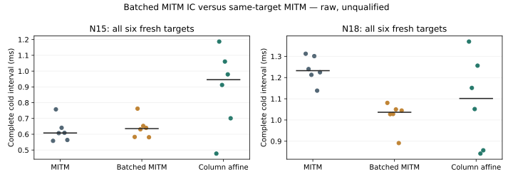
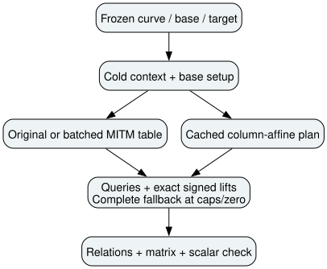

# Batched MITM IC: fixed-input comparison, 2026-11-16

[pcc:unverified] This panel compares complete cold MITM, batched MITM and cached column-affine on the same registered curves, archived prefix bases and fresh target fixtures136..141. Batched preparation preserves pair order and first witness selection while sharing inversions across bounded chunks. All setup remains charged.

| Curve | Method | Median cold interval, ms | Median paired MITM/method |
|---|---|---:|---:|
| N15 | mitm | 0.607897 | 1.000000 |
| N15 | mitm-batched | 0.635633 | 0.965789 |
| N15 | affine-columns | 0.945761 | 0.651798 |
| N18 | mitm | 1.232554 | 1.000000 |
| N18 | mitm-batched | 1.036463 | 1.210652 |
| N18 | affine-columns | 1.101434 | 1.115300 |

[pcc:unverified] All twelve frozen triples and matched references completed. All36 IC and24 rho answers pass the existing independent Python arithmetic implementation. Original/batched MITM query and matrix counters agree; setup counters intentionally differ because complete native preparation replaces independent-addition pricing. Separate source checks match883170 exact returned witnesses across chunk sizes1,7,1024. These are unsigned producer checks.

[pcc:unverified] Retained A/A failures: []. Ratios are medians of same-target paired ratios, rather than ratios of independent medians. Qualified values remain null; the record is invalid for promotion under the frozen exploratory protocol. No sample is discarded.

[pcc:unverified] Cold wall includes fresh context, base construction, oracle/table setup, all successful and failed queries, signed lifts, collection, matrix work and final verification. Batch setup includes map/scratch allocation, batch inversions and exceptional additions. Its measured native nanoseconds are charged once, without hypothetical independent-addition charges. The archived counted-S and context-inclusive counted-S models omit lookup/guard pricing because ns_per_lookup is zero. They are partial models; see problems/ic-probe-lookup-pricing.md and the adjacent audit. They are separate from complete cold wall; calibration, process startup and independent replay are separate.

[pcc:unverified] Resources: one L4 allocation with CPU execution,4 requested CPUs,8GiB,900s hard allocation,780s controller,12s process cap and one pinned allowed CPU. A single separately prepared default release executable uses locked dependencies,-j2 unchanged profile. Source935528687a0afcfa0132b7253386d00c8ffefcef; exact source/toolchain/binary/workload hashes are bound by prepared-input.json, receipt and immutable candidate/workload manifests.

[pcc:unverified] This exploratory comparison does not establish a qualified performance breakthrough or a general complexity improvement. Earlier negative/noisy results remain intact. A future Tier1 claim needs a separately frozen qualifying allocation, noise receipts and paired confidence rule; GPU throughput remains unmeasured.

Raw evidence: timing-001/{arms.jsonl,triples.json,references.json,host.json,summary.json}, analysis.json and independent-arithmetic-timing001.json. Source claim PCC-20261116-ebf2bf; result claim PCC-20261116-a3e74d; pricing correction PCC-20261116-9ceda4. The PCC ledger fork is preserved; no trust-chain rewrite or promotion.
