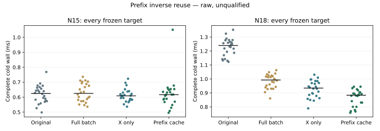
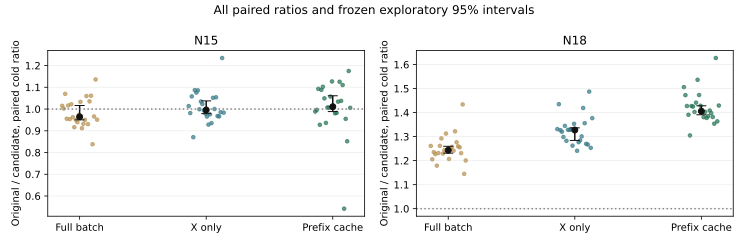
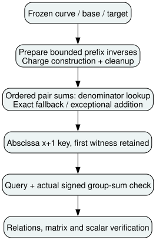

# Prefix inverse reuse: fixed-input comparison, 2026-11-16

[pcc:unverified] All 48 frozen quadruples completed. Existing independent Python arithmetic replays 192 IC and 96 rho answers. Common positive calibration, whole-native-setup pricing and query/matrix counts agree across all four arms. All 48 A/A checks pass; zero process caps. These are unsigned producer checks.

| Curve | Method | Median cold ms | Original/candidate median paired ratio |
|---|---|---:|---:|
| N15 | Original | 0.624984 | 1.000000 |
| N15 | Full batch | 0.625342 | 0.964160 |
| N15 | X only | 0.608924 | 0.995756 |
| N15 | Prefix cache | 0.616297 | 1.010626 |
| N18 | Original | 1.239627 | 1.000000 |
| N18 | Full batch | 0.992318 | 1.243155 |
| N18 | X only | 0.934506 | 1.327446 |
| N18 | Prefix cache | 0.883378 | 1.405684 |

[pcc:unverified] N15 original/prefix paired median 1.010626, frozen exploratory 95% interval [0.988414,1.061130]. Secondary paired x-only/prefix median 1.018817 compares the cache with the strongest prior N18 implementation; it is distinct from the cumulative comparison with original code.
[pcc:unverified] N18 original/prefix paired median 1.405684, frozen exploratory 95% interval [1.390925,1.428460]. Secondary paired x-only/prefix median 1.070720 compares the cache with the strongest prior N18 implementation; it is distinct from the cumulative comparison with original code.

[pcc:unverified] N15 does not establish a raw gain because its interval includes 1. N18 has a raw gain in this frozen panel. All values remain unqualified; these intervals do not establish Tier1 admission, portability or a broader breakthrough. Ratios are paired before taking medians, so they differ from ratios of independent medians.

[pcc:unverified] Whole native table preparation is charged once for every arm, including cache allocation, construction and cleanup; observed group additions remain diagnostics. The remaining phase model prices declared group/lookup/matrix primitives and is not an instruction-count measurement. N18 original/prefix context-inclusive phase-priced ratio is 1.386676. Earlier zero-lookup and asymmetric-setup model results remain limited as documented; none is repriced.

[pcc:unverified] Requested allocation: one L4, 4 CPUs, 8 GiB, 900 seconds; CPU execution only, one pinned exposed CPU, 780s controller, 12s per process. Apparent v1 quota is 20 CPUs and memory limit approximately 340 GiB, which do not verify the requested envelope. Throttle/OOM counters remain unavailable. CPU reported model is unknown; family/model and flags are archived. Physical memory technology/speed/channels are unknown. GNU-time child RSS/CPU/fault receipts are retained; no physical-isolation or Tier1 claim.

[pcc:unverified] Cold interval is fresh context plus first full pipeline, including base/table setup, failed/successful queries, matrix and final verification. Input materialization, model calibration/loading, process startup and existing-Python replay are separate. Negation rho executes after plain rho in each reference process, so its contextual wall is not a first-solve cold-rho comparison. The next scaling protocol separates the two rho processes.

[pcc:unverified] Exact instances and archived bases are fixed N15 dimension 6 and N18 dimension 7. Source 9583f67c93f00be9e79094672a0306089d5feb61, default release, locked-j2, binary c42bab53f55591ea09a308487691968ee7996851aec06f7f797718909eef6ccd. Native preparation passes 883170 complete-domain cached witness checks. Local cache/edge/field checks cover 2649510 full/batch/x-only/cached target comparisons.

Evidence: analysis.json, independent-arithmetic-timing001.json and raw-timing-001.tar.gz. The lossless raw bundle includes all 347 output files and a per-file SHA/URI manifest; split outputs are also stored individually. Result claim PCC-20261116-14ebfc; source 6f5dd0; pricing correction 9ceda4. Ledger histories are preserved. The broad objective remains open.
