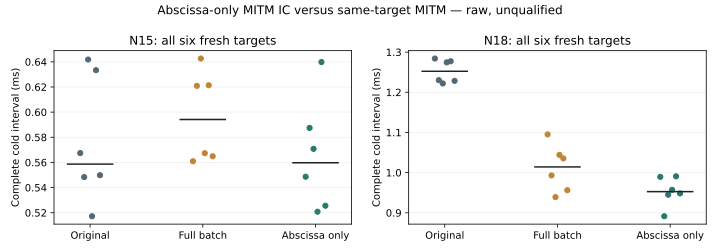
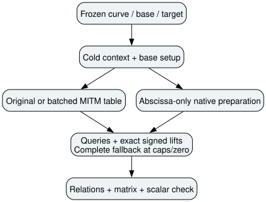

# Abscissa-only MITM IC: fixed-input comparison, 2026-11-16

[pcc:unverified] Exact registered N15/N18 curves, archived prefix bases and fresh fixtures148..153 compare original MITM, full-point batch and abscissa-only batch in one binary. The native x-only path omits ordinary ordinates and enables PCLMUL after runtime detection. Complete signed query checks are unchanged.

| Curve | Method | Median cold interval, ms | Median paired original/method |
|---|---|---:|---:|
| N15 | mitm | 0.558654 | 1.000000 |
| N15 | mitm-batched | 0.594128 | 0.986066 |
| N15 | mitm-xonly | 0.559720 | 1.013700 |
| N18 | mitm | 1.252378 | 1.000000 |
| N18 | mitm-batched | 1.014171 | 1.236289 |
| N18 | mitm-xonly | 0.952672 | 1.296701 |

[pcc:unverified] Twelve frozen triples completed,36 IC and24 rho answers replayed in existing independent Python arithmetic, and non-timing query/matrix counters match across methods. Every arm carries exactly the shared per-curve calibration, with a positive hash-lookup unit. Retained A/A failures: []. Zero process caps. Producer checks are unsigned.

[pcc:unverified] Native x86 preparation independently executes the fixed whole-domain witness check before timing:883170 comparisons pass with PCLMUL capability true. Local full/x-only comparisons cover1766340 targets plus field/edge cases. The original packed-key error and all correction logs remain archived.

[pcc:unverified] Full cold wall includes fresh context, base construction, complete oracle/table setup, failed/successful queries, collection, matrix work and scalar verification. The original model prices setup group additions, whereas native arms price whole setup nanoseconds including map/allocation work. Thus the modeled S ratios have different setup scopes and are not an equivalent complete-cost comparison. Raw model components remain visible, without a comparative model claim. A later opt-in native-setup reference will align that boundary.

[pcc:unverified] One L4 allocation, CPU execution,4 requested CPUs,8GiB,900s hard,780s controller,12s per process,one pinned allowed CPU. Fresh process per arm,all six orders. Sourcea375b2145069d9384dc53525cc1e9b90b074e482,locked-j2 default release and separate bounded preparation. Hashes and exact resource snapshots are retained. All qualified values remain null; record invalid for promotion under the frozen exploratory protocol.

[pcc:unverified] Calibration, unit-file loading, process startup and existing-Python replay remain separate from the cold interval. Earlier204 IC arms with zero lookup pricing remain partial models per correction9ceda4; none is backfilled or promoted. The broad performance objective remains open. Prefix inverse reuse is a separate newly implemented, unmeasured candidate.

Evidence: timing-001 raw files and per-curve calibrations, analysis.json, independent-arithmetic-timing001.json,build-001 preparation receipts. Source b144d0, lookup correction9ceda4 and the appended result statement retain scope. No trust-chain rewrite or ledger bypass.
