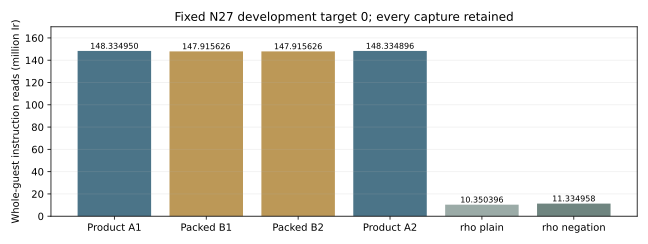
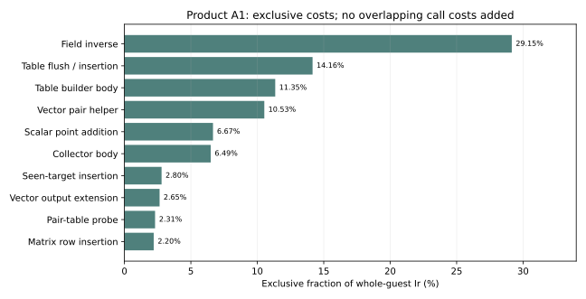
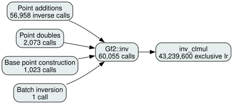

# Native IC instruction attribution: fixed N27 development point

[pcc:unverified] Completed job 20261116-114826-d911 produces six whole-guest Callgrind captures after the actual ordinary-PCLMUL/packed preflight passes 25 complete witness maps. Existing independent Python arithmetic replays all six scalar answers. Raw totals, exclusive instruction sums and tool annotation totals agree. Claim 0e7008 is unsigned producer/tool evidence.

[pcc:unverified] Product Ir repeats are [148334950, 148334896]; packed repeats are [147915626, 147915626]. Median product/packed guest-Ir ratio is 1.002834704. The difference is about 0.28% of whole-process instruction reads, consistent in scope with a small component change; it is not a native wall ratio. Repeat relative ranges: product 3.64041042e-07, packed 0. Two repeats do not support a confidence interval.

[pcc:unverified] Ir covers guest runtime loader/startup, inputs/units, context/base/cache/table, every query/matrix/check, output and cleanup. Valgrind interprets the CPU code. These are instruction-read events, not hardware retirement, cycles, latency or the primary single-target online interval. Instrumented clocks are retained only as execution/resource receipts. Rho rows use the same complete guest-process boundary on the identical point; their instruction gap is supplementary.

| Capture | Whole-guest Ir | Ir / matched rho negation |
|---|---:|---:|
| Product A1 | 148,334,950 | 13.086502 |
| Packed B1 | 147,915,626 | 13.049508 |
| Packed B2 | 147,915,626 | 13.049508 |
| Product A2 | 148,334,896 | 13.086497 |
| rho plain | 10,350,396 | 0.913139 |
| rho negation | 11,334,958 | 1.000000 |

[pcc:unverified] In Product A1, field inversion accounts for 43,239,600 exclusive Ir (29.15%). Table builder body plus flush account for 37,835,845 Ir (25.51%); the vector pair helper accounts for 15,615,021 Ir (10.53%). The call graph records 60,055 field inversions: 56,958 from scalar additions, 2,073 from doubling, 1,023 from factor-base point construction and 1 from batch inversion. Call-edge costs overlap their callees and are not added to exclusive fractions.

[pcc:unverified] Both IC modes execute 55,922 trials, 55,866 oracle lookups, 256 relations/rank and 55,865 walk steps, with 56 repeated targets skipped. Actual vector pairs are 280,368 per IC capture; only packed arms report the same positive packed-square count. Existing oracle counter inversions=0 is scoped to the oracle, not all group arithmetic; it does not contradict the field-inverse call graph. Deterministic work signatures match across all four IC captures.

[pcc:unverified] Requested one L4, 4 CPU, 8 GiB, 900s; CPU work only and one allowed CPU pinned. Controller 780s, IC child 120s, rho 60s, preflight 90s and exports 20s. Instrumentation virtual-address cap 32 GiB is distinct from requested physical 8 GiB. Valgrind 3.22.0, package 1:3.22.0-0ubuntu3, tool-file hashes, lscpu, cgroups, process CPU/wall/RSS/fault receipts and raw captures are retained. Physical memory technology/speed/channels, placement, throttle/OOM coverage and host isolation remain unqualified; record invalid for promotion.

[pcc:unverified] Exact registered curve EC1N27Crbh9ce93808c7a5, prefix dimension 10, 531 sign columns; one development point 0, workload 1d41eea76cd6. Binary 2e8b4e26b30756ce2910572a45642eab29def58544fbf58b71d88dde49591bdf, source 82ccc06d610a45b70356f3b78943c7e4638350d5, preparation 20261116-111450-d78a; calibration from timing 20261116-112736-c9d0 index 4, SHA-pinned with source-job metadata. Original inverse/matrix and all scalar guards remain. Rust inlining and missing source-line information limit attribution granularity; full symbols, instructions and call edges remain available.

Proposed next step: batch the independent additions used to generate relation queries for this one target, using the existing simultaneous-inversion kernel. The current walk chooses each next jump from its current point, so batching changes the collector schedule/query law and requires a fresh candidate and frozen comparison. Preserve global duplicate/identity guards, coefficient tracking, lazy restarts, every setup and unused buffered operation, trial caps, ordinary relation yield, matrix counts and scalar replay. It is a known batching method, with its binary IC adaptation and performance still unmeasured; no cross-target amortization or novelty claim.

The initial profile001 stops before arithmetic because the annotator version command prints 3.22.0 but returns 255. All 11 outputs, failed record and one-page report remain. The published version-only amendment records package version/tool hashes and uses a distinct output path. No ISA, arithmetic, resource or control gate is relaxed. No host capability filter is used.

[pcc:unverified] Timing-boundary correction20c68d: earlier cold labels based on context_ns plus RunReport.wall_seconds omit some scope-exit cleanup. Their raw values remain a narrower computation window; complete cold and primary online costs were not established. The whole-guest Ir in this report includes teardown and is unaffected. See COST_WINDOW_ERRATUM.md and problems/ic-probe-teardown-window.md before new timing.

Sources checked: PROTOCOL.md; official Callgrind manual and platform list; research-kb sources c5b44937741b2f73ed2237dced16f1c1 and c525825f5c51c500234cb8b8749a45dc, owning field/table/collector code and the lead atlas. The batched-inversion lead is closed_known; prime-IC engineering records also contain negative wide-batching results. The historical matched-rho note has a partial withdrawal for arithmetic mismatch and multiple-target scope; none of its ratios are transferred here. No curve, isogeny or endomorphism fact changes, so the curve/route graph set is unaffected. See NEXT_LEAD.md for exact source pointers and obligations.

Evidence: all 78 raw outputs, six .callgrind captures, exclusive/inclusive exports, disassembly, analysis-profile-002.json, replay-profile-002.json and the lossless SHA/URI bundle.
