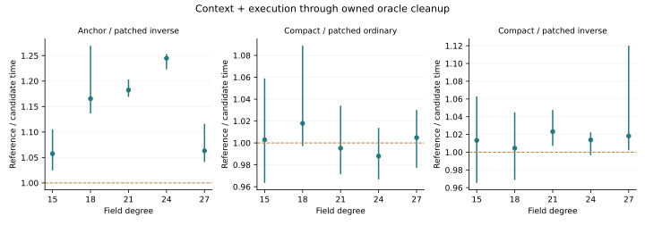
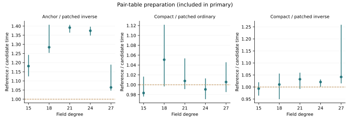
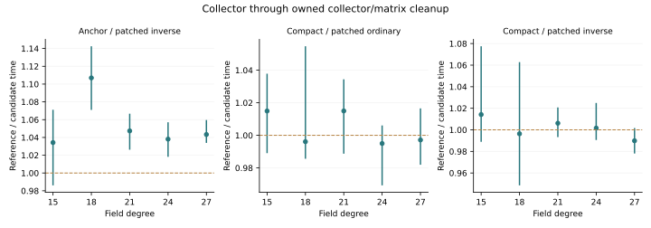

# Packed squares and constant reduction specialization

Specializing Packed squares and constant reduction

PCC-20261117-f09ce2; unsigned exploratory producer data. Job 20261117-075345-ed48; 150 same-target blocks, 30 points per field, five logical methods/three immutable binaries. Qualification remains null. [pcc:unverified]

The inverse-path primary paired ratio favors the candidate at N21 and N27; all ordinary primary intervals include1. All17failed A/A controls remain, including large timing excursions. The candidate stays exploratory and is not promoted as the production baseline. All answers/states replay; no broad performance breakthrough is established. [pcc:unverified]

Existing independent Python arithmetic checks 750 IC, 300 matched-rho, 300 A/A answers and 7680 exported states. All 17 failed A/A controls and 0 capped IC arms are retained. [pcc:unverified]

Ratios above1 favor the denominator. Paired medians and 10000-resample pointwise95% intervals use seed20261116/linear quantiles; all30rows perfield remain. No pooling, filtering or cross-panel products. Primary includes context through owned oracle cleanup; prior fixture/calibration/spec/empty allocation, startup/JSON and later context/report destruction are excluded. Full-process cold remains open. [pcc:unverified]

Field | A / PI | BO / PO | BI / PI
N15 | 1.0574 [1.0246,1.1053] | 1.0029 [0.9635,1.0590] | 1.0133 [0.9653,1.0628]
N18 | 1.1654 [1.1366,1.2696] | 1.0179 [0.9972,1.0889] | 1.0045 [0.9686,1.0450]
N21 | 1.1824 [1.1690,1.2031] | 0.9952 [0.9715,1.0340] | 1.0232 [1.0072,1.0476]
N24 | 1.2448 [1.2231,1.2533] | 0.9880 [0.9667,1.0138] | 1.0138 [0.9965,1.0224]
N27 | 1.0631 [1.0410,1.1160] | 1.0048 [0.9772,1.0302] | 1.0182 [1.0022,1.1201]

A=anchor ordinary; BO/BI=compact baseline ordinary/inverse; PO/PI=patched ordinary/inverse. BO/PO and BI/PI isolate the combined kernel against the compact baseline. [pcc:unverified]

Table preparation and process memory

Field | A / PI | BO / PO | BI / PI
N15 | 1.1810 [1.1249,1.2424] | 0.9834 [0.9762,1.0164] | 0.9936 [0.9643,1.0200]
N18 | 1.2840 [1.2533,1.4073] | 1.0508 [0.9967,1.1216] | 1.0105 [0.9496,1.0560]
N21 | 1.3915 [1.3640,1.4065] | 1.0078 [0.9913,1.0535] | 1.0324 [0.9923,1.0597]
N24 | 1.3745 [1.3481,1.3966] | 0.9906 [0.9708,1.0129] | 1.0209 [1.0015,1.0317]
N27 | 1.0644 [1.0470,1.1890] | 1.0056 [0.9853,1.0456] | 1.0418 [1.0152,1.2587]

Field | A ms | BO | BI | PO | PI
N15 | 0.049 | 0.039 | 0.039 | 0.039 | 0.040
N18 | 0.241 | 0.194 | 0.182 | 0.180 | 0.180
N21 | 0.971 | 0.594 | 0.580 | 0.588 | 0.558
N24 | 3.193 | 2.417 | 2.356 | 2.402 | 2.298
N27 | 8.561 | 7.741 | 8.144 | 7.756 | 7.395

Field | Baseline inv. MiB | Patched inv. MiB
N15 | 6.561 | 6.322
N18 | 6.325 | 6.483
N21 | 6.895 | 6.655
N24 | 7.789 | 7.801
N27 | 12.156 | 12.063

Setup costs and complete-child GNUtime peak RSS are arithmetic means. RSS includes startup/reporting and is not heap-allocation telemetry. Baseline and patched representation are identical compact8byte entry payloads, excluding control metadata/rounding. No setup subtraction/amortization changes the primary interval. [pcc:unverified]

Collector and matched same-point references

Field | A / PI | BO / PO | BI / PI
N15 | 1.0342 [0.9861,1.0711] | 1.0149 [0.9891,1.0379] | 1.0142 [0.9889,1.0775]
N18 | 1.1070 [1.0710,1.1425] | 0.9961 [0.9856,1.0547] | 0.9963 [0.9485,1.0628]
N21 | 1.0473 [1.0262,1.0667] | 1.0150 [0.9887,1.0344] | 1.0061 [0.9933,1.0208]
N24 | 1.0381 [1.0182,1.0571] | 0.9950 [0.9693,1.0061] | 1.0016 [0.9906,1.0249]
N27 | 1.0433 [1.0339,1.0596] | 0.9972 [0.9819,1.0166] | 0.9899 [0.9780,1.0016]

Field | A ms | BO | BI | PO | PI
N15 | 0.472 | 0.488 | 0.462 | 0.444 | 0.469
N18 | 0.762 | 0.663 | 0.646 | 0.633 | 0.635
N21 | 1.979 | 1.562 | 1.486 | 1.525 | 1.434
N24 | 4.875 | 4.028 | 3.936 | 4.098 | 3.887
N27 | 15.861 | 14.936 | 15.109 | 14.963 | 14.355

Field | Plain rho / PI | Negation rho / PI
N15 | 0.60174 | 0.42884
N18 | 0.43455 | 0.33517
N21 | 0.27542 | 0.20292
N24 | 0.15496 | 0.10743
N27 | 0.09388 | 0.06182

Millisecond table: primary arithmetic means. References: medians of paired context-plus-rho compute / patched-inverse primary cost on the exact same Q/G/r/seed. Original rho arithmetic in the compact baseline; fresh processes. Setup-reused rho remains open. [pcc:unverified]

Exact change and separate development instruction evidence

The constant-field path uses two packed PCLMUL squares instead of four independent square products, then the same factored constant reduction. Public canonical point guards retain the general fallback; the compact table reuses the once-checked immutable base invariant, including existing assertions for out-of-domain inputs; exceptions/tails and iterator output append remain. Local tests are ARM-side evidence; the direct native packed-square test and table intersection counters require actual combined use. [pcc:unverified]

Field | Combined | Constant | Validated | All packed
15 | 2668 | 2668 | 2668 | 5336
18 | 15276 | 15276 | 15276 | 30552
21 | 56100 | 56100 | 56100 | 112200
24 | 232852 | 232852 | 232852 | 465704
27 | 1001012 | 1001012 | 1001012 | 2002024

These are source-reported pair counters across the preparation map comparisons. They require the packed/constant intersection to execute and do not measure hardware retirement or native throughput. The scalar/native complete maps must agree exactly. [pcc:unverified]

Path | Whole-guest Ir | Generic dispatcher Ir | Hot wide rem. calls
current | 112254788 | 0 | 0
inverse | 107276068 | 0 | 0

Preparation development profiles replay 2 answers/512 states against original pinned calibration/tools/point/work. They precede fresh timing and are not native clocks, hardware retirement or cache measurements. Existing scalar/group arithmetic replay and full disassembly are retained. [pcc:unverified]

Field | Attempted | Failed A/A | Ratio min | Ratio max
N15 | 30 | 8 | 0.20465 | 10.60129
N18 | 30 | 6 | 0.73177 | 1.17849
N21 | 30 | 2 | 0.92499 | 5.02783
N24 | 30 | 0 | 0.93766 | 1.12970
N27 | 30 | 1 | 0.72160 | 1.12678

A/A band0.85..1.15; every failed row is listed in the final appendix and raw JSON. All rows remain in intervals. [pcc:unverified]

Reproduction and limits

Fixtures612..641; ten Williams orders repeated3. Each method position and ordered adjacent pair occurs6times perfield. One L4/4CPU/8GiB/900s allocation; CPU arithmetic pinned to one allowed CPU. Controller780s, child12s/preflight30s,8GiB native virtual cap. No observer subprocess while timing; physical placement and memory technology/speed/channels unknown. No GPU arithmetic throughput measured. [pcc:unverified]

anchor-input.json: binary 1026bf749fbf8e4a1a266d9833b89a78bf3468956aa9e91eec1af9ffb84d0027; source 25be1116c0cc56f4d7be8a0932de7c6531cdf947; preparation 20261116-152859-d0d3. [pcc:unverified]

prepared-input.json: binary a44e5e80d1ad745d3bf373acc6c497be2c207f9d45ba02b7bd53ddbe48165103; source 2221a26dae90dbcdd703a4a5e3b155c784b908cd; preparation 20261117-043656-db46. [pcc:unverified]

optimized-input.json: binary d238dda783d99df00c2b896186063b2f1c1e78f7e9ab59b28f965e829acfad29; source 539ae8a1166c8134f1d48b79c798317e3e7cccf4; preparation 20261117-073403-af3a. [pcc:unverified]

EC1N15Crbhe4e02575ec1c; r=16319; base dimension6, columns29; base SHA256b508c882d85c0185599a40d201413314f6a2acae7ca1c60ef4761dc8acb23922. [pcc:unverified]

EC1N18Crbhe731503070c0; r=32719; base dimension7, columns67; base SHA25644948c2d6481dcf077b0e88777be615e1691d8c7e8f9abcf864fd3c74f76570c. [pcc:unverified]

EC1N21Crbh30df0435638d; r=1047281; base dimension8, columns127; base SHA2566fadae0420fd81b13709f3ade6537d5386c39a19b64a072878b970f8c84c9d95. [pcc:unverified]

EC1N24Crbh1d71c3dc9cbc; r=2097533; base dimension9, columns257; base SHA256ecb8d5f2793a2719839483c11156efb8bd9b7b952c1d19e1d5813a0a3d8dff44. [pcc:unverified]

EC1N27Crbh9ce93808c7a5; r=22367531; base dimension10, columns531; base SHA25611506ae2cdf00b61ce8c55869410741d7bdf458cd17d02160d6ad58bd06c0d19. [pcc:unverified]

Reconstruction pins original source archive, coefficient overlay and three compact overlays, then the four declared kernel/counter/diagnostic sources change. Sixteen manifest hashes, actual clean preparation Git revision, full snapshot/overlay bytes, compiler/environment/build path are admitted. The first expanded test incorrectly required arithmetic results for out-of-domain inputs and failed on the existing scalar assertion. Its log and explicit protocol correction are retained; compatibility now includes assertion behavior. Arithmetic claim55b3fa and local claim3584b8 are unsigned. [pcc:unverified]

All raw captures, per-file SHA/URI bundles and independent checks are archived via scoped default/us-west-2/crypto-autoresearcher before record closure. Root legacy storage and separate CI credential/proof checksum issues remain separate. No qualified promotion, complete-cold, broad-field, asymptotic or mathematical-novelty assertion. The full requested performance goal remains open. [pcc:unverified]

Every predeclared paired contrast

Context + execution through owned oracle cleanup

Contrast | N15 | N18 | N21 | N24 | N27
A/PI | 1.0574 [1.0246,1.1053] | 1.1654 [1.1366,1.2696] | 1.1824 [1.1690,1.2031] | 1.2448 [1.2231,1.2533] | 1.0631 [1.0410,1.1160]
BO/PO | 1.0029 [0.9635,1.0590] | 1.0179 [0.9972,1.0889] | 0.9952 [0.9715,1.0340] | 0.9880 [0.9667,1.0138] | 1.0048 [0.9772,1.0302]
BI/PI | 1.0133 [0.9653,1.0628] | 1.0045 [0.9686,1.0450] | 1.0232 [1.0072,1.0476] | 1.0138 [0.9965,1.0224] | 1.0182 [1.0022,1.1201]
PO/PI | 1.0102 [0.9684,1.0253] | 1.0013 [0.9636,1.0189] | 1.0252 [1.0124,1.0941] | 1.0254 [1.0138,1.0410] | 1.0331 [0.9988,1.0935]
BO/BI | 0.9885 [0.9456,1.0378] | 1.0079 [0.9642,1.0273] | 1.0069 [0.9876,1.0416] | 1.0051 [0.9854,1.0239] | 0.9986 [0.9696,1.0204]
A/PO | 1.0469 [1.0160,1.0824] | 1.1704 [1.1441,1.2357] | 1.1432 [1.1034,1.1638] | 1.2164 [1.1923,1.2278] | 1.0448 [1.0361,1.1150]
A/BO | 1.0470 [0.9973,1.0799] | 1.1478 [1.1296,1.1811] | 1.1349 [1.1172,1.1466] | 1.2335 [1.2010,1.2577] | 1.0350 [1.0227,1.0834]

Pair-table preparation (included in primary)

Contrast | N15 | N18 | N21 | N24 | N27
A/PI | 1.1810 [1.1249,1.2424] | 1.2840 [1.2533,1.4073] | 1.3915 [1.3640,1.4065] | 1.3745 [1.3481,1.3966] | 1.0644 [1.0470,1.1890]
BO/PO | 0.9834 [0.9762,1.0164] | 1.0508 [0.9967,1.1216] | 1.0078 [0.9913,1.0535] | 0.9906 [0.9708,1.0129] | 1.0056 [0.9853,1.0456]
BI/PI | 0.9936 [0.9643,1.0200] | 1.0105 [0.9496,1.0560] | 1.0324 [0.9923,1.0597] | 1.0209 [1.0015,1.0317] | 1.0418 [1.0152,1.2587]
PO/PI | 0.9970 [0.9779,1.0091] | 0.9786 [0.9463,1.0190] | 1.0368 [0.9878,1.0765] | 1.0201 [1.0018,1.0356] | 1.0211 [0.9872,1.1318]
BO/BI | 1.0040 [0.9711,1.0263] | 1.0245 [0.9631,1.0853] | 0.9887 [0.9746,1.0288] | 1.0016 [0.9823,1.0205] | 0.9823 [0.9275,0.9998]
A/PO | 1.1839 [1.1409,1.2754] | 1.3118 [1.2550,1.3526] | 1.3599 [1.2536,1.4026] | 1.3541 [1.3306,1.3669] | 1.0782 [1.0386,1.1978]
A/BO | 1.1856 [1.1511,1.2676] | 1.2501 [1.2065,1.3132] | 1.3505 [1.3197,1.3795] | 1.3597 [1.3280,1.3825] | 1.0438 [1.0278,1.1349]

Collector through owned collector/matrix cleanup

Contrast | N15 | N18 | N21 | N24 | N27
A/PI | 1.0342 [0.9861,1.0711] | 1.1070 [1.0710,1.1425] | 1.0473 [1.0262,1.0667] | 1.0381 [1.0182,1.0571] | 1.0433 [1.0339,1.0596]
BO/PO | 1.0149 [0.9891,1.0379] | 0.9961 [0.9856,1.0547] | 1.0150 [0.9887,1.0344] | 0.9950 [0.9693,1.0061] | 0.9972 [0.9819,1.0166]
BI/PI | 1.0142 [0.9889,1.0775] | 0.9963 [0.9485,1.0628] | 1.0061 [0.9933,1.0208] | 1.0016 [0.9906,1.0249] | 0.9899 [0.9780,1.0016]
PO/PI | 1.0055 [0.9880,1.0381] | 1.0006 [0.9714,1.0299] | 1.0316 [1.0185,1.0528] | 1.0329 [1.0100,1.0555] | 1.0268 [1.0217,1.0420]
BO/BI | 0.9962 [0.9308,1.0636] | 1.0127 [0.9696,1.0630] | 1.0422 [1.0204,1.0519] | 1.0151 [0.9933,1.0349] | 1.0367 [1.0262,1.0522]
A/PO | 1.0129 [0.9884,1.0759] | 1.0844 [1.0551,1.1678] | 1.0083 [0.9997,1.0257] | 0.9936 [0.9840,1.0202] | 1.0210 [1.0072,1.0304]
A/BO | 1.0257 [0.9750,1.0945] | 1.0814 [1.0514,1.1142] | 0.9919 [0.9712,1.0166] | 1.0032 [0.9903,1.0294] | 1.0150 [1.0033,1.0235]

Ratios are reference/candidate paired medians[pointwise95% intervals], all30rows perfield. A anchor; B compact baseline; P combined packed-square/constant patch; O ordinary/I inverse. [pcc:unverified]

All failed A/A controls retained

Field index | Fixture | A/A ratio
2 | 612 | 5.027826076
1 | 613 | 0.731771805
0 | 621 | 0.832077075
4 | 624 | 0.721602683
0 | 625 | 1.634332131
1 | 626 | 0.776934449
2 | 627 | 1.173757822
0 | 628 | 1.242031312
1 | 628 | 1.178486365
0 | 629 | 0.204652218
0 | 630 | 1.231697190
0 | 631 | 0.822609995
1 | 631 | 0.784948219
0 | 633 | 10.601294950
0 | 635 | 0.784082415
1 | 635 | 0.833459206
1 | 638 | 0.847312277

No failed control is discarded or replaced. Qualification remains null; raw records and benchmark invalid status preserve exploratory standing. [pcc:unverified]

