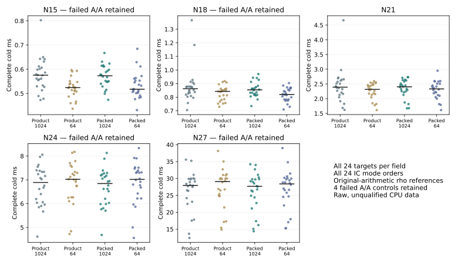
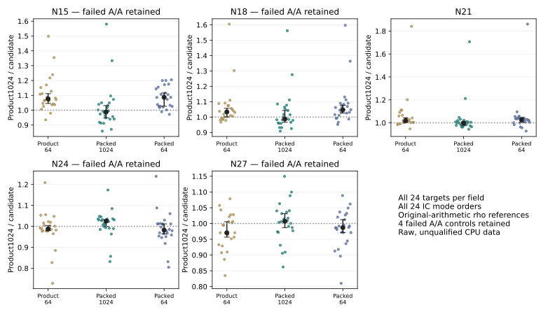

# Packed characteristic-two IC squares: 2026-11-16

[pcc:unverified] All 120 frozen four-way comparisons completed. Existing independent Python arithmetic replays 480 IC answers and 240 fresh-process rho answers. Exact input/candidate manifests, vector and packed-square routing, positive shared calibration, scalar answers and query/matrix counts pass unsigned producer checks. [pcc:unverified] Every primary product1024/packed1024 exploratory interval includes 1; no consistent complete-cold gain is established. Result claim 78806a is unsigned.

| Field | Product1024 median ms | Product64 paired ratio | Packed1024 paired ratio | Packed64 paired ratio |
|---|---:|---:|---:|---:|
| N15 | 0.575436 | 1.076157 | 0.988240 | 1.086410 |
| N18 | 0.862567 | 1.033389 | 0.987746 | 1.047334 |
| N21 | 2.391220 | 1.018915 | 0.998304 | 1.027522 |
| N24 | 6.890642 | 0.988025 | 1.024977 | 0.982200 |
| N27 | 27.955503 | 0.970656 | 1.007058 | 0.987013 |

[pcc:unverified] N15 product1024/packed1024 paired median 0.988240; frozen exploratory 95% bootstrap interval [0.947792, 1.031130].
[pcc:unverified] N18 product1024/packed1024 paired median 0.987746; frozen exploratory 95% bootstrap interval [0.965954, 1.042788].
[pcc:unverified] N21 product1024/packed1024 paired median 0.998304; frozen exploratory 95% bootstrap interval [0.978029, 1.008019].
[pcc:unverified] N24 product1024/packed1024 paired median 1.024977; frozen exploratory 95% bootstrap interval [0.999710, 1.031893].
[pcc:unverified] N27 product1024/packed1024 paired median 1.007058; frozen exploratory 95% bootstrap interval [0.987023, 1.031396].

[pcc:unverified] 116 of 120 pre/post A/A controls pass the frozen 0.85–1.15 bound with correct answers and unchanged calibration. Failed controls: [{"field": 27, "fixture": 363, "ratio": 1.2061329409354047}, {"field": 15, "fixture": 364, "ratio": 1.3203817788424612}, {"field": 18, "fixture": 365, "ratio": 0.8001661389194235}, {"field": 24, "fixture": 368, "ratio": 0.8283972905447718}]. No rows, outliers or controls are removed; zero process caps. Ratios are paired before taking medians. Every raw comparison is exploratory and qualified null; none is promoted.

[pcc:unverified] Requested one L4, 4 CPUs, 8 GiB, 900 seconds; CPU execution only, one pinned exposed CPU, controller 780 seconds, child cap 12 seconds. Exposed cgroup CPU quota/period: 2000000/100000; memory limit: 364645154816 bytes. Requested allocation and physical placement remain unqualified; unavailable throttle/OOM counters and physical memory technology/speed/channels remain unknown. Child RLIMIT_AS is 8 GiB; GNU-time RSS/CPU/fault receipts retained. Record invalid for promotion.

[pcc:unverified] Every IC arm uses the same prefix-cached table strategy. Product-based/packed squaring and chunks 64/1024 form the frozen factorial. Cold wall includes context, base/table/cache construction and cleanup, all queries, matrix work and final scalar verification. Public materialization, calibration/unit loading, process startup and independent replay remain separate. Original shared positive units are reused across all four preparation modes; no candidate-specific repricing. The remaining phase model is primitive pricing, not instruction counts; unchanged operation counts do not price a faster arithmetic implementation by themselves.

[pcc:unverified] Plain and negation rho use original arithmetic in separate fresh processes on the identical point and seed. Their order and placement alternate by fixture parity. No field-inverse or matrix change is combined with this comparison. Wall gaps below are median per-target IC/matched-negation-rho ratios.

| Field | Product1024/matched rho | Packed1024/matched rho |
|---|---:|---:|
| N15 | 2.9247 | 2.8943 |
| N18 | 4.1238 | 4.0730 |
| N21 | 6.5077 | 6.6005 |
| N24 | 11.2497 | 10.9878 |
| N27 | 18.1350 | 18.2757 |

[pcc:unverified] Exact source 82ccc06d610a45b70356f3b78943c7e4638350d5; default release, locked-j2; binary 2e8b4e26b30756ce2910572a45642eab29def58544fbf58b71d88dde49591bdf. Native product checks cover 59 accepted field widths on ['avx2-pclmul128'], comparing forced ordinary 128-bit PCLMUL instructions with selected-native and scalar products and packed squares, with original square fallback above32 bits. Native preparation passes 125 complete witness maps and 15 loader controls. The same timing allocation passes all five map/capability preflights before target comparisons; selected backends: ['avx2-pclmul128']. Actual narrow/wide/packed-square pair counts are archived. The wide packed instruction path is not covered across 59 widths by this narrow-backend preparation. Original inverse, matrix and defaults remain; all kernel guards/fallbacks are retained.

[pcc:unverified] These are engineering measurements on fixed registered N15/18/21/24/27 curves, with 29/67/127/257/531 sign columns. They do not establish cryptographic-size performance, GPU throughput, asymptotic novelty, Tier1 admission or completion of the broad goal. Known unsigned status and ledger custody fork remain unchanged. Earlier negative/noisy results and model limitations are preserved.

Evidence: analysis.json, independent-arithmetic-timing001.json and lossless raw-timing-001.tar.gz with per-file SHA/URI inventory. Split raw outputs are also archived individually. Source claim 32a0a0 and native claim a8b486 are unsigned; result claim 78806a is unsigned. Earlier negative and failed-admission panels remain preserved; there is no host retry or data filtering.

## Matched 64-pair chunks

[pcc:unverified] N15 product64/packed64 paired median 1.002955; exploratory 95% interval [0.957429, 1.032483].

[pcc:unverified] N18 product64/packed64 paired median 1.016720; exploratory 95% interval [1.002459, 1.027992].

[pcc:unverified] N21 product64/packed64 paired median 0.996487; exploratory 95% interval [0.981931, 1.010349].

[pcc:unverified] N24 product64/packed64 paired median 1.008626; exploratory 95% interval [0.981288, 1.023014].

[pcc:unverified] N27 product64/packed64 paired median 1.004069; exploratory 95% interval [0.988148, 1.018725].
