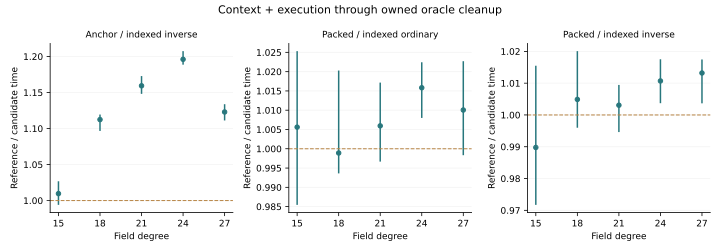
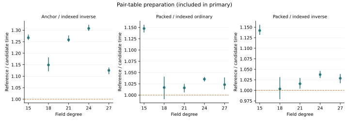
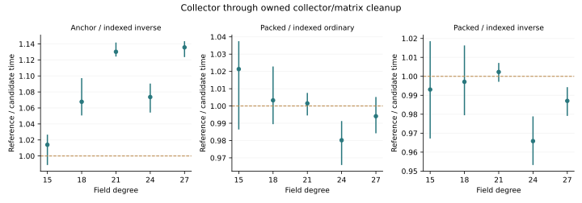

# Index-driven pair preparation

Index-driven pair preparation

PCC-20261117-0b5377; unsigned exploratory producer data. Job 20261117-084938-72bc; 210 same-target blocks, 42 points per field, seven logical methods/four immutable binaries. Qualification remains null. [pcc:unverified]

N27 inverse primary ratios favor indexed preparation over compact and packed controls by about 1.2% and 1.3%, respectively. N24 primary gain over compact remains inconclusive, while its collector interval regresses. Table setup gains do not establish a broad pipeline gain. All 4 failed A/A controls remain; the cause of the new collector slowdown remains unresolved. No production-baseline promotion or broader breakthrough is established. [pcc:unverified]

Existing independent Python arithmetic checks 1470 IC, 420 matched-rho, 420 A/A answers and 10240 exported states. All 4 failed A/A controls and 0 capped IC arms are retained. [pcc:unverified]

Ratios above1 favor the denominator. Paired medians and 10000-resample pointwise95% intervals use seed20261116/linear quantiles; all42rows perfield remain. No pooling, filtering or cross-panel products. Primary includes context through owned oracle cleanup; prior fixture/calibration/spec/empty allocation, startup/JSON and later context/report destruction are excluded. Full-process cold remains open. [pcc:unverified]

Field | A / II | PO / IO | PI / II
N15 | 1.0096 [0.9940,1.0268] | 1.0056 [0.9854,1.0253] | 0.9898 [0.9717,1.0155]
N18 | 1.1124 [1.0967,1.1194] | 0.9989 [0.9936,1.0203] | 1.0049 [0.9960,1.0201]
N21 | 1.1593 [1.1481,1.1729] | 1.0059 [0.9967,1.0171] | 1.0031 [0.9946,1.0094]
N24 | 1.1961 [1.1886,1.2074] | 1.0158 [1.0080,1.0224] | 1.0107 [1.0037,1.0175]
N27 | 1.1230 [1.1112,1.1338] | 1.0100 [0.9983,1.0227] | 1.0132 [1.0037,1.0175]

A=anchor ordinary; CO/CI=compact ordinary/inverse; PO/PI=packed ordinary/inverse; IO/II=indexed ordinary/inverse. PO/IO and PI/II isolate index-driven preparation; compact control comparisons remain in the full contrast table. [pcc:unverified]

Table preparation and process memory

Field | A / II | PO / IO | PI / II
N15 | 1.2674 [1.2576,1.2810] | 1.1477 [1.1388,1.1560] | 1.1422 [1.1318,1.1558]
N18 | 1.1488 [1.1211,1.1819] | 1.0168 [0.9909,1.0409] | 1.0034 [0.9790,1.0315]
N21 | 1.2584 [1.2495,1.2772] | 1.0161 [1.0062,1.0248] | 1.0157 [1.0042,1.0294]
N24 | 1.3077 [1.2965,1.3237] | 1.0353 [1.0302,1.0401] | 1.0374 [1.0294,1.0460]
N27 | 1.1252 [1.1088,1.1377] | 1.0231 [1.0126,1.0391] | 1.0287 [1.0171,1.0390]

Field | A ms | CO | CI | PO | PI | IO | II
N15 | 0.052 | 0.047 | 0.047 | 0.047 | 0.047 | 0.043 | 0.041
N18 | 0.249 | 0.221 | 0.219 | 0.222 | 0.219 | 0.219 | 0.218
N21 | 0.846 | 0.673 | 0.677 | 0.679 | 0.675 | 0.666 | 0.666
N24 | 3.459 | 2.770 | 2.774 | 2.777 | 2.774 | 2.685 | 2.664
N27 | 11.604 | 10.498 | 11.263 | 10.555 | 10.522 | 10.241 | 10.328

Field | Packed inv. MiB | Indexed inv. MiB
N15 | 6.497 | 6.268
N18 | 6.419 | 6.491
N21 | 6.820 | 6.775
N24 | 7.807 | 7.837
N27 | 12.214 | 12.207

Setup costs and complete-child GNUtime peak RSS are arithmetic means. RSS includes startup/reporting and is not heap-allocation telemetry. Compact, packed and indexed representations have identical compact8byte entry payloads, excluding control metadata/rounding. No setup subtraction/amortization changes the primary interval. [pcc:unverified]

Collector and matched same-point references

Field | A / II | PO / IO | PI / II
N15 | 1.0140 [0.9887,1.0267] | 1.0213 [0.9864,1.0375] | 0.9930 [0.9672,1.0185]
N18 | 1.0677 [1.0506,1.0972] | 1.0033 [0.9895,1.0228] | 0.9971 [0.9795,1.0163]
N21 | 1.1302 [1.1242,1.1417] | 1.0015 [0.9945,1.0076] | 1.0023 [0.9971,1.0071]
N24 | 1.0736 [1.0542,1.0904] | 0.9802 [0.9658,0.9913] | 0.9658 [0.9532,0.9789]
N27 | 1.1357 [1.1235,1.1434] | 0.9941 [0.9842,1.0052] | 0.9870 [0.9791,0.9943]

Field | A ms | CO | CI | PO | PI | IO | II
N15 | 0.528 | 0.517 | 0.513 | 0.519 | 0.512 | 0.517 | 0.517
N18 | 0.818 | 0.740 | 0.742 | 0.751 | 0.745 | 0.751 | 0.740
N21 | 2.070 | 1.798 | 1.778 | 1.819 | 1.778 | 1.800 | 1.774
N24 | 5.769 | 4.912 | 4.856 | 4.952 | 4.892 | 4.887 | 4.832
N27 | 22.025 | 20.059 | 20.956 | 20.176 | 19.702 | 19.908 | 19.626

Field | Plain rho / II | Negation rho / II
N15 | 0.54833 | 0.37898
N18 | 0.40819 | 0.29022
N21 | 0.27683 | 0.22407
N24 | 0.18165 | 0.11062
N27 | 0.08594 | 0.06221

Millisecond table: primary arithmetic means. References: medians of paired context-plus-rho compute / indexed-inverse primary cost on the exact same Q/G/r/seed. Original rho arithmetic in the compact baseline; fresh processes. Setup-reused rho remains open. [pcc:unverified]

Exact change and separate development instruction evidence

The indexed path retains the bounded witness-index buffer and reads each four-lane group from the immutable base, avoiding the two full-point chunk buffers. Pair and chunk order, first witnesses, hash/storage and previous packed-constant arithmetic remain unchanged. Public guards remain; exceptions/tails use cached scalar fallback. Native complete maps, indexed pair totals and SIMD counts are mandatory; local ARM checks do not execute the native indexed kernel. [pcc:unverified]

Field | Indexed | Combined | Constant | All packed
15 | 4350 | 2668 | 2668 | 5336
18 | 22780 | 15276 | 15276 | 30552
21 | 81280 | 56100 | 56100 | 112200
24 | 331530 | 232852 | 232852 | 465704
27 | 1412460 | 1001012 | 1001012 | 2002024

These are source-reported pair counters across the preparation map comparisons. Indexed totals include fallback lanes and require the index-driven preparation path to execute and do not measure hardware retirement or native throughput. The scalar/native complete maps must agree exactly. [pcc:unverified]

Path | Whole-guest Ir | Generic dispatcher Ir | Hot wide rem. calls
current | 109463505 | 0 | 0
inverse | 104481547 | 0 | 0

Preparation development profiles replay 2 answers/512 states against original pinned calibration/tools/point/work. They precede fresh timing and are not native clocks, hardware retirement or cache measurements. Existing scalar/group arithmetic replay and full disassembly are retained. [pcc:unverified]

Field | Attempted | Failed A/A | Ratio min | Ratio max
N15 | 42 | 1 | 0.89783 | 1.15388
N18 | 42 | 3 | 0.83887 | 1.53240
N21 | 42 | 0 | 0.95600 | 1.06505
N24 | 42 | 0 | 0.90859 | 1.10181
N27 | 42 | 0 | 0.95219 | 1.07854

A/A band0.85..1.15; every failed row is listed in the final appendix and raw JSON. All rows remain in intervals. [pcc:unverified]

Reproduction and limits

Fixtures642..683; fourteen Williams orders repeated3. Each method position and ordered adjacent pair occurs6times perfield. One L4/4CPU/8GiB/900s allocation; CPU arithmetic pinned to one allowed CPU. Controller780s, child12s/preflight30s,8GiB native virtual cap. No observer subprocess while timing; physical placement and memory technology/speed/channels unknown. No GPU arithmetic throughput measured. [pcc:unverified]

anchor-input.json: binary 1026bf749fbf8e4a1a266d9833b89a78bf3468956aa9e91eec1af9ffb84d0027; source 25be1116c0cc56f4d7be8a0932de7c6531cdf947; preparation 20261116-152859-d0d3. [pcc:unverified]

prepared-input.json: binary a44e5e80d1ad745d3bf373acc6c497be2c207f9d45ba02b7bd53ddbe48165103; source 2221a26dae90dbcdd703a4a5e3b155c784b908cd; preparation 20261117-043656-db46. [pcc:unverified]

packed-input.json: binary d238dda783d99df00c2b896186063b2f1c1e78f7e9ab59b28f965e829acfad29; source 539ae8a1166c8134f1d48b79c798317e3e7cccf4; preparation 20261117-073403-af3a. [pcc:unverified]

optimized-input.json: binary 847d9407bfbee7b13662f2bc33bb6fa204ec8df93bc0362d5f25a7c92f52d278; source bfd0e5062cbedccbc3b2a28856832dd434533510; preparation 20261117-083200-f519. [pcc:unverified]

EC1N15Crbhe4e02575ec1c; r=16319; base dimension6, columns29; base SHA256b508c882d85c0185599a40d201413314f6a2acae7ca1c60ef4761dc8acb23922. [pcc:unverified]

EC1N18Crbhe731503070c0; r=32719; base dimension7, columns67; base SHA25644948c2d6481dcf077b0e88777be615e1691d8c7e8f9abcf864fd3c74f76570c. [pcc:unverified]

EC1N21Crbh30df0435638d; r=1047281; base dimension8, columns127; base SHA2566fadae0420fd81b13709f3ade6537d5386c39a19b64a072878b970f8c84c9d95. [pcc:unverified]

EC1N24Crbh1d71c3dc9cbc; r=2097533; base dimension9, columns257; base SHA256ecb8d5f2793a2719839483c11156efb8bd9b7b952c1d19e1d5813a0a3d8dff44. [pcc:unverified]

EC1N27Crbh9ce93808c7a5; r=22367531; base dimension10, columns531; base SHA25611506ae2cdf00b61ce8c55869410741d7bdf458cd17d02160d6ad58bd06c0d19. [pcc:unverified]

Reconstruction pins the original source archive, coefficient and compact overlays, then the four declared sources change. All16source hashes are admitted, with exact four-file deltas against compact and packed controls and matching compiler/root/environment. Prior packed-candidate failures and all earlier evidence remain separate in the parent study. No fresh data or failed control is discarded. [pcc:unverified]

All raw captures, per-file SHA/URI bundles and independent checks are archived via scoped default/us-west-2/crypto-autoresearcher before record closure. Root legacy storage and separate CI credential/proof checksum issues remain separate. No qualified promotion, complete-cold, broad-field, asymptotic or mathematical-novelty assertion. The full requested performance goal remains open. [pcc:unverified]

Every predeclared paired contrast

Context + execution through owned oracle cleanup

Contrast | N15 | N18 | N21 | N24 | N27
A/II | 1.0096 [0.9940,1.0268] | 1.1124 [1.0967,1.1194] | 1.1593 [1.1481,1.1729] | 1.1961 [1.1886,1.2074] | 1.1230 [1.1112,1.1338]
CO/IO | 0.9941 [0.9879,1.0146] | 0.9973 [0.9868,1.0141] | 0.9967 [0.9873,1.0107] | 1.0022 [0.9976,1.0105] | 1.0025 [0.9950,1.0127]
CI/II | 0.9934 [0.9837,1.0020] | 1.0042 [0.9861,1.0180] | 0.9994 [0.9940,1.0062] | 1.0031 [0.9928,1.0109] | 1.0123 [1.0051,1.0250]
PO/IO | 1.0056 [0.9854,1.0253] | 0.9989 [0.9936,1.0203] | 1.0059 [0.9967,1.0171] | 1.0158 [1.0080,1.0224] | 1.0100 [0.9983,1.0227]
PI/II | 0.9898 [0.9717,1.0155] | 1.0049 [0.9960,1.0201] | 1.0031 [0.9946,1.0094] | 1.0107 [1.0037,1.0175] | 1.0132 [1.0037,1.0175]
IO/II | 1.0000 [0.9819,1.0191] | 1.0064 [0.9926,1.0126] | 1.0111 [1.0052,1.0218] | 1.0117 [1.0053,1.0175] | 1.0172 [1.0067,1.0242]
PO/PI | 1.0133 [0.9951,1.0288] | 1.0013 [0.9885,1.0131] | 1.0165 [1.0139,1.0206] | 1.0103 [1.0035,1.0214] | 1.0196 [1.0126,1.0302]
CO/CI | 1.0188 [0.9989,1.0293] | 0.9972 [0.9877,1.0071] | 1.0083 [1.0043,1.0180] | 1.0136 [1.0071,1.0198] | 1.0139 [0.9928,1.0311]
A/IO | 1.0051 [0.9948,1.0226] | 1.1007 [1.0857,1.1091] | 1.1459 [1.1354,1.1565] | 1.1906 [1.1770,1.2030] | 1.1066 [1.0862,1.1165]

Pair-table preparation (included in primary)

Contrast | N15 | N18 | N21 | N24 | N27
A/II | 1.2674 [1.2576,1.2810] | 1.1488 [1.1211,1.1819] | 1.2584 [1.2495,1.2772] | 1.3077 [1.2965,1.3237] | 1.1252 [1.1088,1.1377]
CO/IO | 1.1510 [1.1338,1.1606] | 1.0158 [0.9921,1.0349] | 1.0081 [0.9961,1.0304] | 1.0302 [1.0234,1.0388] | 1.0212 [1.0072,1.0299]
CI/II | 1.1501 [1.1386,1.1676] | 1.0098 [0.9908,1.0283] | 1.0187 [1.0110,1.0255] | 1.0377 [1.0294,1.0434] | 1.0299 [1.0242,1.0414]
PO/IO | 1.1477 [1.1388,1.1560] | 1.0168 [0.9909,1.0409] | 1.0161 [1.0062,1.0248] | 1.0353 [1.0302,1.0401] | 1.0231 [1.0126,1.0391]
PI/II | 1.1422 [1.1318,1.1558] | 1.0034 [0.9790,1.0315] | 1.0157 [1.0042,1.0294] | 1.0374 [1.0294,1.0460] | 1.0287 [1.0171,1.0390]
IO/II | 0.9972 [0.9925,1.0070] | 1.0047 [0.9916,1.0214] | 0.9954 [0.9846,1.0117] | 1.0072 [0.9944,1.0152] | 0.9968 [0.9825,1.0025]
PO/PI | 1.0045 [0.9951,1.0091] | 1.0079 [0.9921,1.0276] | 1.0028 [0.9934,1.0156] | 1.0040 [0.9941,1.0098] | 0.9977 [0.9855,1.0105]
CO/CI | 0.9964 [0.9864,1.0056] | 1.0101 [0.9893,1.0316] | 0.9962 [0.9856,1.0021] | 0.9990 [0.9929,1.0051] | 0.9892 [0.9678,1.0049]
A/IO | 1.2689 [1.2517,1.2809] | 1.1262 [1.0864,1.1823] | 1.2642 [1.2545,1.2768] | 1.3032 [1.2963,1.3131] | 1.1280 [1.1140,1.1497]

Collector through owned collector/matrix cleanup

Contrast | N15 | N18 | N21 | N24 | N27
A/II | 1.0140 [0.9887,1.0267] | 1.0677 [1.0506,1.0972] | 1.1302 [1.1242,1.1417] | 1.0736 [1.0542,1.0904] | 1.1357 [1.1235,1.1434]
CO/IO | 1.0086 [0.9982,1.0365] | 0.9987 [0.9813,1.0184] | 0.9984 [0.9858,1.0036] | 0.9656 [0.9551,0.9758] | 0.9877 [0.9797,0.9966]
CI/II | 0.9906 [0.9794,1.0109] | 0.9894 [0.9738,1.0113] | 0.9926 [0.9870,1.0004] | 0.9464 [0.9388,0.9693] | 0.9831 [0.9775,0.9909]
PO/IO | 1.0213 [0.9864,1.0375] | 1.0033 [0.9895,1.0228] | 1.0015 [0.9945,1.0076] | 0.9802 [0.9658,0.9913] | 0.9941 [0.9842,1.0052]
PI/II | 0.9930 [0.9672,1.0185] | 0.9971 [0.9795,1.0163] | 1.0023 [0.9971,1.0071] | 0.9658 [0.9532,0.9789] | 0.9870 [0.9791,0.9943]
IO/II | 0.9905 [0.9717,1.0174] | 1.0096 [0.9891,1.0229] | 1.0367 [1.0291,1.0466] | 1.0282 [1.0205,1.0372] | 1.0486 [1.0423,1.0529]
PO/PI | 1.0198 [0.9949,1.0326] | 1.0085 [0.9851,1.0204] | 1.0346 [1.0229,1.0475] | 1.0346 [1.0241,1.0380] | 1.0516 [1.0462,1.0633]
CO/CI | 1.0077 [0.9966,1.0388] | 1.0016 [0.9821,1.0260] | 1.0383 [1.0326,1.0435] | 1.0365 [1.0316,1.0423] | 1.0565 [1.0363,1.0644]
A/IO | 1.0075 [0.9859,1.0169] | 1.0673 [1.0507,1.0900] | 1.0959 [1.0910,1.1067] | 1.0453 [1.0351,1.0634] | 1.0865 [1.0788,1.0942]

Ratios are reference/candidate paired medians[pointwise95% intervals], all42rows perfield. A anchor; C compact; P packed; I indexed; O ordinary/I inverse. [pcc:unverified]

All failed A/A controls retained

Field index | Fixture | A/A ratio
1 | 645 | 1.532395321
0 | 669 | 1.153878836
1 | 675 | 1.173159867
1 | 676 | 0.838872347

No failed control is discarded or replaced. Qualification remains null; raw records and benchmark invalid status preserve exploratory standing. [pcc:unverified]

