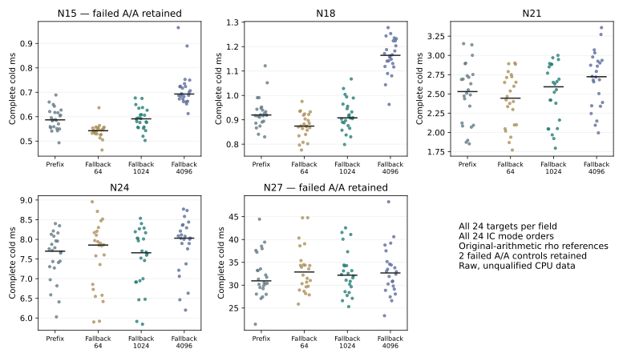
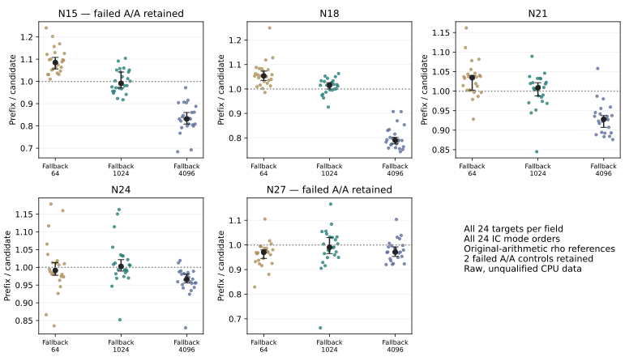

# AVX2 cached pair preparation: 2026-11-16

[pcc:unverified] CAPABILITY ADMISSION FAILED: the timing host lacks VPCLMULQDQ; all 360 requested vector arms used the exact scalar fallback. This is not a SIMD performance measurement. All 120 frozen four-way comparisons completed. Existing independent Python arithmetic replays 480 IC answers and 240 fresh-process rho answers. Exact input/candidate manifests, scalar fallback routing, positive shared calibration, scalar answers and query/matrix counts pass unsigned producer checks.

| Field | Prefix median ms | Fallback64 paired ratio | Fallback1024 paired ratio | Fallback4096 paired ratio |
|---|---:|---:|---:|---:|
| N15 | 0.587030 | 1.085107 | 0.991197 | 0.831610 |
| N18 | 0.919733 | 1.053599 | 1.015268 | 0.789994 |
| N21 | 2.530250 | 1.034432 | 1.008334 | 0.927778 |
| N24 | 7.699995 | 0.991405 | 1.002707 | 0.965930 |
| N27 | 30.941035 | 0.969847 | 0.990162 | 0.971159 |

[pcc:unverified] N15 prefix/fallback4096 diagnostic paired median 0.831610; frozen exploratory 95% bootstrap interval [0.808440, 0.860503].
[pcc:unverified] N18 prefix/fallback4096 diagnostic paired median 0.789994; frozen exploratory 95% bootstrap interval [0.775329, 0.801974].
[pcc:unverified] N21 prefix/fallback4096 diagnostic paired median 0.927778; frozen exploratory 95% bootstrap interval [0.907259, 0.937385].
[pcc:unverified] N24 prefix/fallback4096 diagnostic paired median 0.965930; frozen exploratory 95% bootstrap interval [0.955933, 0.980808].
[pcc:unverified] N27 prefix/fallback4096 diagnostic paired median 0.971159; frozen exploratory 95% bootstrap interval [0.953398, 0.992073].

[pcc:unverified] 118 of 120 pre/post A/A controls pass the frozen 0.85–1.15 bound with correct answers and unchanged calibration. Failed controls: [{"field": 27, "fixture": 288, "ratio": 1.2085731770594255}, {"field": 15, "fixture": 299, "ratio": 0.8469872539805842}]. No rows, outliers or controls are removed; zero process caps. Ratios are paired before taking medians. These ratios describe fallback paths only. Every comparison is unqualified; no SIMD timing result is admitted.

[pcc:unverified] Requested one L4, 4 CPUs, 8 GiB, 900 seconds; CPU execution only, one pinned exposed CPU, controller 780 seconds, child cap 12 seconds. Exposed cgroup CPU quota/period: 2000000/100000; memory limit: 364645142528 bytes. Requested allocation and physical placement remain unqualified; unavailable throttle/OOM counters and physical memory technology/speed/channels remain unknown. Child RLIMIT_AS is 8 GiB; GNU-time RSS/CPU/fault receipts retained. Record invalid for promotion.

[pcc:unverified] Every IC arm uses the same prefix-cached table strategy. Cold wall includes context, base/table/cache construction and cleanup, all queries, matrix work and final scalar verification. Public materialization, calibration/unit loading, process startup and independent replay remain separate. Original shared positive units are reused across all four requested preparation modes; no candidate-specific repricing. The remaining phase model is primitive pricing, not instruction counts; unchanged operation counts do not price a faster arithmetic implementation by themselves.

[pcc:unverified] Plain and negation rho use original arithmetic in separate fresh processes on the identical point and seed. Their order and placement alternate by fixture parity. No field-inverse or matrix change is combined with this comparison. Wall gaps below are median per-target IC/matched-negation-rho ratios.

| Field | Prefix/matched rho | Fallback4096/matched rho |
|---|---:|---:|
| N15 | 3.1308 | 3.7341 |
| N18 | 4.6499 | 5.9675 |
| N21 | 5.7944 | 6.2275 |
| N24 | 13.0189 | 13.5518 |
| N27 | 21.8135 | 22.2737 |

[pcc:unverified] Static disassembly contains YMM VPCLMUL instructions, which the timing host correctly skips. Exact source 2f74aafe134eb1e4147fef3830dd937170d30624; default release, locked-j2; binary 18ef30c0b4cf21b6068f556952ca153f3535c8166baddeb20cf6520a87a9eb13. Native preparation checks 100 complete first-witness maps and 15 unit-loader controls; vector product tests exercise 59 accepted field widths. The separate preparation host exercised vector instructions, but timing vector_pairs is zero in every requested vector arm; the frozen admission gate fails. Runtime AVX2/VPCLMUL and sparse-tail guards preserve complete scalar fallback on unsupported CPUs/fields and exceptional/missing-cache pairs. The original inverse, matrix and defaults remain.

[pcc:unverified] These are engineering measurements on fixed registered N15/18/21/24/27 curves, with 29/67/127/257/531 sign columns. They do not establish cryptographic-size performance, GPU throughput, asymptotic novelty, Tier1 admission or completion of the broad goal. Known unsigned status and ledger custody fork remain unchanged. Earlier negative/noisy results and model limitations are preserved.

Evidence: analysis.json, independent-arithmetic-timing001.json and lossless raw-timing-001.tar.gz with per-file SHA/URI inventory. Split raw outputs are also archived individually. Source claim c3b75f is unsigned. Native claim 4e89f7 and failed-admission claim 28dc44 are unsigned statements; all receipts remain alongside this report.

