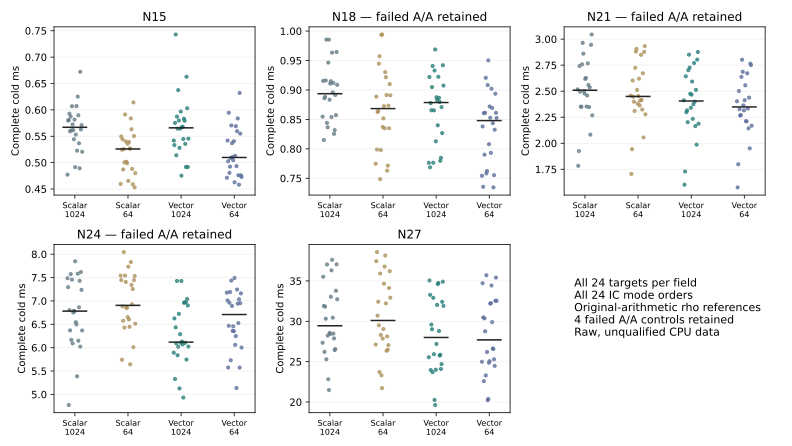
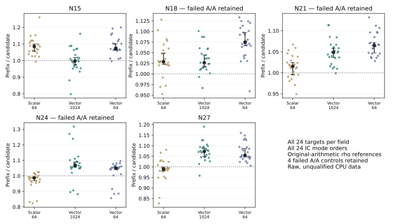
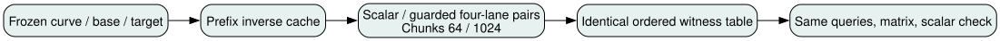

# Guarded PCLMUL/AVX2 pair preparation: 2026-11-16

[pcc:unverified] All 120 frozen four-way comparisons completed. Existing independent Python arithmetic replays 480 IC answers and 240 fresh-process rho answers. Exact input/candidate manifests, vector routing, positive shared calibration, scalar answers and query/matrix counts pass unsigned producer checks.

| Field | Prefix median ms | Scalar64 paired ratio | Vector1024 paired ratio | Vector64 paired ratio |
|---|---:|---:|---:|---:|
| N15 | 0.566958 | 1.084909 | 0.997638 | 1.073097 |
| N18 | 0.893655 | 1.028819 | 1.026359 | 1.074723 |
| N21 | 2.509171 | 1.015217 | 1.048593 | 1.065270 |
| N24 | 6.782344 | 0.986896 | 1.066609 | 1.049940 |
| N27 | 29.447762 | 0.989671 | 1.072814 | 1.054525 |

[pcc:unverified] N15 scalar1024/vector64 paired median 1.073097; frozen exploratory 95% bootstrap interval [1.063621, 1.101275].
[pcc:unverified] N18 scalar1024/vector64 paired median 1.074723; frozen exploratory 95% bootstrap interval [1.066164, 1.097485].
[pcc:unverified] N21 scalar1024/vector64 paired median 1.065270; frozen exploratory 95% bootstrap interval [1.047516, 1.071529].
[pcc:unverified] N24 scalar1024/vector64 paired median 1.049940; frozen exploratory 95% bootstrap interval [1.040453, 1.056372].
[pcc:unverified] N27 scalar1024/vector64 paired median 1.054525; frozen exploratory 95% bootstrap interval [1.046364, 1.085922].

[pcc:unverified] 116 of 120 pre/post A/A controls pass the frozen 0.85–1.15 bound with correct answers and unchanged calibration. Failed controls: [{"field": 18, "fixture": 324, "ratio": 1.153560470781028}, {"field": 21, "fixture": 325, "ratio": 0.8329613352595544}, {"field": 24, "fixture": 326, "ratio": 1.2302906609534339}, {"field": 24, "fixture": 336, "ratio": 0.8441576279469215}]. No rows, outliers or controls are removed; zero process caps. Ratios are paired before taking medians. Every raw comparison is exploratory and qualified null; none is promoted.

[pcc:unverified] Requested one L4, 4 CPUs, 8 GiB, 900 seconds; CPU execution only, one pinned exposed CPU, controller 780 seconds, child cap 12 seconds. Exposed cgroup CPU quota/period: 2000000/100000; memory limit: 364645134336 bytes. Requested allocation and physical placement remain unqualified; unavailable throttle/OOM counters and physical memory technology/speed/channels remain unknown. Child RLIMIT_AS is 8 GiB; GNU-time RSS/CPU/fault receipts retained. Record invalid for promotion.

[pcc:unverified] Every IC arm uses the same prefix-cached table strategy. Scalar/vector preparation and chunks 64/1024 form the frozen factorial. Cold wall includes context, base/table/cache construction and cleanup, all queries, matrix work and final scalar verification. Public materialization, calibration/unit loading, process startup and independent replay remain separate. Original shared positive units are reused across all four preparation modes; no candidate-specific repricing. The remaining phase model is primitive pricing, not instruction counts; unchanged operation counts do not price a faster arithmetic implementation by themselves.

[pcc:unverified] Plain and negation rho use original arithmetic in separate fresh processes on the identical point and seed. Their order and placement alternate by fixture parity. No field-inverse or matrix change is combined with this comparison. Wall gaps below are median per-target IC/matched-negation-rho ratios.

| Field | Prefix/matched rho | Vector64/matched rho |
|---|---:|---:|
| N15 | 2.8450 | 2.6553 |
| N18 | 4.2722 | 4.0274 |
| N21 | 5.9440 | 5.4929 |
| N24 | 14.0162 | 14.0870 |
| N27 | 21.7634 | 20.8887 |

[pcc:unverified] Exact source f307aa6c5da94591d74f6e9ecc0d405ccdadda62; default release, locked-j2; binary 48a27ee9a6eac361ede4bc2c9df7ea00b62c571ef64eaf6bd116fe8b2e997025. Native product checks cover 59 accepted field widths, comparing forced ordinary 128-bit PCLMUL instructions with selected-native and scalar products. Native preparation passes 100 complete witness maps and 15 loader controls. The same timing allocation passes all five map/capability preflights before target comparisons; selected backends: ['avx2-pclmul128']. Actual narrow/wide pair counts are archived. Original inverse, matrix and defaults remain; all kernel guards/fallbacks are retained.

[pcc:unverified] These are engineering measurements on fixed registered N15/18/21/24/27 curves, with 29/67/127/257/531 sign columns. They do not establish cryptographic-size performance, GPU throughput, asymptotic novelty, Tier1 admission or completion of the broad goal. Known unsigned status and ledger custody fork remain unchanged. Earlier negative/noisy results and model limitations are preserved.

Evidence: analysis.json, independent-arithmetic-timing001.json and lossless raw-timing-001.tar.gz with per-file SHA/URI inventory. Split raw outputs are also archived individually. Source claim cc0f2e and native claim 79b084 are unsigned. The initial failed-admission panel remains preserved; there is no host retry or data filtering.

