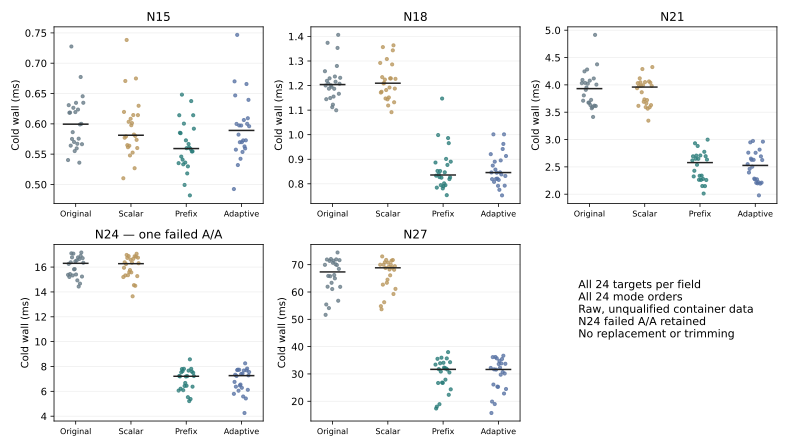
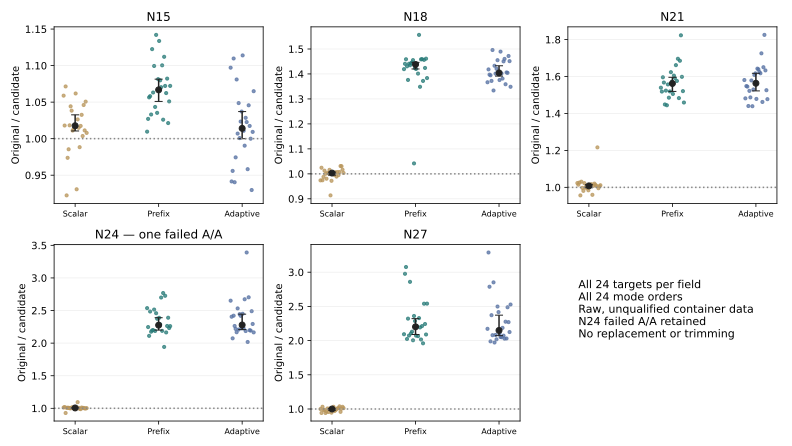

# Registered prefix scaling: 2026-11-16

[pcc:unverified] All 120 frozen four-way comparisons completed, with zero process caps. Existing independent Python arithmetic replays 480 IC answers and 240 fresh-process rho answers. Shared positive units, exact candidate/input manifests, scalar verification, and query/matrix counts agree. These remain unsigned producer checks.

| Field | Original median ms | Scalar paired ratio | Prefix paired ratio | Adaptive paired ratio |
|---|---:|---:|---:|---:|
| N15 | 0.599475 | 1.017672 | 1.066772 | 1.014070 |
| N18 | 1.204078 | 1.003116 | 1.437772 | 1.404233 |
| N21 | 3.931171 | 1.008119 | 1.562144 | 1.563292 |
| N24 | 16.300762 | 1.005575 | 2.275341 | 2.278171 |
| N27 | 67.336115 | 0.999635 | 2.201388 | 2.148621 |

[pcc:unverified] N15 prefix paired median 1.066772; frozen exploratory 95% bootstrap interval [1.050952, 1.081376].
[pcc:unverified] N18 prefix paired median 1.437772; frozen exploratory 95% bootstrap interval [1.419918, 1.446303].
[pcc:unverified] N21 prefix paired median 1.562144; frozen exploratory 95% bootstrap interval [1.519172, 1.595707].
[pcc:unverified] N24 prefix paired median 2.275341; frozen exploratory 95% bootstrap interval [2.199571, 2.389487]. One failed A/A (fixture 219, pre/post ratio 0.687076) remains in all raw summaries.
[pcc:unverified] N27 prefix paired median 2.201388; frozen exploratory 95% bootstrap interval [2.089103, 2.321160].

[pcc:unverified] 119 of 120 pre/post A/A checks satisfy the frozen 0.85–1.15 interval with correct calibration answers; N24 fixture 219 fails. No failed control or outlier is removed, and no target is replaced. Raw medians are exploratory diagnostics, with qualified values null. Ratios are paired before taking medians. Scalar-only dispatch gives little benefit across the panel; it does not support the earlier dispatch hypothesis. The adaptive selector does not consistently improve on prefix alone.

[pcc:unverified] One L4 allocation requested 4 CPUs, 8 GiB and 900 seconds; CPU execution only, one pinned exposed CPU, controller 780 seconds and child cap 12 seconds. Exposed quota is 20 CPUs and cgroup memory limit 181842173952 bytes (about 169.35 GiB). Requested limits and physical isolation are unverified; throttle/OOM and memory technology/speed/channels remain unavailable. Each child inherits RLIMIT_AS 8 GiB and GNU-time RSS/CPU/fault receipts. Record invalid for promotion.

[pcc:unverified] Cold wall includes fresh instance context, factor-base construction, complete native table/cache setup and cleanup, all failed/successful queries, matrix work and final scalar verification. Process startup, public materialization, unit calibration/loading and independent replay remain separate. Whole native preparation is charged once for every arm; the remaining phase model is primitive pricing, not instruction counts. Plain and negation rho execute in separate fresh processes on the identical point and seed. Even the optimized IC cold walls remain above those matched rho references on this panel.

[pcc:unverified] Exact registered fields N15/18/21/24/27 use archived prefix dimensions 6/7/8/9/10 and 29/67/127/257/531 sign columns. Source 42380ff2e83a1bd7bbdbed5c270365733295e726; default release, locked-j2; binary 7e54b6bc8304aa4570a7d551ce3f521bf184f5b4410a6ce5c98d2cb0b0f7f9a2. Native preparation passes 45 complete first-witness-map comparisons and 15 unit-loader checks. The original receipt contains the literal label HEAD; clean launcher metadata and exact source hashes separately bind the resolved commit. No receipt is rewritten.

[pcc:unverified] These measurements extend registered field sizes, with every case retained. They do not establish cryptographic-size performance, GPU throughput, asymptotic improvement, Tier1 admission or the broad requested breakthrough. The separate reciprocal matrix implementation is unmeasured and is absent from this frozen binary. Existing ledger custody fork and unsigned status remain unchanged.

Evidence: analysis.json, independent-arithmetic-timing001.json, raw-timing-001.tar.gz and raw-bundle-receipt.json bind all 977 raw outputs; split raw outputs are archived individually. Earlier negative results and pricing limitations remain preserved.

