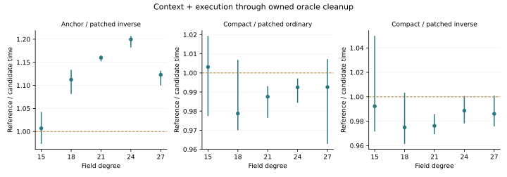
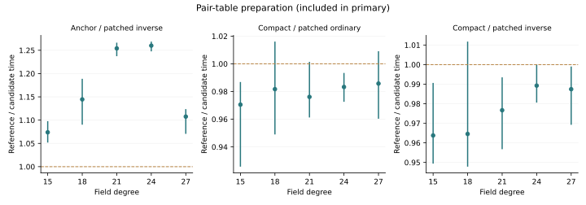
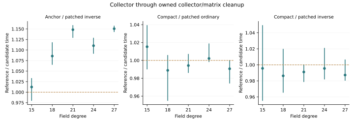

# SIMD abscissa output specialization

Specializing SIMD abscissa output

PCC-20261117-a7c941; unsigned exploratory producer data. Job 20261117-062133-95ad; 150 same-target blocks, 30 points per field, five logical methods/three immutable binaries. Qualification remains null. [pcc:unverified]

The fixed-array output candidate does not establish a native gain. N21 primary ratios favor the compact baseline in both ordinary and inverse paths; several setup comparisons also favor baseline. All three failed A/A controls are retained. The candidate is exploratory and rejected for performance promotion; the previous iterator append is restored after measurement. [pcc:unverified]

Existing independent Python arithmetic checks 750 IC, 300 matched-rho, 300 A/A answers and 7680 exported states. All 3 failed A/A controls and 0 capped IC arms are retained. [pcc:unverified]

Ratios above1 favor the denominator. Paired medians and 10000-resample pointwise95% intervals use seed20261116/linear quantiles; all30rows perfield remain. No pooling, filtering or cross-panel products. Primary includes context through owned oracle cleanup; prior fixture/calibration/spec/empty allocation, startup/JSON and later context/report destruction are excluded. Full-process cold remains open. [pcc:unverified]

Field | A / PI | BO / PO | BI / PI
N15 | 1.0068 [0.9731,1.0424] | 1.0031 [0.9773,1.0194] | 0.9923 [0.9716,1.0498]
N18 | 1.1125 [1.0814,1.1338] | 0.9787 [0.9700,1.0069] | 0.9750 [0.9615,1.0033]
N21 | 1.1599 [1.1521,1.1653] | 0.9875 [0.9764,0.9931] | 0.9763 [0.9695,0.9858]
N24 | 1.1997 [1.1823,1.2072] | 0.9925 [0.9843,0.9972] | 0.9887 [0.9783,1.0007]
N27 | 1.1230 [1.1000,1.1318] | 0.9926 [0.9628,1.0072] | 0.9861 [0.9758,1.0011]

A=anchor ordinary; BO/BI=compact baseline ordinary/inverse; PO/PI=patched ordinary/inverse. BO/PO and BI/PI isolate the two output append replacements. [pcc:unverified]

Table preparation and process memory

Field | A / PI | BO / PO | BI / PI
N15 | 1.0738 [1.0518,1.0977] | 0.9705 [0.9257,0.9869] | 0.9638 [0.9494,0.9906]
N18 | 1.1445 [1.0902,1.1888] | 0.9817 [0.9490,1.0161] | 0.9646 [0.9478,1.0118]
N21 | 1.2541 [1.2373,1.2663] | 0.9761 [0.9613,1.0014] | 0.9767 [0.9568,0.9935]
N24 | 1.2600 [1.2477,1.2687] | 0.9833 [0.9726,0.9934] | 0.9893 [0.9806,1.0001]
N27 | 1.1076 [1.0705,1.1236] | 0.9858 [0.9604,1.0091] | 0.9874 [0.9692,0.9990]

Field | A ms | BO | BI | PO | PI
N15 | 0.054 | 0.049 | 0.048 | 0.052 | 0.049
N18 | 0.256 | 0.216 | 0.219 | 0.220 | 0.223
N21 | 0.870 | 0.683 | 0.679 | 0.700 | 0.695
N24 | 3.519 | 2.810 | 2.809 | 2.843 | 2.840
N27 | 12.142 | 10.744 | 10.643 | 10.904 | 10.847

Field | Baseline inv. MiB | Patched inv. MiB
N15 | 6.471 | 6.567
N18 | 6.607 | 6.306
N21 | 6.545 | 6.605
N24 | 7.749 | 7.807
N27 | 12.183 | 11.890

Setup costs and complete-child GNUtime peak RSS are arithmetic means. RSS includes startup/reporting and is not heap-allocation telemetry. Baseline and patched representation are identical compact8byte entry payloads, excluding control metadata/rounding. No setup subtraction/amortization changes the primary interval. [pcc:unverified]

Collector and matched same-point references

Field | A / PI | BO / PO | BI / PI
N15 | 1.0122 [0.9795,1.0334] | 1.0153 [0.9899,1.0395] | 0.9956 [0.9551,1.0495]
N18 | 1.0857 [1.0650,1.1183] | 0.9888 [0.9547,1.0060] | 0.9863 [0.9652,1.0199]
N21 | 1.1483 [1.1290,1.1590] | 0.9943 [0.9860,1.0072] | 0.9911 [0.9786,1.0004]
N24 | 1.1103 [1.0912,1.1290] | 1.0022 [0.9982,1.0189] | 0.9955 [0.9818,1.0211]
N27 | 1.1506 [1.1428,1.1577] | 0.9907 [0.9742,1.0003] | 0.9873 [0.9803,1.0066]

Field | A ms | BO | BI | PO | PI
N15 | 0.530 | 0.529 | 0.530 | 0.529 | 0.526
N18 | 0.833 | 0.733 | 0.733 | 0.745 | 0.752
N21 | 2.152 | 1.856 | 1.808 | 1.883 | 1.845
N24 | 5.841 | 4.966 | 4.893 | 4.996 | 4.946
N27 | 22.377 | 20.147 | 19.560 | 20.387 | 19.823

Field | Plain rho / PI | Negation rho / PI
N15 | 0.52355 | 0.36634
N18 | 0.40495 | 0.29524
N21 | 0.29272 | 0.26456
N24 | 0.16363 | 0.10989
N27 | 0.09993 | 0.06960

Millisecond table: primary arithmetic means. References: medians of paired context-plus-rho compute / patched-inverse primary cost on the exact same Q/G/r/seed. Original rho arithmetic in the compact baseline; fresh processes. Setup-reused rho remains open. [pcc:unverified]

Exact change and separate development instruction evidence

Two normal-block statements change from extend(iterator.map(Some)) to extend_from_slice(array.map(Some)). Safe Rust preserves Option representation, vector output order and pre-existing prefix. Arithmetic, exceptional-pair group fallback and tails stay identical. Local tests are ARM-side evidence; native table positive controls exercise actual SIMD. [pcc:unverified]

Path | Whole-guest Ir | Generic dispatcher Ir | Hot wide rem. calls
current | 112848670 | 0 | 0
inverse | 107885973 | 0 | 0

Preparation development profiles replay 2 answers/512 states against original pinned calibration/tools/point/work. They precede fresh timing and are not native clocks, hardware retirement or cache measurements. Existing scalar/group arithmetic replay and full disassembly are retained. [pcc:unverified]

Field | Attempted | Failed A/A | Ratio min | Ratio max
N15 | 30 | 0 | 0.88990 | 1.14953
N18 | 30 | 3 | 0.82928 | 1.37137
N21 | 30 | 0 | 0.93371 | 1.05888
N24 | 30 | 0 | 0.93627 | 1.07338
N27 | 30 | 0 | 0.93627 | 1.13217

A/A band0.85..1.15; every failed row is listed in the final appendix and raw JSON. All rows remain in intervals. [pcc:unverified]

Reproduction and limits

Fixtures582..611; ten Williams orders repeated3. Each method position and ordered adjacent pair occurs6times perfield. One L4/4CPU/8GiB/900s allocation; CPU arithmetic pinned to one allowed CPU. Controller780s, child12s/preflight30s,8GiB native virtual cap. No observer subprocess while timing; physical placement and memory technology/speed/channels unknown. No GPU arithmetic throughput measured. [pcc:unverified]

anchor-input.json: binary 1026bf749fbf8e4a1a266d9833b89a78bf3468956aa9e91eec1af9ffb84d0027; source 25be1116c0cc56f4d7be8a0932de7c6531cdf947; preparation 20261116-152859-d0d3. [pcc:unverified]

prepared-input.json: binary a44e5e80d1ad745d3bf373acc6c497be2c207f9d45ba02b7bd53ddbe48165103; source 2221a26dae90dbcdd703a4a5e3b155c784b908cd; preparation 20261117-043656-db46. [pcc:unverified]

optimized-input.json: binary 6feee0d6a7afa97c05c31b5959dcb9de699e9ad5f10956a0c752dc52459814a2; source ab02ec29c831dd6dab38e457d64a7622d5e975d8; preparation 20261117-060251-5ded. [pcc:unverified]

EC1N15Crbhe4e02575ec1c; r=16319; base dimension6, columns29; base SHA256b508c882d85c0185599a40d201413314f6a2acae7ca1c60ef4761dc8acb23922. [pcc:unverified]

EC1N18Crbhe731503070c0; r=32719; base dimension7, columns67; base SHA25644948c2d6481dcf077b0e88777be615e1691d8c7e8f9abcf864fd3c74f76570c. [pcc:unverified]

EC1N21Crbh30df0435638d; r=1047281; base dimension8, columns127; base SHA2566fadae0420fd81b13709f3ade6537d5386c39a19b64a072878b970f8c84c9d95. [pcc:unverified]

EC1N24Crbh1d71c3dc9cbc; r=2097533; base dimension9, columns257; base SHA256ecb8d5f2793a2719839483c11156efb8bd9b7b952c1d19e1d5813a0a3d8dff44. [pcc:unverified]

EC1N27Crbh9ce93808c7a5; r=22367531; base dimension10, columns531; base SHA25611506ae2cdf00b61ce8c55869410741d7bdf458cd17d02160d6ad58bd06c0d19. [pcc:unverified]

Reconstruction pins original source archive, coefficient overlay and three compact overlays, then only koblitz_fast.rs changes. Sixteen manifest hashes, actual clean preparation Git revision, full snapshot/overlay bytes, compiler/environment/build path are admitted. The first local cache-path failure is retained; shared cache was not repaired. Local claim467209 is unsigned. [pcc:unverified]

All raw captures, per-file SHA/URI bundles and independent checks are archived via scoped default/us-west-2/crypto-autoresearcher before record closure. Root legacy storage and separate CI credential/proof checksum issues remain separate. No qualified promotion, complete-cold, broad-field, asymptotic or mathematical-novelty assertion. The full requested performance goal remains open. [pcc:unverified]

Every predeclared paired contrast

Context + execution through owned oracle cleanup

Contrast | N15 | N18 | N21 | N24 | N27
A/PI | 1.0068 [0.9731,1.0424] | 1.1125 [1.0814,1.1338] | 1.1599 [1.1521,1.1653] | 1.1997 [1.1823,1.2072] | 1.1230 [1.1000,1.1318]
BO/PO | 1.0031 [0.9773,1.0194] | 0.9787 [0.9700,1.0069] | 0.9875 [0.9764,0.9931] | 0.9925 [0.9843,0.9972] | 0.9926 [0.9628,1.0072]
BI/PI | 0.9923 [0.9716,1.0498] | 0.9750 [0.9615,1.0033] | 0.9763 [0.9695,0.9858] | 0.9887 [0.9783,1.0007] | 0.9861 [0.9758,1.0011]
PO/PI | 1.0022 [0.9809,1.0419] | 0.9819 [0.9572,1.0230] | 1.0156 [1.0069,1.0237] | 1.0146 [1.0057,1.0211] | 1.0246 [1.0156,1.0372]
BO/BI | 0.9965 [0.9772,1.0250] | 0.9974 [0.9868,1.0157] | 1.0211 [1.0146,1.0300] | 1.0099 [1.0035,1.0252] | 1.0245 [1.0176,1.0391]
A/PO | 1.0139 [0.9713,1.0455] | 1.1217 [1.0892,1.1561] | 1.1405 [1.1301,1.1486] | 1.1816 [1.1699,1.1892] | 1.0880 [1.0708,1.1142]
A/BO | 1.0201 [0.9732,1.0353] | 1.1343 [1.1172,1.1605] | 1.1624 [1.1529,1.1676] | 1.1838 [1.1758,1.1994] | 1.0990 [1.0862,1.1167]

Pair-table preparation (included in primary)

Contrast | N15 | N18 | N21 | N24 | N27
A/PI | 1.0738 [1.0518,1.0977] | 1.1445 [1.0902,1.1888] | 1.2541 [1.2373,1.2663] | 1.2600 [1.2477,1.2687] | 1.1076 [1.0705,1.1236]
BO/PO | 0.9705 [0.9257,0.9869] | 0.9817 [0.9490,1.0161] | 0.9761 [0.9613,1.0014] | 0.9833 [0.9726,0.9934] | 0.9858 [0.9604,1.0091]
BI/PI | 0.9638 [0.9494,0.9906] | 0.9646 [0.9478,1.0118] | 0.9767 [0.9568,0.9935] | 0.9893 [0.9806,1.0001] | 0.9874 [0.9692,0.9990]
PO/PI | 1.0021 [0.9926,1.0281] | 0.9906 [0.9566,1.0221] | 1.0012 [0.9921,1.0168] | 1.0002 [0.9929,1.0151] | 1.0117 [0.9927,1.0222]
BO/BI | 0.9941 [0.9896,1.0280] | 0.9917 [0.9546,1.0294] | 1.0081 [0.9911,1.0245] | 0.9952 [0.9886,1.0067] | 1.0040 [0.9968,1.0182]
A/PO | 1.0629 [1.0426,1.0837] | 1.1527 [1.1140,1.2209] | 1.2485 [1.2311,1.2631] | 1.2571 [1.2441,1.2675] | 1.0935 [1.0690,1.1250]
A/BO | 1.0963 [1.0890,1.1056] | 1.1719 [1.1440,1.2298] | 1.2754 [1.2580,1.2899] | 1.2768 [1.2626,1.2872] | 1.1117 [1.0883,1.1439]

Collector through owned collector/matrix cleanup

Contrast | N15 | N18 | N21 | N24 | N27
A/PI | 1.0122 [0.9795,1.0334] | 1.0857 [1.0650,1.1183] | 1.1483 [1.1290,1.1590] | 1.1103 [1.0912,1.1290] | 1.1506 [1.1428,1.1577]
BO/PO | 1.0153 [0.9899,1.0395] | 0.9888 [0.9547,1.0060] | 0.9943 [0.9860,1.0072] | 1.0022 [0.9982,1.0189] | 0.9907 [0.9742,1.0003]
BI/PI | 0.9956 [0.9551,1.0495] | 0.9863 [0.9652,1.0199] | 0.9911 [0.9786,1.0004] | 0.9955 [0.9818,1.0211] | 0.9873 [0.9803,1.0066]
PO/PI | 0.9916 [0.9641,1.0345] | 1.0064 [0.9691,1.0488] | 1.0340 [1.0241,1.0400] | 1.0314 [1.0247,1.0350] | 1.0627 [1.0479,1.0763]
BO/BI | 1.0081 [0.9878,1.0567] | 0.9930 [0.9664,1.0291] | 1.0396 [1.0330,1.0441] | 1.0422 [1.0285,1.0501] | 1.0521 [1.0407,1.0675]
A/PO | 0.9882 [0.9648,1.0320] | 1.0758 [1.0627,1.1381] | 1.1044 [1.0911,1.1173] | 1.0776 [1.0638,1.0929] | 1.0910 [1.0772,1.1092]
A/BO | 1.0039 [0.9519,1.0370] | 1.0831 [1.0711,1.1255] | 1.1107 [1.0979,1.1257] | 1.0753 [1.0645,1.0856] | 1.0955 [1.0820,1.1038]

Ratios are reference/candidate paired medians[pointwise95% intervals], all30rows perfield. A anchor; B compact baseline; P fixed-array-output patch; O ordinary/I inverse. [pcc:unverified]

All failed A/A controls retained

Field index | Fixture | A/A ratio
1 | 589 | 1.371369295
1 | 592 | 1.194406999
1 | 600 | 0.829276526

No failed control is discarded or replaced. Qualification remains null; raw records and benchmark invalid status preserve exploratory standing. [pcc:unverified]

