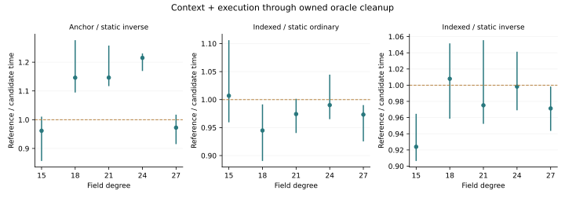
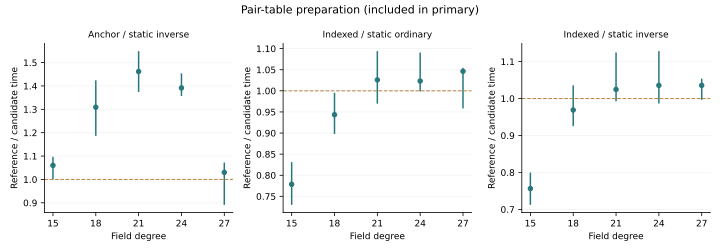
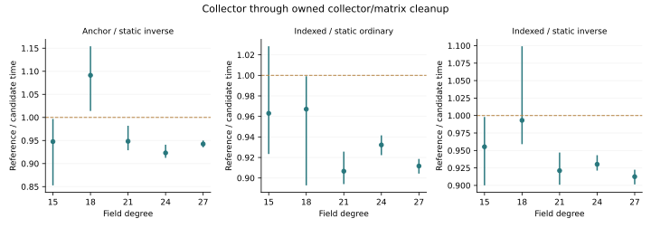

# Static packed witness dictionary

Static packed witness dictionary

PCC-20261117-e2657c; unsigned exploratory producer data. Job 20261117-103835-fc0d; 210 same-target blocks, 42 points per field, seven logical methods/four immutable binaries. Qualification remains null. [pcc:unverified]

The static dictionary does not establish a primary improvement. Relative to indexed inverse, N27 primary favors the existing control; N24/N27 collectors favor the existing control. Forty-six failed A/A rows remain, including four at N27. Lower fixed-development instructions did not translate into a primary gain. The broader performance objective and the earlier indexed collector-regression cause remain open. [pcc:unverified]

Existing independent Python arithmetic checks 1470 IC, 420 matched-rho, 420 A/A answers and 10240 exported states. All 46 failed A/A controls and 0 capped IC arms are retained. [pcc:unverified]

Ratios above1 favor the denominator. Paired medians and 10000-resample pointwise95% intervals use seed20261116/linear quantiles; all42rows perfield remain. No pooling, filtering or cross-panel products. Primary includes context through owned oracle cleanup; prior fixture/calibration/spec/empty allocation, startup/JSON and later context/report destruction are excluded. Full-process cold remains open. [pcc:unverified]

Field | A / SI | IO / SO | II / SI
N15 | 0.9616 [0.8565,1.0107] | 1.0068 [0.9595,1.1061] | 0.9239 [0.9064,0.9646]
N18 | 1.1461 [1.0945,1.2765] | 0.9448 [0.8904,0.9914] | 1.0079 [0.9586,1.0516]
N21 | 1.1464 [1.1169,1.2578] | 0.9742 [0.9403,1.0014] | 0.9752 [0.9523,1.0556]
N24 | 1.2150 [1.1695,1.2302] | 0.9902 [0.9651,1.0445] | 0.9983 [0.9690,1.0413]
N27 | 0.9724 [0.9152,1.0175] | 0.9732 [0.9254,0.9902] | 0.9713 [0.9435,0.9983]

A=anchor; CO/CI=compact ordinary/inverse; IO/II=indexed ordinary/inverse; SO/SI=static ordinary/inverse. IO/SO and II/SI isolate dictionary replacement; compact comparisons remain in the full contrast table. [pcc:unverified]

Table preparation and process memory

Field | A / SI | IO / SO | II / SI
N15 | 1.0601 [1.0007,1.0963] | 0.7785 [0.7298,0.8311] | 0.7563 [0.7122,0.7995]
N18 | 1.3091 [1.1864,1.4242] | 0.9434 [0.8978,0.9954] | 0.9689 [0.9254,1.0357]
N21 | 1.4618 [1.3746,1.5491] | 1.0260 [0.9696,1.0941] | 1.0246 [0.9927,1.1246]
N24 | 1.3917 [1.3569,1.4539] | 1.0232 [0.9988,1.0907] | 1.0356 [0.9865,1.1283]
N27 | 1.0302 [0.8911,1.0722] | 1.0463 [0.9583,1.0544] | 1.0356 [0.9965,1.0539]

Field | A ms | CO | CI | IO | II | SO | SI
N15 | 0.051 | 0.044 | 0.045 | 0.037 | 0.035 | 0.046 | 0.048
N18 | 0.275 | 0.202 | 0.208 | 0.200 | 0.205 | 0.210 | 0.209
N21 | 0.931 | 0.647 | 0.636 | 0.663 | 0.658 | 0.659 | 0.618
N24 | 3.382 | 2.531 | 2.569 | 2.607 | 2.572 | 2.517 | 2.453
N27 | 7.966 | 7.953 | 8.224 | 7.921 | 8.008 | 8.013 | 8.076

Field | Indexed inv. MiB | Static inv. MiB
N15 | 6.534 | 6.423
N18 | 6.302 | 6.489
N21 | 6.871 | 6.737
N24 | 7.765 | 7.731
N27 | 12.088 | 11.617

Setup costs and complete-child GNUtime peak RSS are arithmetic means. RSS includes startup/reporting and is not heap-allocation telemetry. Compact, indexed and static representations have8byte entry payloads, excluding capacity slack and any control metadata/rounding. No setup subtraction/amortization changes the primary interval. [pcc:unverified]

Collector and matched same-point references

Field | A / SI | IO / SO | II / SI
N15 | 0.9476 [0.8527,0.9967] | 0.9630 [0.9234,1.0284] | 0.9553 [0.9001,0.9980]
N18 | 1.0913 [1.0139,1.1542] | 0.9671 [0.8928,0.9991] | 0.9931 [0.9590,1.0992]
N21 | 0.9483 [0.9288,0.9819] | 0.9066 [0.8941,0.9257] | 0.9211 [0.9009,0.9470]
N24 | 0.9231 [0.9124,0.9408] | 0.9322 [0.9223,0.9416] | 0.9302 [0.9212,0.9432]
N27 | 0.9424 [0.9352,0.9500] | 0.9117 [0.9043,0.9186] | 0.9125 [0.9014,0.9224]

Field | A ms | CO | CI | IO | II | SO | SI
N15 | 0.491 | 0.517 | 0.500 | 0.517 | 0.492 | 0.509 | 0.521
N18 | 0.848 | 0.711 | 0.724 | 0.714 | 0.740 | 0.738 | 0.729
N21 | 1.910 | 1.615 | 1.582 | 1.617 | 1.613 | 1.681 | 1.608
N24 | 5.241 | 4.326 | 4.358 | 4.495 | 4.397 | 4.468 | 4.383
N27 | 15.224 | 15.258 | 15.234 | 15.361 | 15.106 | 16.028 | 15.832

Field | Plain rho / SI | Negation rho / SI
N15 | 0.55264 | 0.39951
N18 | 0.42432 | 0.33753
N21 | 0.27247 | 0.24067
N24 | 0.15458 | 0.11560
N27 | 0.08378 | 0.05095

Millisecond table: primary arithmetic means. References: medians of paired context-plus-rho compute / static-inverse primary cost on the exact same Q/G/r/seed. Original rho arithmetic in the compact baseline; fresh processes. Setup-reused rho remains open. [pcc:unverified]

Exact change and separate development instruction evidence

The static dictionary stores the existing nonzero u32 key and packed u32 witness in each u64 bucket. It retains MixHasher and the indexed coordinate path, field arithmetic, pair/chunk order and first witnesses. Checked capacity derives from all scheduled pairs, with bounded linear probes and overflow/allocation fallback to the existing compact map. Empty capacity slack and all initialization are charged. Public high-key guards and arithmetic fallback remain. Forced collision/wraparound controls, full maps and actual static-backend counts are mandatory. [pcc:unverified]

Field | Static maps | Indexed pairs | Const pairs | All packed
15 | 5 | 4350 | 2668 | 5336
18 | 5 | 22780 | 15276 | 30552
21 | 5 | 81280 | 56100 | 112200
24 | 5 | 331530 | 232852 | 465704
27 | 5 | 1412460 | 1001012 | 2002024

These are source-reported pair counters across the preparation map comparisons. Indexed totals include fallback lanes; static map counts require the new backend actually to be selected and do not measure hardware retirement or native throughput. The scalar/native complete maps must agree exactly. [pcc:unverified]

Path | Whole-guest Ir | Generic dispatcher Ir | Hot wide rem. calls
static ordinary | 102971123 | 0 | 0
static inverse | 97989550 | 0 | 0

Preparation development profiles replay 2 answers/512 states against original pinned calibration/tools/point/work. They precede fresh timing and are not native clocks, hardware retirement or cache measurements. Existing scalar/group arithmetic replay and full disassembly are retained. [pcc:unverified]

Field | Attempted | Failed A/A | Ratio min | Ratio max
N15 | 42 | 22 | 0.69248 | 1.72756
N18 | 42 | 16 | 0.55256 | 1.58675
N21 | 42 | 4 | 0.81408 | 1.32116
N24 | 42 | 0 | 0.88272 | 1.07543
N27 | 42 | 4 | 0.69624 | 1.44521

A/A band0.85..1.15; every failed row is listed in the final appendix and raw JSON. All rows remain in intervals. [pcc:unverified]

Separate N24 instruction diagnostic

Path | Whole-guest Ir | Collector function own Ir | Witness lookup own Ir
compact | 25971308 | 869478 | 377271
packed | 25666353 | 869478 | 377271
indexed | 25013298 | 869478 | 377271
static | 23462953 | 869478 | 405429

This separately declared fixture0 diagnostic runs before fresh generation on the new preparation allocation, using synthetic unit values1. Existing Python arithmetic checks all four answers. Exact public points and semantic schedules match. Function-exclusive work and call edges are instruction attribution, not exact collector clocks; inlining changes where work is attributed. Equal or lower Ir does not prove a cache, allocator or layout explanation for the earlier native collector regression. No N24 diagnostic wall time is used in this report. [pcc:unverified]

Generation provenance limitation: the local ARM identity-probe hash receipt was recorded retrospectively after this panel, rather than at generation. Exact candidate/workload IDs, protocol and four native binary bindings were published before launch, and every native target matched those frozen IDs. fresh-generation.json explicitly retains this limitation; no identities or timing inputs were changed. [pcc:unverified]

Reproduction and limits

Fixtures684..725; fourteen Williams orders repeated3. Each method position and ordered adjacent pair occurs6times perfield. One L4/4CPU/8GiB/900s allocation; CPU arithmetic pinned to one allowed CPU. Controller780s, child12s/preflight30s,8GiB native virtual cap. No observer subprocess while timing; physical placement and memory technology/speed/channels unknown. No GPU arithmetic throughput measured. [pcc:unverified]

anchor-input.json: binary 1026bf749fbf8e4a1a266d9833b89a78bf3468956aa9e91eec1af9ffb84d0027; source 25be1116c0cc56f4d7be8a0932de7c6531cdf947; preparation 20261116-152859-d0d3. [pcc:unverified]

prepared-input.json: binary a44e5e80d1ad745d3bf373acc6c497be2c207f9d45ba02b7bd53ddbe48165103; source 2221a26dae90dbcdd703a4a5e3b155c784b908cd; preparation 20261117-043656-db46. [pcc:unverified]

indexed-input.json: binary 847d9407bfbee7b13662f2bc33bb6fa204ec8df93bc0362d5f25a7c92f52d278; source bfd0e5062cbedccbc3b2a28856832dd434533510; preparation 20261117-083200-f519. [pcc:unverified]

optimized-input.json: binary 37a7b6b78200bd6abdfaff2d4ca9d45c8d459e7cf78e5b6d94d7bf778b053d79; source 9b39f7f8d19b6e19ffec5c39778a2eb1c09b2ea3; preparation 20261117-095854-5065. [pcc:unverified]

EC1N15Crbhe4e02575ec1c; r=16319; base dimension6, columns29; base SHA256b508c882d85c0185599a40d201413314f6a2acae7ca1c60ef4761dc8acb23922. [pcc:unverified]

EC1N18Crbhe731503070c0; r=32719; base dimension7, columns67; base SHA25644948c2d6481dcf077b0e88777be615e1691d8c7e8f9abcf864fd3c74f76570c. [pcc:unverified]

EC1N21Crbh30df0435638d; r=1047281; base dimension8, columns127; base SHA2566fadae0420fd81b13709f3ade6537d5386c39a19b64a072878b970f8c84c9d95. [pcc:unverified]

EC1N24Crbh1d71c3dc9cbc; r=2097533; base dimension9, columns257; base SHA256ecb8d5f2793a2719839483c11156efb8bd9b7b952c1d19e1d5813a0a3d8dff44. [pcc:unverified]

EC1N27Crbh9ce93808c7a5; r=22367531; base dimension10, columns531; base SHA25611506ae2cdf00b61ce8c55869410741d7bdf458cd17d02160d6ad58bd06c0d19. [pcc:unverified]

Reconstruction pins the original source archive, coefficient and compact overlays, then the three declared sources change. All16source hashes are admitted, with an exact three-file delta against indexed control and the inherited four-file differences from compact control and matching compiler/root/environment. Prior candidate failures, collector regressions and all earlier evidence remain separate in the parent study. No fresh data or failed control is discarded. [pcc:unverified]

All raw captures, per-file SHA/URI bundles and independent checks are archived via scoped default/us-west-2/crypto-autoresearcher before record closure. Root legacy storage and separate CI credential/proof checksum issues remain separate. No qualified promotion, complete-cold, broad-field, asymptotic or mathematical-novelty assertion. The full requested performance goal remains open. [pcc:unverified]

Every predeclared paired contrast

Context + execution through owned oracle cleanup

Contrast | N15 | N18 | N21 | N24 | N27
A/SI | 0.9616 [0.8565,1.0107] | 1.1461 [1.0945,1.2765] | 1.1464 [1.1169,1.2578] | 1.2150 [1.1695,1.2302] | 0.9724 [0.9152,1.0175]
CO/SO | 0.9967 [0.9578,1.0749] | 0.9788 [0.9248,1.0042] | 0.9602 [0.9250,0.9946] | 0.9689 [0.9447,0.9966] | 0.9714 [0.9320,0.9889]
CI/SI | 1.0004 [0.9633,1.0130] | 0.9862 [0.9515,1.0243] | 0.9891 [0.9674,1.0292] | 0.9820 [0.9607,1.0254] | 0.9659 [0.9443,0.9860]
IO/SO | 1.0068 [0.9595,1.1061] | 0.9448 [0.8904,0.9914] | 0.9742 [0.9403,1.0014] | 0.9902 [0.9651,1.0445] | 0.9732 [0.9254,0.9902]
II/SI | 0.9239 [0.9064,0.9646] | 1.0079 [0.9586,1.0516] | 0.9752 [0.9523,1.0556] | 0.9983 [0.9690,1.0413] | 0.9713 [0.9435,0.9983]
SO/SI | 0.9932 [0.9350,1.0485] | 1.0257 [0.9888,1.0427] | 1.0285 [1.0025,1.1042] | 1.0043 [0.9904,1.0300] | 1.0103 [0.9847,1.0252]
IO/II | 1.0385 [0.9968,1.1359] | 0.9780 [0.8800,1.0083] | 1.0234 [0.9804,1.0516] | 1.0270 [0.9919,1.0660] | 1.0071 [0.9911,1.0453]
CO/CI | 1.0161 [0.9567,1.0601] | 0.9696 [0.9306,1.0337] | 1.0152 [0.9810,1.0477] | 0.9915 [0.9817,1.0208] | 1.0103 [0.9858,1.0330]
A/SO | 0.9744 [0.9352,1.0260] | 1.1518 [1.0618,1.2411] | 1.1278 [1.0944,1.1901] | 1.2067 [1.1530,1.2248] | 0.9643 [0.9134,0.9971]

Pair-table preparation (included in primary)

Contrast | N15 | N18 | N21 | N24 | N27
A/SI | 1.0601 [1.0007,1.0963] | 1.3091 [1.1864,1.4242] | 1.4618 [1.3746,1.5491] | 1.3917 [1.3569,1.4539] | 1.0302 [0.8911,1.0722]
CO/SO | 0.9568 [0.9101,0.9973] | 0.9462 [0.8994,1.0286] | 0.9870 [0.9021,1.0137] | 1.0077 [0.9818,1.0565] | 1.0513 [0.9576,1.0733]
CI/SI | 0.9326 [0.8771,0.9734] | 0.9763 [0.9078,1.0697] | 1.0553 [0.9855,1.1095] | 1.0355 [0.9992,1.0932] | 1.0301 [1.0007,1.0547]
IO/SO | 0.7785 [0.7298,0.8311] | 0.9434 [0.8978,0.9954] | 1.0260 [0.9696,1.0941] | 1.0232 [0.9988,1.0907] | 1.0463 [0.9583,1.0544]
II/SI | 0.7563 [0.7122,0.7995] | 0.9689 [0.9254,1.0357] | 1.0246 [0.9927,1.1246] | 1.0356 [0.9865,1.1283] | 1.0356 [0.9965,1.0539]
SO/SI | 0.9907 [0.9391,1.0554] | 1.0087 [0.9510,1.0814] | 1.0386 [0.9907,1.1282] | 1.0039 [0.9840,1.0328] | 0.9788 [0.9644,1.0108]
IO/II | 1.0357 [1.0023,1.0822] | 0.9989 [0.9333,1.1030] | 1.0346 [0.9309,1.0962] | 1.0317 [0.9741,1.0859] | 0.9931 [0.9738,1.0106]
CO/CI | 1.0170 [0.9812,1.0328] | 0.9621 [0.9046,1.0430] | 1.0000 [0.9559,1.0196] | 1.0056 [0.9750,1.0288] | 1.0011 [0.9363,1.0241]
A/SO | 1.1035 [1.0601,1.1799] | 1.2582 [1.2105,1.4120] | 1.4250 [1.3169,1.4965] | 1.4147 [1.3219,1.4296] | 1.0208 [0.9164,1.0744]

Collector through owned collector/matrix cleanup

Contrast | N15 | N18 | N21 | N24 | N27
A/SI | 0.9476 [0.8527,0.9967] | 1.0913 [1.0139,1.1542] | 0.9483 [0.9288,0.9819] | 0.9231 [0.9124,0.9408] | 0.9424 [0.9352,0.9500]
CO/SO | 1.0112 [0.9379,1.0847] | 0.9627 [0.9413,0.9960] | 0.9171 [0.8944,0.9378] | 0.8988 [0.8920,0.9075] | 0.8953 [0.8863,0.9013]
CI/SI | 0.9657 [0.9361,1.0070] | 0.9844 [0.9527,1.0575] | 0.9013 [0.8881,0.9175] | 0.8915 [0.8803,0.8982] | 0.8906 [0.8829,0.9039]
IO/SO | 0.9630 [0.9234,1.0284] | 0.9671 [0.8928,0.9991] | 0.9066 [0.8941,0.9257] | 0.9322 [0.9223,0.9416] | 0.9117 [0.9043,0.9186]
II/SI | 0.9553 [0.9001,0.9980] | 0.9931 [0.9590,1.0992] | 0.9211 [0.9009,0.9470] | 0.9302 [0.9212,0.9432] | 0.9125 [0.9014,0.9224]
SO/SI | 1.0221 [0.9617,1.0526] | 1.0330 [1.0068,1.0996] | 1.0317 [1.0122,1.0481] | 1.0261 [1.0175,1.0329] | 1.0348 [1.0284,1.0471]
IO/II | 1.0098 [0.9754,1.1181] | 0.9719 [0.8759,1.0015] | 1.0143 [0.9905,1.0418] | 1.0230 [1.0106,1.0403] | 1.0355 [1.0258,1.0496]
CO/CI | 1.0208 [0.9474,1.0742] | 1.0012 [0.9421,1.0286] | 1.0436 [1.0220,1.0665] | 1.0338 [1.0218,1.0454] | 1.0383 [1.0323,1.0480]
A/SO | 0.9481 [0.9018,0.9845] | 1.0764 [1.0243,1.1550] | 0.9253 [0.9085,0.9548] | 0.9162 [0.9001,0.9277] | 0.9100 [0.8995,0.9157]

Ratios are reference/candidate paired medians[pointwise95% intervals], all42rows perfield. A anchor; C compact; I indexed; S static; O ordinary/I inverse. [pcc:unverified]

All failed A/A controls retained

Field index | Fixture | A/A ratio
0 | 685 | 0.819169992
0 | 686 | 0.732818152
0 | 687 | 0.835032600
1 | 688 | 0.817737480
4 | 688 | 1.282743797
0 | 690 | 1.322312978
1 | 691 | 0.685128965
0 | 692 | 0.800578581
1 | 694 | 1.304537989
0 | 695 | 0.846703990
1 | 695 | 0.806456950
0 | 697 | 1.378852089
1 | 697 | 1.261486652
2 | 698 | 0.814082441
0 | 699 | 1.727557989
1 | 700 | 0.773446138
0 | 701 | 0.692482541
2 | 701 | 1.321161209
0 | 702 | 0.722435579
1 | 703 | 0.798380455
0 | 704 | 1.179246916
1 | 704 | 1.479387580
2 | 704 | 0.845894697
0 | 705 | 0.819102922
0 | 707 | 1.282453976
4 | 707 | 1.445205721
1 | 709 | 1.586751382
0 | 710 | 1.313975430
4 | 710 | 0.696238498
0 | 711 | 1.280842816
1 | 711 | 0.743604027
0 | 713 | 0.726440447
1 | 713 | 1.297458745
0 | 714 | 0.824892885
1 | 714 | 1.366812121
1 | 715 | 0.552559917
0 | 716 | 0.835115966
4 | 716 | 1.195401098
0 | 717 | 1.481575069
0 | 718 | 0.703304175
2 | 718 | 1.154588964
0 | 720 | 0.834273103
1 | 721 | 0.837569172
1 | 723 | 0.726676331
0 | 724 | 1.168987300
1 | 725 | 1.504233236

No failed control is discarded or replaced. Qualification remains null; raw records and benchmark invalid status preserve exploratory standing. [pcc:unverified]

