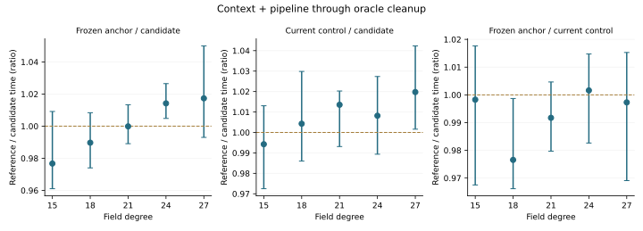
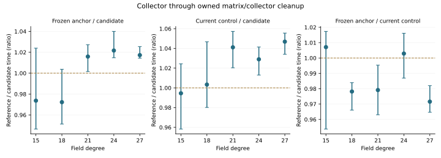
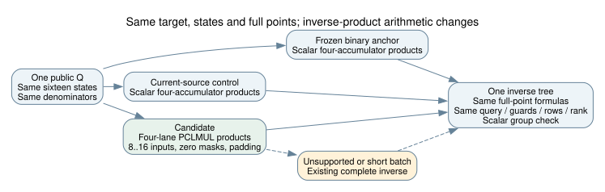

# SIMD products in the shared inverse

[pcc:unverified] PCC-20261116-994c50; unsigned exploratory producer analysis, qualificationnull.

Job 20261116-200407-325c; 120 triples of fresh fixtures456..479 across five fields. Existing independent Python arithmetic checks 360 target IC answers, 240 rho answers and 240 A/A control answers. Analysis status pass. All rows and controls retained. [pcc:unverified]

Primary ratios compare context plus pipeline execution through explicit oracle destruction. Frozen anchor / candidate measures against the previous binary; current control / candidate isolates the new inverse-product path; frozen anchor / current control exposes compiler/layout effects. Per-field paired medians,10000-resample95% intervals, seed20261116 and linear quantiles. Ratios above1 mean lower cost for the denominator method. [pcc:unverified]

Identical target and schedule; exact cost boundaries [pcc:unverified]

All three methods use the same Q/G/subgroup/seed, archived base, constant-polynomial table mode3 and vector16 query law. Initialization is unchanged. The candidate vectorizes products in the existing four accumulators, retains one scalar inverse tree, restores zeros and charges padded lanes. Unsupported CPU/field/noncanonical inputs and lengths outside8..16 retain the complete existing inverse. Full-point formulas, guards, restarts, caps, rows/rank and scalar group check remain. [pcc:unverified]

Primary includes context construction, reusable base/table preparation, target-dependent setup, collector/matrix/group check and explicit oracle cleanup. Prior input/fixture/calibration/spec/empty-oracle allocation, startup/JSON and later context/report destruction are excluded. This is not complete-process cold time. Collector interval includes owned collector/matrix cleanup and is shown separately. Native group checking is inside compute; fixture equality is a harness check. Existing Python elapsed/CPU is outside native timing. [pcc:unverified]

The millisecond table gives arithmetic means. Rho/IC columns are medians of paired context-plus-reference compute / context-plus-pipeline cleanup, on the exact same target and seed. Plain and negation rho use fresh processes and original arithmetic. Reused-setup precomputation-rho remains open. These scope-defined ratios are supplementary and do not establish a complete cold comparison. [pcc:unverified]

Collector and actual inverse work [pcc:unverified]

Failed A/A controls 4; capped IC arms 0. All retained. Current-source ordinary-inverse fixture0 brackets each triple, allowed0.85..1.15. Scalar replay also checks those control answers and their public inputs are tied to the fixed preflight point. No host selection, filtering, cap extension or parameter tuning. [pcc:unverified]

Actual inverse counters distinguish request from execution and record batches, input elements and padded lanes. Point-vector counts and every other query/row/rank/work/semantic operation are audited across all three arms. The extra inverse counters are the only allowed semantic-signature exclusions. Raw per-target setup, collector, group/rank work, RSS and counter rows remain in analysis and captures. [pcc:unverified]

Reproduction, curve/base scope and limits [pcc:unverified]

Candidate binary SHA256 c808153b43186cf6012eee823b1784150105c6c95db6cfbaa54c66b3058f65a8, source cff665a3ed3206b991963a01df1efb2f5d17b5ee, preparation 20261116-162931-e755. Frozen anchor SHA256 1026bf749fbf8e4a1a266d9833b89a78bf3468956aa9e91eec1af9ffb84d0027, source 25be1116c0cc56f4d7be8a0932de7c6531cdf947, preparation 20261116-152859-d0d3. Separate receipt/job metadata hashes bind both binaries; host.json retains both toolchains. Source/protocol and exact candidate/workload manifests were published before target timings. [pcc:unverified]

Native preparation:175complete maps and15loader controls;5batched-walk/2full-point/1constant/27framework/3inverse test filters, with overlapping counts;58accepted inverse widths and valid-curve-point boundary controls. Five stream variants give four comparisons at512states per registered field. Existing Python replays2560exported coefficient states. Same-allocation preflight repeats both binaries and requires exact frame/group-operation agreement plus positive actual inverse execution. [pcc:unverified]

One L4CPU4/8GiB900s allocation, CPU work pinned to one allowed CPU; controller780s, target child12s, preflight30s and8GiBvirtual cap. Host/cgroup/affinity/GNU wall/CPU/RSS/fault receipts retained. Physical placement, memory technology/speed/channels and unavailable hardware counters remain unknown. No observer subprocess during target timing. Raw captures are separately archived and losslessly bundled with per-file SHA/URI pins before record closure. [pcc:unverified]

Known engineering on Montgomery batching already present in Gf2. All measurements remain exploratory/unsigned and invalid for promotion; no trusted performance signature. PCC custody fork retained without rewrite/waiver. No default promotion, mathematical novelty, GPU-throughput or larger-field conclusion. Sources: owning Gf2.batch_inv_body, Simd256, FastCurve, CountedGroup, BatchedWalker, the previous constant-reduction report and KB/atlas receipts in DEVELOPMENT.md. Canonical curve catalog and volcano/isogeny-route graph sources have no changed mathematical facts. Broad optimization remains active. [pcc:unverified]

| Field | Anchor / candidate primary | Current / candidate | Anchor / current | A/A |
|---|---:|---:|---:|---:|
| N15 | 0.9767 [0.9611, 1.0091] | 0.9942 [0.9725, 1.0130] | 0.9983 [0.9675, 1.0177] | 1 |
| N18 | 0.9897 [0.9740, 1.0084] | 1.0043 [0.9860, 1.0298] | 0.9765 [0.9662, 0.9987] | 1 |
| N21 | 0.9999 [0.9891, 1.0133] | 1.0135 [0.9931, 1.0203] | 0.9917 [0.9797, 1.0046] | 1 |
| N24 | 1.0142 [1.0048, 1.0265] | 1.0082 [0.9894, 1.0274] | 1.0016 [0.9826, 1.0148] | 0 |
| N27 | 1.0173 [0.9930, 1.0500] | 1.0198 [1.0016, 1.0424] | 0.9973 [0.9691, 1.0153] | 1 |

EC1N15Crbhe4e02575ec1c; r=16319; dimension=6; columns=29; base SHA256 b508c882d85c0185599a40d201413314f6a2acae7ca1c60ef4761dc8acb23922 [pcc:unverified]

EC1N18Crbhe731503070c0; r=32719; dimension=7; columns=67; base SHA256 44948c2d6481dcf077b0e88777be615e1691d8c7e8f9abcf864fd3c74f76570c [pcc:unverified]

EC1N21Crbh30df0435638d; r=1047281; dimension=8; columns=127; base SHA256 6fadae0420fd81b13709f3ade6537d5386c39a19b64a072878b970f8c84c9d95 [pcc:unverified]

EC1N24Crbh1d71c3dc9cbc; r=2097533; dimension=9; columns=257; base SHA256 ecb8d5f2793a2719839483c11156efb8bd9b7b952c1d19e1d5813a0a3d8dff44 [pcc:unverified]

EC1N27Crbh9ce93808c7a5; r=22367531; dimension=10; columns=531; base SHA256 11506ae2cdf00b61ce8c55869410741d7bdf458cd17d02160d6ad58bd06c0d19 [pcc:unverified]
