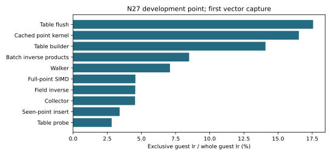
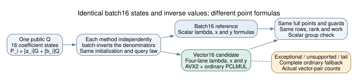

# Instruction profile after shared inversion and full-point SIMD

[pcc:unverified] PCC-20261116-503112; unsigned producer analysis. No signed performance verdict. [pcc:unverified]

Job 20261116-144118-ab03: six completed captures, ABBA batch16/vector16 then plain and negation rho. Fixed N27 development fixture0, dimension10,531columns; one public target per solve. Binary dab1240e459c95551e1a558a25f57f4f8d40497a3cdf1e0482217df8efc19f7e, source5cb366343. Current as_chunks style changes are outside this binary. [pcc:unverified]

Whole-guest Ir: batch16 122445015 and122445008; vector16 119553350 and119553343. Ratio of median totals1.024187236. Plain rho10358849; negation rho11374055, same point and seed. These are interpreted instruction-read events across startup, inputs/fixture, context/base/table preparation, collector/matrix/check, JSON output and executed cleanup. They are not native time, hardware retired instructions, cycles or the primary online interval. Two repeats give a repeat range, not a confidence interval. [pcc:unverified]

Raw headers, footers, exclusive sums and annotated PROGRAM TOTALS agree for every capture. Six answers and512exported coefficient states pass producer invocations of the existing independent Python arithmetic. Table/stream Nulgrind admission passed; actual backend is avx2-pclmul128 with positive vector pairs. The allocation used one L4,4CPU,8GiB900s; arithmetic ran on one pinned CPU. Physical placement/memory details and unavailable hardware counters remain unknown. [pcc:unverified]

Attribution and next controlled change [pcc:unverified]

First vector capture: disjoint table builder body, flush and cached helper total57590428exclusiveIr, about48.17% of the whole guest. Batch-inverse product function10152364Ir, about8.49%; field inverse5438160Ir, about4.55%. Inlined work limits attribution. The3451point-kernel context constructors cost821338inclusiveIr, about0.687%; inclusive edges overlap callees and must not be summed with exclusive totals. [pcc:unverified]

The preceding packed-square study and this binary use rustc1.98.1/LLVM22.1.8 and matching recorded build environment. Static cached-narrow false disassembly grows from457to642instruction lines; the new exclusive count is higher, but changed inlining prevents treating that isolated count as a cross-source runtime regression. Keep both binaries and receipts. The next proposed control specializes exact polynomial reduction at compile time, retains the general kernel and fallback, and measures fresh paired targets after correctness controls. No performance result for that proposal is established. [pcc:unverified]

Reproduction: PROFILE_PROTOCOL.md, profile-input.json, run_profile.py, analyze_profiles.py, replay_profiles.py, replay_profile_walk.py, analysis-profile-001.json, replay-profile-001.json, replay-profile-walk-001.json and profile-bundle-receipt.json. Raw83files have lossless bundle SHA/URI pins. Existing native timing REPORT.pdf remains unchanged. Known engineering; curve catalog and volcano/isogeny-route graph sources have no changed mathematical facts. Qualificationnull, invalid for promotion; custody fork retained without ledger rewrite or waiver. Broad optimization remains active. [pcc:unverified]

Sources: owning koblitz_fast.rs, semaev_decomp.rs, ic_boundary/batched_walk.rs and ic_framework/batch_mitm.rs; the preceding ic-native-profile study; official Callgrind manual https://valgrind.org/docs/manual/cl-manual.html. Ir does not establish native latency. Larger fields, GPU execution and complete-process cold improvement remain open. [pcc:unverified]

