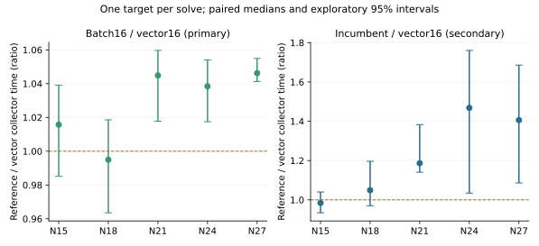
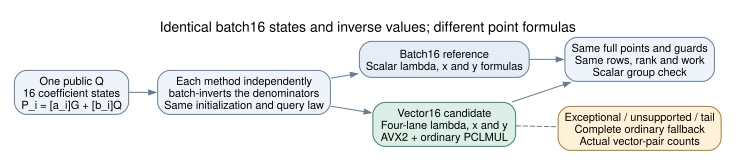
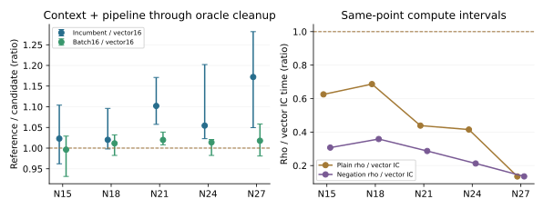

# Vector full-point formulas for a single target IC collector

[pcc:unverified] Claim 323b58; unsigned producer controls/analysis. No signed performance verdict.

Timing job 20261116-140621-6b2c; binary dab1240e459c95551e1a558a25f57f4f8d40497a3cdf1e0482217df8efc19f7e; preparation 20261116-134408-3f40. Protocol/source and fixture408..431 inputs were published before timing. 120 triples, 360 IC and 240 rho scalar replays; analysis status pass. All controls/errors are retained.

| Field | Batch16 / vector16 (primary) | Incumbent / vector16 (secondary) | A/A failures |
|---|---:|---:|---:|
| N15 | 1.0157 [0.9851, 1.0391] | 0.9845 [0.9341, 1.0401] | 1 |
| N18 | 0.9950 [0.9635, 1.0186] | 1.0489 [0.9702, 1.1963] | 4 |
| N21 | 1.0449 [1.0178, 1.0597] | 1.1863 [1.1407, 1.3828] | 0 |
| N24 | 1.0384 [1.0175, 1.0541] | 1.4684 [1.0345, 1.7605] | 0 |
| N27 | 1.0462 [1.0413, 1.0550] | 1.4059 [1.0861, 1.6858] | 0 |

[pcc:unverified] Claim 323b58; unsigned producer controls/analysis. No signed performance verdict.

Every primary field uses24paired targets. Frozen bootstrap10000/seed20261116, linear quantiles. Ratios above1 mean lower vector cost. All rows retained; 5 failed A/A controls, 0 capped IC arms. Intervals describe exploratory host data and do not qualify it. A changed collector schedule can change yield; only the batch16/vector16 contrast isolates arithmetic.

[pcc:unverified] Claim 323b58; unsigned producer controls/analysis. No signed performance verdict.

Both sixteen-state methods use the same Q and P=[a]G+[b]Q. Both independently perform the ordinary batch inversion and identical initialization; vector16 evaluates the full x/y point formulas in four lanes. Global guards, coefficient tracking, lazy restarts, cofactor/rows/rank and final scalar group check remain. Generated-point cap500000 includes identities and unused work. Total buffered generated-but-unused points across native arms: 878. Batch/vector same-schedule work/count audits are pass; generic scalar fallback remains. No work is shared across targets.

[pcc:unverified] Claim 323b58; unsigned producer controls/analysis. No signed performance verdict.

Primary collector clock includes target-dependent setup, collection, matrix, scalar group check and owned collector/matrix cleanup. MITM base/pair-table preparation is reusable and Q-independent. Supplementary context + pipeline-through-oracle-cleanup excludes input/spec/empty-oracle allocation, process startup, context/report destruction and serialization. It is not complete-process cold time. Earlier incomplete-window reports remain immutable; see ../ic-walk-batching-20261116/ACCOUNTING_AUDIT.md and ../ic-native-profile-20261116/COST_WINDOW_ERRATUM.md.

Existing Python replay is separate from native timing: elapsed 0.160376s, CPU 0.160144s for 600 checks. Native scalar group verification remains inside compute. Fresh rho has the same point/seed and original arithmetic, separate plain and negation processes, with target-dependent work through owned cleanup. Reusable-setup rho remains an open requirement for a qualified online claim.

## Costs and yield

| Field | Incumbent ms | Batch16 ms | Vector16 ms | Incumbent median queries | Vector16 median queries | Vector16 max RSS MiB |
|---|---:|---:|---:|---:|---:|---:|
| N15 | 0.284 | 0.273 | 0.273 | 311.5 | 340.5 | 7.4 |
| N18 | 0.339 | 0.312 | 0.316 | 453.5 | 473.5 | 7.4 |
| N21 | 1.153 | 0.962 | 0.925 | 4132.5 | 4251.0 | 7.9 |
| N24 | 2.333 | 1.841 | 1.791 | 6774.0 | 6884.5 | 9.5 |
| N27 | 13.929 | 10.226 | 9.769 | 46618.5 | 45938.0 | 18.3 |

[pcc:unverified] Claim 323b58; unsigned producer controls/analysis. No signed performance verdict.

Compute values are means of24targets; query values are medians; RSS is maximum observed child GNU-time RSS, distinct from requested allocation memory. Inspect analysis.json for per-target setup, ranks, rows, work, semantic operations, generated/consumed/unused, actual backend flags, references, failed controls and every cap/error.

## Exact scope and evidence

[pcc:unverified] Claim 323b58; unsigned producer controls/analysis. No signed performance verdict.

Requested one L4,4CPU,8GiB,900s; CPU execution on one allowed CPU pinned. Actual selected CPU: 0. Controller780s, child12s, capability preflight30s, RLIMIT_AS8GiB. Same timing allocation checks125table maps and2560walk states with actual CLMUL/native-pair use before targets. Independent Python replay of those exported preflight states is separate. Preparation also records15loader controls and4walker plus2full-point tests, including58accepted formula widths and seven valid-curve field cases. Physical placement/memory technology/speed/channels and unavailable throttle/OOM counters remain unknown. Modal/gVisor qualificationnull; record invalid for promotion.

Five exact curves (archived prefix bases unchanged):
- EC1N15Crbhe4e02575ec1c: dimension6, columns29; full candidate/workload IDs in identities.json and immutable ic-bench manifests.
- EC1N18Crbhe731503070c0: dimension7, columns67; full candidate/workload IDs in identities.json and immutable ic-bench manifests.
- EC1N21Crbh30df0435638d: dimension8, columns127; full candidate/workload IDs in identities.json and immutable ic-bench manifests.
- EC1N24Crbh1d71c3dc9cbc: dimension9, columns257; full candidate/workload IDs in identities.json and immutable ic-bench manifests.
- EC1N27Crbh9ce93808c7a5: dimension10, columns531; full candidate/workload IDs in identities.json and immutable ic-bench manifests.

Methods: incumbent walk, ordinary batch16, vector16 with full point formulas. All use the same fixed field chunk policy64atN15/18/21 and1024atN24/27, product vector preparation, original inverse/matrix. All6orders repeated4times. Native preparation binary/source/receipt/job metadata are SHA-bound in prepared-input.json. Source5cb366343; published protocol46a89a8fc and inputs026ef4821; prepared bindings/controller75d06dcad.

Raw timing outputs and the lossless SHA/URI bundle are retained before record closure. analysis.json, independent-arithmetic-timing001.json, preflight-state replay, raw-bundle-receipt.json and artifact manifests are the reproducibility trail. PCC custody fork remains; no ledger rewrite, waiver, default promotion, mathematical novelty, GPU-throughput or cryptographic-size conclusion.

Prior-art/source audit: ../ic-native-profile-20261116/NEXT_LEAD.md, PROTOCOL.md, DEVELOPMENT.md. Known batch inversion; wide prime-field negative results and withdrawn multi-target ratios do not transfer. No curve/isogeny fact changed. Canonical curve catalog, volcano/isogeny-route figures and related graph sources remain current.

## Failed controls

[pcc:unverified] Claim 323b58; unsigned producer controls/analysis. No signed performance verdict.

[
  {
    "index": 0,
    "fixture": 410,
    "ratio": 0.8105668287183824
  },
  {
    "index": 1,
    "fixture": 415,
    "ratio": 1.2178281911369808
  },
  {
    "index": 1,
    "fixture": 416,
    "ratio": 0.8449926295291997
  },
  {
    "index": 1,
    "fixture": 424,
    "ratio": 1.1829722480140308
  },
  {
    "index": 1,
    "fixture": 430,
    "ratio": 0.8268750154653206
  }
]

## Next discriminating action

[pcc:unverified] Retain this result and compare a successor on fresh frozen inputs. Use the matching batch16/vector16 contrast to assess formula arithmetic. If it is inconclusive or regresses, inspect gather/scatter and per-batch context cost; if it improves, attribute the remaining shared-inverse and table costs before selecting a successor. Any subsequent implementation change requires its own source/correctness controls and predeclared comparison. Broad requested optimization remains active; this bounded panel does not discharge it.
