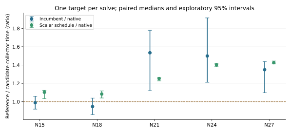
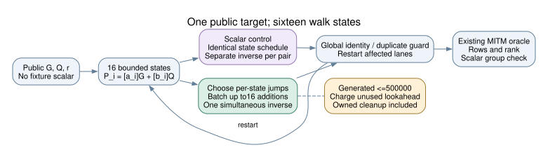
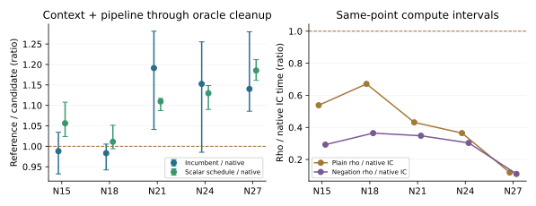

# Native batched additions for a one-target binary IC collector

[pcc:unverified] Claim b513bd; unsigned producer controls/analysis. No signed performance verdict.

Timing job 20261116-130300-7971; binary e9e27798565aa707fd528eadbe9d122718db9dfc35989bc81f7513494772a5aa; preparation 20261116-125049-f932. Protocol/source and fixture384..407 inputs were published before timing. 120 triples, 360 IC and 240 rho scalar replays; analysis status pass. All controls/errors are retained.

| Field | Incumbent / native collector | Scalar schedule / native collector | A/A failures |
|---|---:|---:|---:|
| N15 | 0.9882 [0.9188, 1.0596] | 1.1025 [1.0342, 1.1240] | 1 |
| N18 | 0.9470 [0.8590, 1.0391] | 1.0836 [1.0404, 1.1175] | 1 |
| N21 | 1.5344 [1.1196, 1.7799] | 1.2524 [1.2280, 1.2625] | 0 |
| N24 | 1.4993 [1.2118, 1.9150] | 1.4040 [1.3826, 1.4187] | 0 |
| N27 | 1.3492 [1.0978, 1.4392] | 1.4256 [1.4139, 1.4443] | 0 |

[pcc:unverified] Claim b513bd; unsigned producer controls/analysis. No signed performance verdict.

Every primary field uses24paired targets. Frozen bootstrap10000/seed20261116, linear quantiles. Ratios above1 mean lower native cost. All rows retained; 2 failed A/A controls, 0 capped IC arms. Intervals describe exploratory host data and do not qualify it. A changed collector schedule can change yield; only the scalar/native same-schedule contrast isolates arithmetic.

[pcc:unverified] Claim b513bd; unsigned producer controls/analysis. No signed performance verdict.

Sixteen states work on the same Q with P=[a]G+[b]Q. Group pairwise addition shares an inversion. Global guards, coefficient tracking, lazy restarts, cofactor/rows/rank and final scalar group check remain. Generated-point cap500000 includes identities and unused work. Total buffered generated-but-unused points across native arms: 926. Native/scalar same-schedule work/count audits are pass; generic scalar fallback remains. No work is shared across targets.

[pcc:unverified] Claim b513bd; unsigned producer controls/analysis. No signed performance verdict.

Primary collector clock includes target-dependent setup, collection, matrix, scalar group check and owned collector/matrix cleanup. MITM base/pair-table preparation is reusable and Q-independent. Supplementary context + pipeline-through-oracle-cleanup excludes input/spec/empty-oracle allocation, process startup, context/report destruction and serialization. It is not complete-process cold time. Earlier incomplete-window reports remain immutable; see ACCOUNTING_AUDIT.md and ../ic-native-profile-20261116/COST_WINDOW_ERRATUM.md.

Existing Python replay is separate from native timing: elapsed 0.130324s, CPU 0.130324s for 600 checks. Native scalar group verification remains inside compute. Fresh rho has the same point/seed and original arithmetic, separate plain and negation processes, with target-dependent work through owned cleanup. Reusable-setup rho remains an open requirement for a qualified online claim.

## Costs and yield

| Field | Incumbent ms | Scalar schedule ms | Native ms | Incumbent median queries | Native median queries | Native max RSS MiB |
|---|---:|---:|---:|---:|---:|---:|
| N15 | 0.285 | 0.317 | 0.291 | 348.5 | 377.5 | 7.3 |
| N18 | 0.303 | 0.342 | 0.318 | 367.5 | 446.5 | 7.5 |
| N21 | 1.170 | 1.079 | 0.865 | 4221.0 | 3658.5 | 7.9 |
| N24 | 2.427 | 2.317 | 1.652 | 7557.5 | 6189.5 | 9.7 |
| N27 | 13.701 | 15.169 | 10.639 | 46131.0 | 50173.5 | 17.7 |

[pcc:unverified] Claim b513bd; unsigned producer controls/analysis. No signed performance verdict.

Compute values are means of24targets; query values are medians; RSS is maximum observed child GNU-time RSS, distinct from requested allocation memory. Inspect analysis.json for per-target setup, ranks, rows, work, semantic operations, generated/consumed/unused, actual backend flags, references, failed controls and every cap/error.

## Exact scope and evidence

[pcc:unverified] Claim b513bd; unsigned producer controls/analysis. No signed performance verdict.

Requested one L4,4CPU,8GiB,900s; CPU execution on one allowed CPU pinned. Actual selected CPU: 0. Controller780s, child12s, capability preflight30s, RLIMIT_AS8GiB. Same timing allocation checks125table maps and2560walk states with actual CLMUL/native-pair use before targets. Independent Python replay of those exported preflight states is separate. Preparation also records15loader controls and3native walker tests. Physical placement/memory technology/speed/channels and unavailable throttle/OOM counters remain unknown. Modal/gVisor qualificationnull; record invalid for promotion.

Five exact curves (archived prefix bases unchanged):
- EC1N15Crbhe4e02575ec1c: dimension6, columns29; full candidate/workload IDs in identities.json and immutable ic-bench manifests.
- EC1N18Crbhe731503070c0: dimension7, columns67; full candidate/workload IDs in identities.json and immutable ic-bench manifests.
- EC1N21Crbh30df0435638d: dimension8, columns127; full candidate/workload IDs in identities.json and immutable ic-bench manifests.
- EC1N24Crbh1d71c3dc9cbc: dimension9, columns257; full candidate/workload IDs in identities.json and immutable ic-bench manifests.
- EC1N27Crbh9ce93808c7a5: dimension10, columns531; full candidate/workload IDs in identities.json and immutable ic-bench manifests.

Methods: incumbent walk, sixteen-lane scalar schedule, sixteen-lane native schedule. All use the same fixed field chunk policy64atN15/18/21 and1024atN24/27, product vector preparation, original inverse/matrix. All6orders repeated4times. Native preparation binary/source/receipt/job metadata are SHA-bound in prepared-input.json. Source73f5781a5; published inputs92cfc9c58; prepared bindings/controller4a086d42b.

Raw timing outputs and the lossless SHA/URI bundle are retained before record closure. analysis.json, independent-arithmetic-timing001.json, preflight-state replay, raw-bundle-receipt.json and artifact manifests are the reproducibility trail. PCC custody fork remains; no ledger rewrite, waiver, default promotion, mathematical novelty, GPU-throughput or cryptographic-size conclusion.

Prior-art/source audit: ../ic-native-profile-20261116/NEXT_LEAD.md, PROTOCOL.md, DEVELOPMENT.md. Known batch inversion; wide prime-field negative results and withdrawn multi-target ratios do not transfer. No curve/isogeny fact changed. Canonical curve catalog, volcano/isogeny-route figures and related graph sources remain current.

## Failed controls

[pcc:unverified] Claim b513bd; unsigned producer controls/analysis. No signed performance verdict.

[
  {
    "index": 0,
    "fixture": 387,
    "ratio": 1.1646371845193306
  },
  {
    "index": 1,
    "fixture": 396,
    "ratio": 0.6194192293837357
  }
]

## Next discriminating action

[pcc:unverified] Retain the measured result and compare a successor on fresh frozen inputs. If arithmetic improves the same schedule but not the incumbent, investigate query yield/restart cost. If both primary contrasts improve, test larger registered fields and attribute the remaining collector/table costs. Any subsequent compact-table or vector-query implementation requires its own source/correctness controls and predeclared comparison. Broad requested optimization remains active; this bounded panel does not discharge it.
