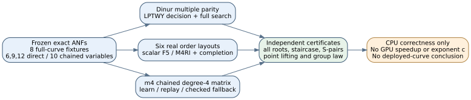
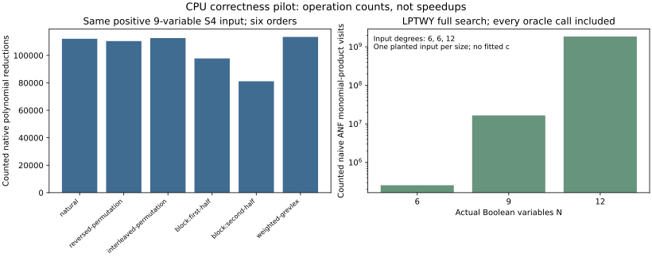

# Boolean solver execution: items 3, 5 and 6

Date: 2026-10-18. Repository base: `0ea8931d21d567f83de47c30bdaac0585f479c11`.
Classification: engineering and exact toy correctness controls. CPU only; `F4_F2_ECHELON=host`, one worker per command. No full IC performance run, calibrated rho comparison, deployment conclusion or solver exponent c is claimed. Raw seconds are shared-host diagnostics.

## Executed result

LPTWY randomized decision passed eight controls and its fully charged decision-to-search reduction passed all six descended systems, including three natural certified negatives. Dinur multiple-parity counting passed six complete vector checks. The existing F5/M4RI engine passed sixteen signature-budget arms. All forty-eight M4RI plus completion order arms passed independent exact ideal certificates. The scalar Python reference and the instrumented scalar native engine each retained twelve 20-second timeouts at the 12-variable S5 cell.

| Arm | Recorded outcomes |
|---|---|
| original_scalar_F5 | {"complete": 44, "timeout": 12} |
| instrumented_native_six_orders | {"verified": 36, "timeout": 12} |
| M4RI_six_orders | {"verified": 48} |
| existing_F5_M4RI_signature_budget_arms | {"gb": 16} |
| Dinur_multiple_parity | {"verified": 6} |
| LPTWY_decision | {"verified": 8} |
| LPTWY_full_search | {"verified": 6} |

The six orders comprise natural grevlex; reversed and interleaved variable permutations under grevlex; two genuine elimination block orders; and positive weighted grevlex. A block is compared before the other block, without an outer total-degree key. Weight and layout records are retained per trial. Every completed order passed full Boolean root-set equality, staircase dimension, reducedness, original-generator normal forms, and all ordinary and Boolean-field S-pairs.

## Frozen inputs and identities

| Fixture | N | ANF degree | Boolean roots | group-verified x tuples |
| --- | ---: | ---: | ---: | ---: |
| direct-n13-m3-ell2-0 | 6 | 6 | 6 | 6 |
| direct-n13-m3-ell2-1 | 6 | 6 | 0 | 0 |
| direct-n13-m3-ell3-0 | 9 | 6 | 6 | 6 |
| direct-n13-m3-ell3-1 | 9 | 6 | 0 | 0 |
| direct-n17-m4-ell3-0 | 12 | 12 | 24 | 24 |
| direct-n17-m4-ell3-1 | 12 | 12 | 0 | 0 |
| chain-n3-m4-ell1-0 | 10 | 3 | 5 | 5 |
| chain-n3-m4-ell1-1 | 10 | 3 | 3 | 3 |

Exact polynomials, targets, field moduli, curve coefficients, seeds and input digests are in `runs/cpu-correctness-r1/inputs.json`. These use the full curve `y^2+xy=x^3+1`, not a prime-order subgroup. Field moduli are 8231 at n=13, 131081 at n=17, and 11 at n=3. The canonical registry was checked: its toy13 alias uses modulus 8219 and a specified subgroup, so its EC1 ID is not reused. Candidate, subgroup and EC1 IDs remain null for these correctness fixtures.

The tiny chained m=4, n=3, ell=1 fixture has repeated points and includes 2-torsion. It exercises a real chained S3 encoding in ten Boolean variables, with input degree three, but cannot establish behavior of nondegenerate deployed-size decomposition systems.

## Polynomial-method applicability

Dinur's primary source, arXiv:2005.04800v2, gives the 0.6943 exponent specifically for quadratic degree d=2. These direct S4/S5 descents have measured ANF degrees six and twelve. Frobenius linearity of powers does not make their products quadratic. The implemented reference follows Algorithm 2 with random mixtures, recursive partial parity counting, downset Mobius interpolation/evaluation, and 48N+1 majority repetitions; it uses Equation (2)'s indicator product of (1+P_j) in the base case. Complete returned parity vectors are checked independently. The affine isolation/search reduction is not part of that implementation.

The primary LPTWY author manuscript's Lemma 3.3, q=2, is implemented in `lptwy_decision.cpp`: independent mixtures for each suffix; complement-polynomial products; independent random suffix weights; ANF construction; Mobius evaluation; and a 40% scoreboard threshold over 100N repetitions. The separately frozen search reduction charges the original decision and every variable-fixing decision, all restrictions and final verification. The pilot uses n0=max(1,floor(N/5)), rather than the asymptotic degree-dependent optimal partition. It is a reference implementation of the method with a declared finite parameter, not evidence for its optimized asymptotic exponent.

No credible c fit can be extracted from three tiny sizes that mix two arities and degrees six/twelve. Counting different polynomial operations as one unit would further hide their costs. The raw native counts are retained separately. Full n<=41 scaling at m*ell approximately n, auxiliaries included, and confidence-bounded c remain open. This pilot does not close the polynomial-method paradigm.

## Six-order and signature controls

M4RI release 20260122 was built in a workspace-local prefix because no installed library was available. Its upstream elimination test passed. Matrix-degree settings are N for the direct systems, and four for the tiny chained fixture. At each fixed input, all six orders generated the same matrix row count and rank; final ideals were independently certified. The scalar completion is unbounded and charged separately. A fixed degree-four matrix followed by scalar completion is not a degree-four solving-degree result. Maximum materialized product degree includes reducer-table products and is an observed allocation/work statistic, not a lower bound on the necessary solving degree.

For the planted nine-variable S4 input, the six scalar-native order arms used reductions ranging from 81143 to 113481; criterion calls, product visits, nnz and zero outputs are separate axes in the raw results. This is not an online IC speedup. Existing F5 was already implemented in the source corpus; this campaign adds adapters and tests, not a claim of inventing or first building F5. Signature-budget arms 0 and 64 preserve exact roots; F5 rows and matrix ranks are retained rather than treating a stage count as a speedup.

## Charged trace replay

The degree-four trace control intentionally uses a smaller fixed row rule: each of nine S3 equations times every monomial of degree at most one. It has 99 rows and 386 possible columns. This differs from the existing M4RI generator's full admissible-product rule; their matrix sizes are not directly comparable.

Learning used 199 row XORs. On the distinct next target, replay diverged at zero-based row 66 after 49 row XORs, then paid 180 for full fallback. Baseline alone paid 180. Learning plus one target paid 428 XORs. Baseline and fallback have identical exact reduced row-space digests. Comparisons and zero rows are retained too. This refutes a saving for this one checked fixed-row replay transfer; it is not a Joux-Vitse symbolic F4 trace implementation or a universal trace-replay impossibility result.

## Remaining acceptance gates

- Item 3 is partial: complete Dinur isolation/search; actual n<=41 descent scaling with all auxiliaries counted; optimized partition parameters; fit uncertainty; and strongest matched baselines remain.
- Item 5 is partial: a genuine bounded F4 solving-degree scan, beyond the fixed-degree matrix plus completion used here, and realistic large cells remain.
- Item 6 is partial: Joux-Vitse symbolic trace learning/transfer, strongest external F4/F5 references, realistic nondegenerate m4 degree-four cells and GPU full IC comparison remain. msolve and Sage were unavailable. No configured GPU host was available.

Canonical graph review: no IC leaderboard, volcano or isogeny-route graph was changed, since this study produced no new candidate, curve transport or verified full DLP. Existing pdp-scaling and candidate-registry sources were checked. The supplied diagram and count graph explain only this correctness campaign.

## Reproduction and sources

The six frozen protocol files declare every arm; exact argv and hashes are recorded in every run's provenance. See `README.md` for executable commands. All failures are retained. Four adapter controls pass in `test_controls.py`. The M4RI source archive digest and upstream test log are retained in `sources/toolchain-build.json` and `sources/build-logs/`.

Primary papers: [Dinur, arXiv:2005.04800v2](https://arxiv.org/abs/2005.04800v2), Algorithms 2/3 and Equation (2); [Lokshtanov et al., SODA 2017 author manuscript](https://people.csail.mit.edu/rrw/polyEqSoda2017Submit.pdf), Lemma 3.3. Download identities and rejected retrievals are in `sources/primary-sources.json`. Existing engines and exact source hashes are pinned in run provenance. Prior fixed-row trace evidence was checked at `crypto-autoresearcher:experiments/EXP-CERTBIN-4e92d7/runs/RUN-CERTBIN-3b7e05/run-report.md`; its n=17,m=2 result is not repeated as a new result here.

