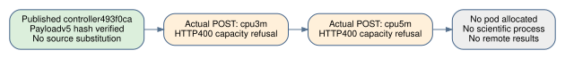

# CPU API-v2: two actual capacity refusals, no scientific trial

Observed 2026-10-18, approximately06:03:31–06:03:35 UTC. The fresh controller
attempt is `resource-runs/cpu-api-v2-01`, bound to published source
`493f0ca1b7183dbd9e42ddcf8c44c650754e3fdb`. Both actual create requests
were refused. No pod ID was returned, no scientific process started and no
remote result was produced. This is neither a256GB host measurement nor a
mathematical negative.

The API-v2 controller requested two catalog CPU types in its frozen order:

| Request | Catalog metadata | Actual provider response |
|---|---|---|
| `cpu3m`,32vCPU | derived256GB; availability HIGH; quote$1.76/hour | HTTP400: no longer any instances available with requested specifications |
| `cpu5m`,32vCPU | derived256GB; availability LOW; quote$2.08/hour | HTTP400: same explicit capacity refusal |

Catalog availability and derived RAM are request metadata, not observations
of an allocated machine. The refusal scope is these two requests at this
time; it does not establish general unavailability or impossibility of the
research. The controller's stderr ends with the explicit stop: both exact
CPU-flavor requests refused, no capacity conclusion beyond these requests.

Raw source-linked records are retained unchanged:

- [First request/refusal](resource-runs/cpu-api-v2-01/allocation-1-cpu3m/refusal.json)
  and [second refusal](resource-runs/cpu-api-v2-01/allocation-2-cpu5m/refusal.json),
  with adjacent redacted request bodies.
- [Catalog](resource-runs/cpu-api-v2-01/selected-catalog.json),
  [ownership intent](resource-runs/cpu-api-v2-01/ownership-intent.json),
  [controller outcome](resource-runs/cpu-api-v2-01/resource-outcome.json),
  [controller stderr](cpu-api-v2-01-controller.stderr).
- [Public-source proof](resource-runs/cpu-api-v2-01/public-source-proof.json):
  an unauthenticated fetch verified1,626,771bytes against unchanged payloadv5
  SHA256 `e269ad82ff1ff7724d88ccd34adf3752f642f9895f2dd015889315245fbfcfd4`.
  Publication/provenance does not imply a remote scientific launch.

The original controller outcome correctly records `pod_id:null` and
`results_fetched:false`. Its `absence_verified:false` and `deleted:false`
are retained as written; there was no allocated pod ID to delete.

The separate [root closeout](resource-runs/cpu-api-v2-01/root-no-allocation-closeout.json) records an independent complete API-v2 inventory (one page), zero exact-request matches and zero active campaign resources. No provider DELETE was required because no resource was allocated. Root verified the exact local watchdog process identity/owner, stopped only that watchdog with SIGTERM and recorded it stopped. The original controller outcome remains unchanged.

Operational note: the frozen intent watchdog could otherwise keep polling an empty inventory every2seconds until its deadline. The explicit no-allocation closeout avoids those unnecessary local polls; no controller or scientific source was changed.

This attempt supplied no new closure output, solving degree, GPU control,
throughput, relation yield or challenge progress. The original run1 control,
additive local ingestion qualification and censored memory-frontier evidence
remain unchanged. GPU-v3's failed device host remains separately recorded.
The prior four-page PDF is preserved as
[gpu-v3-report.pdf](reports/gpu-v3-report.pdf), SHA256
`fb389bfbcf60bc1fba1e8b6f680ac78a932779a8c0cf929408531a684fa21417`.
The current [five-page PDF](reports/report.pdf) includes this refusal record; [cpu-api-v2-summary.json](reports/cpu-api-v2-summary.json) and the report receipt bind the raw refusal and closeout files.
