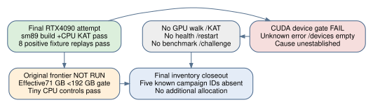

# Final allocated GPU attempt: build passed, device initialization failed

Observed 2026-10-18,06:22:18–06:24:10 UTC. This fifth and last allocated
campaign pod is a separate attempt under `resource-runs/gpu-final-01`,
source commit `390898259771f708e431a49f356dcf2a296f82aa`. Its nested raw
basename `remote/run-gpu-v3` is reused by the launcher; the full resource-run
path distinguishes it from the earlier RTX5090 attempt. No additional
allocation follows this bounded continuation.

The [resource outcome](resource-runs/gpu-final-01/resource-outcome.json)
records all evidence fetched, exact allocated pod deleted and absence verified.
The [final independent inventory](resource-runs/gpu-final-01/root-final-inventory.json)
records one complete API-v2 inventory page, all five known allocated campaign
IDs absent, zero campaign-prefix resources and a separate404 for the latest
exact ID. The local detached watchdog is stateZ (stopped, not running), not
claimed absent from the process table. Unrelated provider resources were not
altered or inventoried in the public receipt.

The [archive](resource-runs/gpu-final-01/evidence.tar.gz) is27,318bytes,
SHA256 `d74c3fab830939e3ecfc18c03925b37d9dc5d1d30a893bacc68302eaf637d4de`.
The separate [reporting audit](diagnostics/gpu-final-audit/receipt.json)
verifies all120 manifest-listed payload files in retained and freshly
extracted trees, with exact coverage;121 archived files include the manifest.
Earlier independent agent/root checks are also retained. Raw evidence is
unchanged.

| Stage | Actual outcome |
|---|---|
| Allocation | RTX4090; catalog quote$0.34/hour; provider36vCPU, effective/cgroup71GB |
| Pinned CUDA13.3.73 client build | exit0; architecture `compute_89`/`sm_89` |
| Host KAT/test bundle |48/48 KAT,2862 sigma,28645 CLMUL and28642 portable checks passed |
| Remote native v2 positive fixture |8records/8positive golden-model replays passed; zero zero-length records |
| Device initialization | exit3, CUDA `unknown error`, driver13000/runtime13030, `devices:[]` |
| Native GPU KAT/checker, GPU walk and GPU-report ingestion | Not run |
| Health, checkpoint restart, throughput benchmarks, challenge | Not run |
| Tiny CPU frontier controls | SAT/UNSAT passed |
| Original large frontier | gate78; not executed; effective70,999,998,464bytes below192,000,000,000-byte minimum |
| Negation diagnostics | baseline collision flag at42,678steps; all three quotient arms censored at2,208,379steps |

`nvidia-smi` reports driver580.126.09 and **GPU Recovery Action: Reboot**.
The actual cause of CUDA initialization failure remains **unknown**. The
recovery field alone does not prove a physical hardware fault, nor do these
records establish a general compiler/runtime incompatibility. Compilation
and CPU fixtures are not GPU arithmetic coverage. The controller outcome's
workflow-started flag does not imply that the gated GPU walk ran.

Physical host RAM was540,788,072,448bytes; effective cgroup RAM was
70,999,998,464bytes. The large original n19/m3/ell7,draw0,degree5 cell did not
run after the192GB memory gate. It supplies no new closure measurement or D.
Run1's earlier80GB-cap allocation failure remains the sole large-frontier
attempt in this record. No CPU/GPU F4 acceleration is inferred.

The [current six-page PDF](reports/report.pdf) retains all preceding findings
and adds this attempt. The previous five-page PDF remains
[CPU-api-v2-report.pdf](reports/CPU-api-v2-report.pdf), SHA256
`70b17e44201e6dff213e5e9b41776825966c5cce6a5cd9f1c6971408d07bfac8`.
The earlier three/four-page versions remain preserved too.

This is an observed device-initialization failure with completed cleanup,
not a new successful GPU computation, mathematical negative or finished
challenge. Run1's short DP46 control, original ingestion refusal and separate
local v2 qualification remain scoped exactly as recorded. Production rates,
forecasts, IC leaderboard and scientific statuses are unchanged. A compatible
device passing doctor/KAT/control/restart and a host satisfying the original
large-frontier resource/closure requirements remain needed to execute the
missing scientific gates. Closing this bounded resource attempt does not
discharge those obligations.
