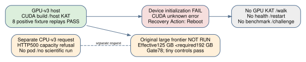

# Split GPU-v3: build succeeded; device failed; no new GPU arithmetic run

Observed 2026-10-18,05:41:00–05:41:52 UTC. This is a separate failed-host
attempt. It does not change the qualified [run1 control and local checker
results](RUN1_RESULTS.md). Delivery source:
`3e36dca3b10a69f013e97c965f4cec7ed1c1f523`.

The recovered [archive](remote-gpu-v3.evidence.tar.gz) is27,213bytes,
SHA256 `15516ac73ae3b4e7874bb03b2dbb5c1eedafebbc50382ec7ccd8ca8f582b967d`.
The independent [audit](diagnostics/gpu-v3-audit/receipt.json) verifies its
authenticated terminal/controller hash and all120 manifest-listed payload
files in retained and freshly extracted trees. There are121 archived files
including the manifest itself. [Raw evidence](remote/run-gpu-v3/) is unchanged.

| Stage | Actual outcome |
|---|---|
| CUDA fetch/build | exit0, pinned CUDA13.3.73 |
| Host test bundle | exit0;2862 sigma checks including48/48 KAT,28642 CLMUL and28642 portable controls |
| Local native v2 positive fixture on remote host | exit0;8 records,8 positive golden replays, no zeros |
| Native device doctor | exit3: CUDA `unknown error`, driver13000/runtime13030, `devices:[]` |
| Native GPU KAT/checker, GPU walk and GPU-report v2 ingestion | Not run after device failure |
| Health/restart/benchmarks/challenge | Not run |
| Four negation diagnostic arms | commands exit0; three quotient arms remain censored, baseline collision flag only |
| Large original frontier | gate exit78; not executed; tiny SAT/UNSAT controls passed |

`nvidia-smi` identified RTX5090, driver580.173.02, and
**GPU Recovery Action: Reboot**. The observation is a failed CUDA device
initialization with that provider-reported recovery flag. It does not prove
a general compiler/runtime incompatibility or invalidate run1's successful
control on a different host/driver. No host reboot or provider mutation was
performed by the reporting workstream. The controller fetched all evidence,
deleted the pod and verified absence; the independent watchdog also recorded
absence. See [resource outcome](resource-outcome-gpu-v3.json).

The revised frontier gate required192,000,000,000 effective RAM bytes.
Physical host RAM was405,163,536,384bytes, but the cgroup/effective limit was
124,999,999,488bytes. That limit failed the gate. Tiny controls ran before
the gate; the original n19/m3/ell7,draw0,degree5 large cell did not run in
this attempt. It supplies neither a new memory-frontier measurement nor D.
Run1's earlier allocation failure remains retained separately.

The paired CPU-v3 controller received an actual HTTP500 capacity refusal
while requesting256GB, with `pod_id:null`: **no CPU pod was allocated and
no scientific CPU run started**. This is recorded in
[resource-outcome-cpu-v3.json](resource-outcome-cpu-v3.json) and the controller
stdout/stderr. A no-allocation refusal is not a timeout, zero-yield trial,
failed mathematical search or security result.

The current [four-page PDF](reports/report.pdf) adds this attempt; the prior
three-page report is preserved as [run1-report.pdf](reports/run1-report.pdf).
[continuation-summary.json](reports/continuation-summary.json) links both
attempt summaries. Neither the historical campaign throughput/forecasts nor
any IC leaderboard or scientific status is changed. Missing device health,
whole-pipeline control/restart, benchmark/challenge and original large-frontier
completion remain concrete execution obligations.
