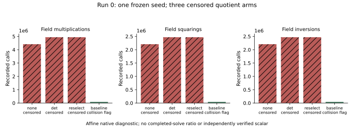

# Run 0: recovered packaging failure and censored negation diagnostics

Observed 2026-10-18, 05:00:52–05:00:54 UTC. This is a failed infrastructure
attempt with four native diagnostic commands, not a GPU benchmark or a
completed ECDLP experiment. The independently retrieved archive is
`remote-run-0.evidence.tar.gz`, **15,160 bytes**, SHA256
`26d26efe1f6e8d9917c3256720065315dd37ee3c31ce909131139207938af217`.
All files are retained under `remote/run-0/`; authenticated terminal status
is `http-job-status-run-0.json`.

The pod's native hardware receipt identifies RTX5090, driver580.65.06,
CUDA13.0 and AMD EPYC7663. Host memory is limited by a124,999,999,488-byte
cgroup; the exposed CPU quota is2,380,000/100,000. These establish the
instance context, not CUDA13.3 correctness, host isolation or throughput.

All **39** pinned ECC source hashes passed. The launch manifest then
failed because the delivered packet omitted `PROTOCOL.md` and
`frontier-binding.md`. The frontier script also lacked executable mode.
Recorded exits: hardware1, ECC3, negation0, frontier3. Consequently there
is **no ECC GPU execution, challenge slice, checkpoint or frontier solve**
in this attempt. Root retains the original packet and made a separate,
additive corrected delivery; the original failure remains charged.

The four original native affine prime-field diagnostic commands all
returned0, but their scientific outcomes differ:

| Arm | Steps | Multiplications | Squarings | Inversions | DP | Censored | Collision |
|---|---:|---:|---:|---:|---:|---|---|
| none | 2,208,379 | 4,416,758 | 2,208,379 | 2,208,379 | 0 | yes | no |
| deterministic break | 2,208,379 | 4,940,428 | 2,470,214 | 2,470,214 | 1 | yes | no |
| branch reselect | 2,208,379 | 4,940,428 | 2,470,214 | 2,470,214 | 1 | yes | no |
| baseline | 42,678 | 85,356 | 42,678 | 42,678 | 10 | no | yes |

The common frozen L32 curve and seed1/r20/dpbits12 inputs are in
`source/negation-curves.json` and the per-arm `.command` files. The original
implementation's affine/Jacobian deviation remains explicit. All three
quotient arms hit their step budget and are **censored**; their operation
counts cannot be compared as completed-solve costs. A baseline collision
flag is not an independently replayed discrete-log scalar. No M-equivalent
conversion, gain estimate, confidence interval or full negation-contract
conclusion is admitted.

The plot reads each original native counter directly. It preserves
censoring and keeps multiplication/squaring/inversion units separate.

All original scientific criteria remain open after run0. A fresh run1 on
the same pod is a separate attempt; this report makes no statement about
its outcome. Existing IC leaderboard/campaign rate figures remain
unchanged because run0 supplies no verified new GPU or complete ECDLP cost.
