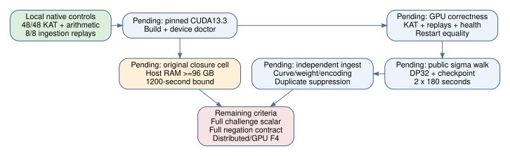
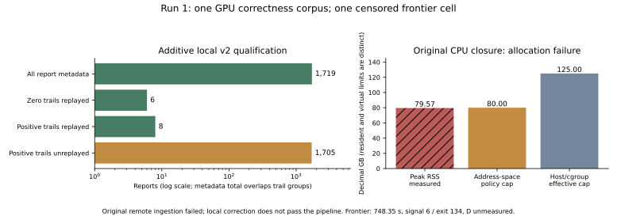

# Run 1: GPU control passed; ingestion stopped continuation; memory frontier censored

Measured 2026-10-18, 05:05:38–05:19:54 UTC. The pinned CUDA13.3.73 client
built and executed on an RTX5090, but the original whole pipeline returned1.
It stopped at an overstrict ingestion predicate. The CPU memory-frontier
attempt also terminated without a degree measurement. No challenge slice,
completed benchmark, scalar recovery, solving-degree result or attack gain
is claimed.

The original evidence archive is
[`remote-run-1.evidence.tar.gz`](remote-run-1.evidence.tar.gz),139,739bytes,
SHA256 `c7ddcdbd1a88c72e28c25177ddbce7fe0531e55dab12260ccc2cec9126890096`.
The independent [archive audit](diagnostics/run1-audit/receipt.json) checks the
authenticated terminal hash and all147 manifest-listed files, both in the
retained tree and a fresh extraction. Raw records remain unchanged under
[`remote/run-1/`](remote/run-1/). The published delivery source was
`9bb0c292b3b1d6b0fafe9c33f73a2145d3dc4830`; pinned ECC source remains
`0ea8931d21d567f83de47c30bdaac0585f479c11` (39 hashed files).

The resource controller records the dedicated pod as deleted with absence
verified in [`resource-outcome-run-1.json`](resource-outcome-run-1.json).
This report makes no statement about later separately named allocation attempts.

## Actual gates and missing stages

| Stage | Recorded outcome |
|---|---|
| Source/launch hashes and CUDA13.3.73 build | Passed |
| Device doctor | Passed on RTX5090, driver580.65.06; driver API13000, runtime13030 |
| Remote host test bundle | 2862 sigma checks including48/48 public KAT;28641 native-CLMUL and28638 portable controls |
| Native sigma checker | 2697 checks and48/48 known answers passed |
| GPU correctness control | 3,145,728 iterations;1719DP;3 native golden-model replays;0bad reports;0dropped |
| Original independent ingestion v1 | Failed: `invalid trail length`, exit1 |
| Health, checkpoint restart equality, three benchmarks | Not run after ingestion failure |
| Two180-second DP32 challenge periods and final ingestion | Not run |
| Original CPU closure frontier | Ran; allocation failure, signal6/actual exit134; degree unmeasured |

The GPU control uses DPweight46, run53180,256threads,16slots,96steps and
eight launches. It is a short correctness workload, distinct from campaign
DPweight32 and the quarantined prospective challenge run53181. Its native
0.213-second interval/14,744,428iterations-per-second field remains a raw
control diagnostic. It is not a repeated campaign benchmark and does not
replace historical throughput, rho reference or completion forecasts.

Public P/Q, normal-basis representation, subgroup and sigma-walk semantics
are bound by `source/tree/ecc2k130/src/hostcheck.h` and the pinned snapshot.
The polynomial-basis alias `EC1N131Ckb1h136f03e58c98` is not reused for this
different representation. No shared campaign records were uploaded or seed
namespace lease established.

## Additive local correction: valid zero-length reports

The retained corpus contains six native-valid zero-length trails. A start
point can already satisfy DPweight46; the pinned native reference checks
iteration0. The original v1 ingester required a positive length and refused
the corpus. That original failure remains the remote pipeline outcome.

The independently frozen [local qualification](diagnostics/ingestion-zero/README.md)
and [protocol](diagnostics/ingestion-zero/protocol.json) introduce v2 without
altering v1, source packet or original run. Local native v2 checked all1719
paired reports for public-curve membership, weight, canonical coordinates,
seed namespace and DP32/DP64 encoding. It independently replayed all6zero
trails and8eligible positive trails;1705positive trails remain unreplayed.
The [actual receipt](diagnostics/ingestion-zero/actual.stdout) reports14total
golden-model replays. Zero replays are unconditional and do not consume the
positive replay budget. Seed-tampered zero and coordinate-tampered positive
controls were rejected; retained original/source hashes remain bound.

This establishes a corrected local checker on retained control data. It does
not retroactively pass the original remote pipeline or execute the missing
health/restart/benchmark/challenge stages.

## Original high-memory closure: actual allocation failure

The original committed `m3-19-7.jsonl`,draw0, is used with40Boolean variables,
degree5,max-columns800000 and the pinned native `dreg_closure` binary. Its
input SHA256 is
`a6bf7f1545cb5d91fffb41fa455c065b6fd0d547dce85aed2c5cdd5483c91532`.
The tiny SAT control retained12solutions without a refutation through4;
the UNSAT control refuted at4. Both validation receipts passed.

Effective host memory was124,999,999,488bytes, exceeding the frozen96GB
gate. The process address-space limit was80,000,000,000bytes. After748.35s
wall,700.06s user and49.23s system CPU, allocation of3320bytes failed.
Peak RSS was77,709,264KiB (79,574,286,336bytes). No frontier JSON result
was emitted. D remains **unmeasured**; neither a degree lower bound nor
security conclusion follows from this incomplete scan.

The raw GNU-time receipt prints both `Command terminated by signal 6` and a
JSON `exit_status:0` derived from its `%x` field. The separate process exit
file is134 and the terminal/whole-launch receipts also record134. `%x`
alone does not encode the signal termination and is not a successful-exit
certificate here. Both conflicting fields are preserved; actual signal6 /
exit134 governs the failed outcome.

This was CPU XL/MutantXL closure on a GPU host. It was not distributed F4,
an out-of-core solver, GPU elimination or an F4 solving-degree measurement.
It had no inner closure checkpoint. The next original frontier result needs
an implementation that completes the same closure with a valid resource
boundary, preserving this failed attempt; a smaller substitute cannot close
that obligation.

## Negation diagnostics and visual record

Run1 repeated the four frozen L32/seed1/r20/dpbits12 native diagnostic arms.
The step/operation/DP/censoring/collision counters match
[run0](RUN0_RESULTS.md); only deterministic-break peak-RSS differs. All
three quotient arms remain censored and the baseline has a collision flag
without an independently replayed recovered scalar. The existing
H-RHO-bc6ea6 / EXP-RHO-60da4f affine/Jacobian deviation, prior trials and
full-contract limitations remain explicit. No completed-solve ratio is inferred.

The [current PDF](reports/report.pdf) includes run0, run1, the additive local
checker qualification and remaining criteria. Data/source for the new plot
are [run1-summary.json](reports/run1-summary.json) and
[plot_run1.py](reports/plot_run1.py). Counts describe one retained control
corpus and one failed frontier attempt, without a sampling interval or
performance comparison.

Checked canonical campaign sources:
`papers/ecdlp-constant/sec-ecc2k-campaign.tex` and
`papers/ecdlp-constant/sec-ecc2k-gpu.tex`. Their production-rate figures remain
historical: a short DP46 correctness control and censored closure attempt
do not supersede them. No IC leaderboard, curve/isogeny edge, attack-cost or
scientific state transition is promoted by this record.
