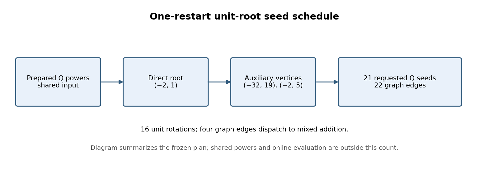
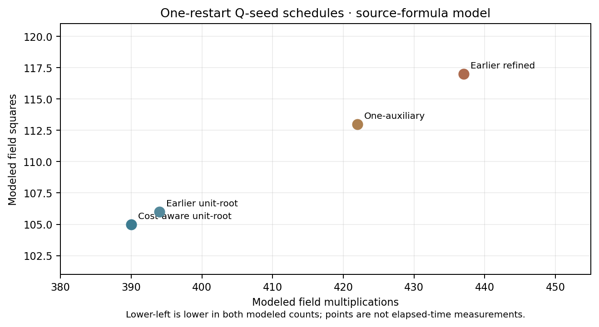

# Cost-aware Eisenstein Q-seed schedule

**Question.** Can a bounded search choose a lower source-formula cost graph for the 21 Q seeds used by one restart, while preserving the existing scalar recoding and exact native outputs?

**Instance.** The study uses the existing secp256k1 Eisenstein coefficient graph and frozen one-restart input in [JOINT_SEED_GRAPH.md](../prime-j0-eisenstein-residue-20261015/JOINT_SEED_GRAPH.md). It changes the schedule for constructing requested Q points. It does not change the curve, scalar recoding, target seed set, or online restart evaluation.

{width=6.2in}

**Selected plan.** The [cost-aware one-restart plan](cost-aware-one-plan-1.json) starts from unit root `(-2,1)`, reached by one unit rotation of the prepared Q power. It uses auxiliary vertices `(-32,19)` and `(-2,5)` to connect 21 requested seeds through 22 graph edges. The [search receipt](cost-aware-one-receipt.json) records the source plan and output plan hashes, 10,692 second-link candidates, 372 complete graphs evaluated, source-formula boundary, and ten exact output replays. The bounded search ranks its enumerated candidates; it does not prove a global addition-chain optimum.

\newpage

**Modeled operation counts.** The selected plan has 390 field multiplications and 105 squares, compared with 394/106 for the earlier unit-root plan, 422/113 for the one-auxiliary plan, and 437/117 for the earlier refined plan. These counts use the pinned source-formula model. They include graph construction and batch normalization, including direct-root calls, while excluding shared binary-power preparation, its inversion, recoding, plan loading, Q parsing, search, and restart evaluation. The [editable count plot](q-seed-report-figures/q-seed-cost-model.svg) shows both modeled quantities and makes no wall-time inference.

{width=5.0in}

**Native replay and proof boundary.** The existing replay receipt records ten verified exact outputs from both `graph-planned` and `fused-graph-planned` evaluators: the frozen Q plus four independently constructed alternate Q values. Its binary and fixture hashes are preserved in the receipt. The [Lean graph proof](../prime-j0-eisenstein-residue-20261015/JointSeedGraph.lean) proves coefficient-to-point implications under its stated additive and unit-action hypotheses. Native finite replays check these outputs only; they do not prove all-input refinement of the concrete secp256k1 group implementation.

**Unmeasured performance gate.** There is no qualified paired Tier 1 wall-time panel for this final schedule. Operation counts, planner receipts, and local exact-output replays do not establish lower elapsed time. The next performance measurement must pair the frozen graph orders on the same Q and scalar stream, with calibration, noise, and correctness gates; no latency or throughput gain is claimed here.

The [study record](README.md) links the plans, search receipts, and local replay artifacts. The editable figure source, SVG and 180-dpi PNG files, and this report's [PDF](Q_SEED_SCHEDULING_REPORT_2026-10-19.pdf) accompany the result.
