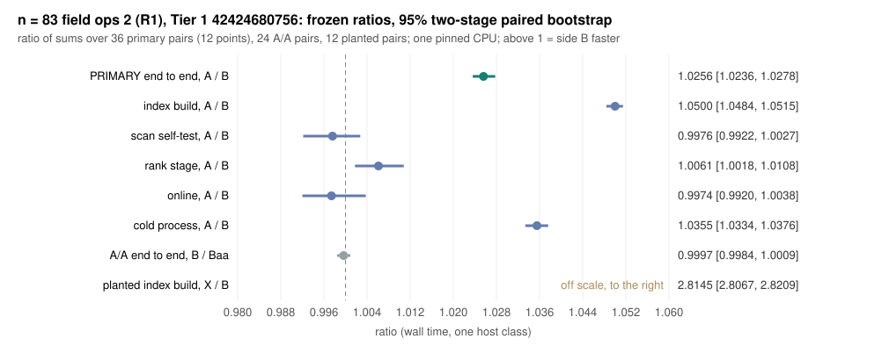

# n = 83: field operations 2, a constant reduce shift (R1) (Tier 1 design)

**Status (2026-11-08): result in. Verdict: improvement; every gate passes and
the run is valid** `[pcc:unverified]`. R = E2E(A) / E2E(B) = **1.0256
[1.0236, 1.0278]** over 36 alternating pairs, run
[42424680756](https://github.com/isogeny-labs/cryptanalysis/actions/runs/42424680756),
Tier 1, instance scope. The design sections below are the frozen text,
unchanged; they were frozen before any timing on the Tier 1 runner. Every
figure from the shared cloud-agent VM is a local diagnostic: it sized the design
and is not evidence. The result section is added with the archived receipt.

## Why this run

The n = 83 a = 1 baseline row is the **field-ops producer**
(`koblitz-n83-fieldops-20261104`, on main, PR #1400, run 41869146827, frozen
`fieldops_source_sha256` `8dc428ea...`). In that run its end-to-end cold cost
was **4.096x** the matched rT770 rho in the same run (point estimate)
`[pcc:unverified]`. That gap is the distance remaining. Its field products are
inlined carry-less products, `fast_field::mul` and `fast_field::sqr`, which take
the field degree `n`, the mask `2^n - 1` and the tail as run-time arguments.
After inlining, the two folds of the reduction still shift by `n`, a value read
from the `Gf2_128` struct. At n = 83 that value is known, so R1 passes it as a
constant.

## 1. The change and its proof

Side B's producer is derived from side A's by `make_fieldops2_source.py`:
five counted, exact edits, each of which must match exactly once, and
`check_inverse()` undoes them back to side A's bytes (`8dc428ea...`). The
edits are:

- **R1, `fmul` and `fsqr`.** At the head of each, `if gf.n == 83 { return
  unsafe { fast_field::mul(83, (1u128 << 83) - 1, (gf.irr ^ (1u128 << 83)) as
  u64, a, b) }; }` (and `fast_field::sqr` for the square). When `gf.n == 83`,
  `gf.mask` is `2^83 - 1` by the definition of the mask, so the call has the
  same arguments the parent's line passes; only `n` and the mask are
  compile-time constants, so the shifts of the reduction become immediates.
  For every other field the parent's line runs unchanged. A reduced field
  element is unique, so every product and square is the parent's, and through
  it the library's.
- a header comment, the summary's `field_ops_pipeline` (the parent's name plus
  `+n83_const_reduce_shift`, so a row says which producer ran), and an
  appended test module.

`fast_field::check` runs before any use and fails closed. It compares `fmul`
and `fsqr`, now the specialised path at n = 83, with the library's `gf.mul` and
`gf.sqr` on edge cases and 65,536 pseudo-random pairs. The appended module
`fieldops2_tests` (run by the workflow's `cargo test --bins`) checks the
specialised product against the library and against the general path on all
2^20 pairs of a 1,024-element sample, the specialised square on 2^18
elements, and that the field is n = 83 with mask `2^83 - 1`.

The `proto_r12` candidate (R2), which also touched the linear run finder, was
rejected before this design and is not part of it.

## 2. Local ranking (diagnostic)

`profile/run_local_profile.py`: alternating fresh processes of side A and side
B on one pinned CPU of the shared VM, the M38 base and the first panel point;
4 cold rounds and 3 rank rounds (record
`benchmarks/records/20261107T2050Z-n83-fieldops2-local.json`, report
`profile/local_profile.pdf`). Every index, layout, relation, probe and
root-call digest of A and B was identical `[pcc:unverified]`.

| stage | side A (ms) | side B (ms) | B/A |
| --- | ---: | ---: | ---: |
| index build | 4,240 | 4,067 | 0.959 |
| scan self-test | 1,171 | 1,248 | 1.066 |
| online | 861 | 820 | 0.952 |
| rank stage | 3,531 | 3,474 | 0.984 |

The scan self-test runs no field products, so its 1.066 is noise on this VM;
it is kept as measured in the power model, which makes the model conservative
by that much. An earlier local diagnostic of the same prototype saw the index
build 5.3% and the rank stage 3.1% shorter `[pcc:unverified]`. R1 is a small lever (a few
percent), so this run is sized to separate about 2% from none.

## 3. Not in scope

The index keys' linear run finder, the root table's layout, the probe loops,
the rank-stage algorithm, the factor base and the self-test's predicate are
unchanged.

## 4. Frozen design

The design, pairing, bootstrap, A/A control, Tier 1 records and fail-closed
verifier are the parent's (`protocol.json`, `verify_receipt.py`):

- **Panel:** 12 new held-out points (`inputs/cold_targets.json`, role
  `fieldops2-cold-v1`, disjoint from every earlier n = 83 panel:
  `inputs/panel_disjointness.json`).
- **Pairs per point:** three alternating primary pairs, two A/A pairs, one
  planted pair and one tuned-rho process.
- **Rank seeds:** 2201-2236, new on n = 83 (`inputs/seed_disjointness.json`).
- **Primary:** R = sum E2E(A) / sum E2E(B) over the 36 primary pairs, with
  E2E = rank stage + cold.
- **Decision:** improvement iff the 95% two-stage paired bootstrap lower bound
  of R exceeds 1 `[pcc:unverified]`.

Arms:

- **Side A** (the row, `online/`, +pclmulqdq): kM38FO + cM38FO, binary
  `ic_online_fieldops_r770`.
- **Side B** (`online-b/`, +pclmulqdq): kM38R1 + cM38R1, binary
  `ic_online_fieldops2_r770`.
- **A/A:** B against kM38R1aa + cM38R1aa.
- **Planted:** cold pairs cM38R1 / cM38R1X. cM38R1X uses
  `KIC_INDEX_CANON=lift_plant`, so every index key is also checked against
  lift_scan; its layout digests are unchanged and its index build is slower.
- **Q0:** run on K600, M10 and M38 by both producers.

The gates are the parent's. The `field_ops_pipeline` gate now has a pipeline
on both sides: the parent's on every side-A row, and the parent's plus
`+n83_const_reduce_shift` on every side-B row.

## 5. Power and runtime

`power_check.py` (`analysis/power.json`) uses the parent's run as the prior and
the four local stage factors as the modelled cell:

| quantity | value |
| --- | --- |
| expected R at the prior means (modelled) | 1.021 |
| power at a 1.02 effect | 1.00 |
| power at a 1.01 effect | 0.87 |
| type I error at 1.00 | 0.01 |
| A/A point estimates inside [0.97, 1.03] | every time |
| planted control detected | every time |
| modelled schedule | about 42 min |
| modelled job | about 61 min |

## Trigger

`.github/workflows/n83-fieldops2.yml`, on a push to `claude/n83-fieldops2`
restricted by path filters, as the parent's (`workflow_dispatch` is refused for
this integration). It clones crypto 770f6a69 from the public
`isogeny-labs/crypto`.

## Result

Run [42424680756](https://github.com/isogeny-labs/cryptanalysis/actions/runs/42424680756)
(workflow `n83-fieldops2.yml`, push trigger, frozen commit `4734da12`, attempt
1, conclusion success) on one GitHub-hosted `ubuntu-24.04` runner
(`GitHub Actions 1000197558`, image 20261101.360.1, AMD EPYC 9V74, execution
CPU 0). The job ran 23:19 to 00:18 UTC (59 min); the schedule took 42 min
against the 165-minute guard. The receipt is archived in
[`run_github_42424680756/`](run_github_42424680756/) (the 1.5 MB run log in the
artifact store, `panel/.artifacts.json`).

**Verdict: improvement** `[pcc:unverified]`. R = sum E2E(A) / sum E2E(B) =
**1.0256 [1.0236, 1.0278]** over 36 alternating pairs (12 points x 3 pairs;
two-stage paired bootstrap, 10,000 draws). All 282 scheduled rows ran and are
valid, none was skipped by the time guard, and every gate passes:

- one index and layout digest set per base (K600, M10, M38), each equal to the
  frozen one, and the Q0 identities equal to the archived ones;
- identical relation digests, probe vectors, root calls and counters per rank
  seed across kM38FO, kM38R1 and kM38R1aa, and rank tables equal to the frozen
  verified tables `[pcc:unverified]`;
- every IC row's `rank_probe_pipeline` and `field_ops_pipeline` equal to its
  arm's (the parent's pipeline on side A, plus `+n83_const_reduce_shift` on
  side B); runner identity, binaries, CPU record and pinning unchanged;
- one scalar per point across every IC and rho process, replayed in the pinned
  oracle.

`verify_receipt.py` re-run on a copy of the whole receipt directory reproduces
`panel/result.json` and `panel/result_table.md` byte for byte. The crate tests
passed on the runner: `online` 38 + 4, `online-b` 41 (`fieldops2_tests` 3).

### Primary, controls and stages (frozen rule)

| stage | side A mean (ms) | side B mean (ms) | A / B [95%] |
| --- | ---: | ---: | --- |
| index build (cold process) | 4,339 | 4,132 | 1.0500 [1.0484, 1.0515] |
| scan self-test | 886 | 889 | 0.9976 [0.9922, 1.0027] |
| rank stage (rank process) | 2,933 | 2,915 | 1.0061 [1.0018, 1.0108] |
| online, one target | 405 | 406 | 0.9974 [0.9920, 1.0038] |
| cold process | 5,932 | 5,728 | 1.0355 [1.0334, 1.0376] |
| end to end (rank + cold) | 8,864 | 8,643 | 1.0256 [1.0236, 1.0278] |

- A/A: B / Baa end to end 0.9997 [0.9984, 1.0009], cold 1.0002 [0.9991, 1.0014],
  both inside [0.97, 1.03].
- Planted: cM38R1X / cM38R1 index build 2.8145 [2.8067, 2.8209], lower bound
  above 1; the planted processes kept the frozen layout digests.
- Probe law: kM38FO and kM38R1 both 0.9530 of the law over 576 attempts, inside
  the frozen band [0.80, 1.20].
- Order: A first 1.0268, B first 1.0248; every point's ratio lies in
  [1.0212, 1.0318].
- Peak RSS and cold minor faults are unchanged (A / B 1.0000 and 0.9999); the
  process CPU time moves like the wall time (1.0257 [1.0243, 1.0274]).

R1 moved the index build (1.050x) and with it the cold process (1.036x) and the
end-to-end cost (1.026x) `[pcc:unverified]`. The self-test and the online stage
did not move (their intervals contain 1), and the rank stage moved by 0.6%
(1.0061 [1.0018, 1.0108]). The local model had the stages differently (index
build 1.042, rank stage 1.016, online 1.051, and a noise value of 0.938 for the
self-test) and its end-to-end figure of 1.021 was close to the measured 1.0256;
the agreement is partly compensation, so the local stage factors are not a
guide to where the saving lands on this host `[pcc:unverified]`.

### Distance to rho

In this run's own matched rT770 rho (12 processes, mean cold 2,730 ms, step
245.81 ns), the end-to-end cold gap is **3.246 for side A and 3.165 for side
B** (point estimates); S end to end cold is 0.3895 for A and 0.3798 for B in
rT770 steps `[pcc:unverified]`. Side A is the field-ops row as landed; it read
4.096 in its own run (run 41869146827, rT770 step 247.22 ns, rho mean cold
2,192 ms), where its end-to-end mean was 8,976 ms against 8,864 ms here. The
two runs' rT770 steps agree to 0.6%, but the matched rho's mean cold time is a
mean of 12 processes whose step counts are random, and it differs by 25%
between the runs, so the in-run gap carries that noise and moves between runs
by more than the paired ratio does. Only the paired ratio within one run is a
delta (1.0256 [1.0236, 1.0278]); no interval is computed for the gaps
`[pcc:unverified]`.

### Limits of this result

- Wall time on one GitHub-hosted runner, one pinned CPU, Tier 1 instance
  scope, no host-wide exclusivity; not replayed on another host class.
- The saving is 2.6% end to end, and the local stage factors did not predict
  its stage split, so another host class may move it differently.
- The gap to rho depends on the host class and on the 12 rho processes (above);
  the paired ratio is the result.
- Factor-base construction is charged to neither arm, as in every n = 83 row,
  so the cold S is a lower bound.
- The section 5a GAE band is not computable from this run (wall time only).

## Files

- **Derivation:** `make_fieldops2_source.py` (side B), plus the parents' chain
  (`make_fieldops_source.py` and earlier, verbatim).
- **Crates:** `online/` (side A and the tuned rho) and `online-b/` (side B),
  each with `.cargo/config.toml`.
- **Experiment scripts:** `restore.py`, `make_targets.py`,
  `check_panel_disjoint.py`, `check_seed_disjoint.py`, `make_power_prior.py`,
  `power_check.py`, `make_protocol.py`, `make_schedule.py`, `run_schedule.py`,
  `arm.py`, `verify_receipt.py`, `test_verify_receipt.py` and
  `make_report_pdf.py` (the report renderer).
- **Local diagnostics:** `profile/run_local_profile.py`, `profile/raw/`,
  `inputs/local_profile.json`, `inputs/local_exactness.json` and `smoke/`.
- **Receipt:** `run_github_42424680756/`; figure `figures/result.svg` and
  `.png` from `figures/make_result_figure.py`; this report as `README.pdf`.
