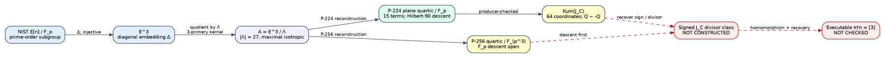

# NIST genus-3 `(3,3,3)` transfer assessment

Date: 2026-11-19
Status: `PARTIAL — P-224 KUMMER MAP PRODUCER-CHECKED; P-256 F_(p^3) QUARTIC CONSTRUCTED; SIGNED MAP/DESCENTS OPEN` [pcc:unverified]
Evidence scope: public curve structure and cost assessment; no discrete-logarithm solving

## Result

The previously suspected NIST signal is now explicit and reproducible.

- P-224 has full scalar Frobenius `-I` on `E[3]`; its 3-division polynomial
  splits into four linear factors over `F_p`. All 1,120 Lagrangians of
  `E[3]^3` are Frobenius-stable and 768 are transverse to each of the three
  coordinate elliptic factors.
- P-256 has Frobenius characteristic polynomial `(X+1)^2` on `E[3]` with a
  non-scalar Jordan action; its 3-division polynomial factors as degrees
  `1+3`. Thirteen Lagrangians are Frobenius-stable and 12 are transverse to
  each coordinate factor.
- For each curve, an exact torsion basis and the same explicit rank-three
  kernel matrix were constructed. The resulting kernel contains 27 distinct
  points, is maximal isotropic, is rational, and has trivial intersection with
  each individual factor.
- P-192, P-384, and P-521 are complete negative controls for this exact
  `ell=3`, direct-product family: none of their 1,120 Lagrangians is
  Frobenius-stable.
- The repeated-product audit now covers all 13 scalar diagonal elliptic
  subgroups `E_v[3]`, not only the three coordinate factors.  P-224 has 192
  rational admissible kernels with zero such incidences; an explicit alternate
  is included.  Every one of the 12 P-256 candidates has four incidences.
- A separate complex-period diagnostic gives the non-hyperelliptic pattern—36
  nonzero even theta constants—for the shared kernel and the P-224 alternate
  at three independent periods.  This shows the kernel types are not
  generically forced to decompose, but does not prove the NIST finite-field [pcc:unverified]
  fibers are Jacobians.
- The P-224 finite-field implementation now constructs the 27-function normal
  kernel Weil set, evaluates all 64 quotient characteristics, and feeds them
  through the Weber–Riemann reconstruction.  It obtains the exact `28` odd
  zeros / `36` nonzero even values, a consistent Riemann system, and seven
  verified Aronhold bitangents.
- The reconstruction defect is resolved.  An exhaustive `2^6` sign audit
  found the unique reduced-characteristic correction: flip `alpha_32` and
  `alpha_33`.  With those signs the implementation reproduces Tian's published
  `q=523` quartic moduli.
- The corrected P-224 quartic is nonsingular, has Frobenius-rational
  Dixmier–Ohno moduli, and descends by an explicit degree-three Hilbert-90
  matrix to a 15-term plane quartic over `F_p`.  Magma independently verifies [pcc:unverified]
  nonsingularity and equality of the extension and descended moduli.
- The quotient functions now give an executable 64-coordinate map from
  `E^3` to the quotient Kummer variety. Exact evaluation shows that all three
  selected kernel generators give the same projective image, while a
  transverse nonkernel 3-torsion direction changes it. This closes the
  quotient-fiber check at Kummer level. Exact evaluation at `P` and `-P`
  produces the same 64-coordinate digest, empirically confirming that the map
  remains sign-blind.
- The rational bitangent `X=0` on the descended P-224 curve factors as
  `c(Y-y1 Z)^2(Y-y2 Z)^2`. Its two contact points are rational and smooth,
  giving a concrete basepoint, the canonical divisor `2P1+2P2`, and the
  generic encoding `[D3-3P1]` for future divisor arithmetic.
- P-256 now reaches the exact `28/36` theta pattern, a 15-term quartic, and
  seven Aronhold bitangent checks. Every coefficient lies in `F_(p^3)`.
  Base-field descent is not claimed: the preserved Magma diagnostic could not
  be run because no local Magma/Sage is installed and the public service
  returned HTTP 401.
- The exact expected P-224 L-polynomial `(1-t*T+p*T^2)^3` is recorded
  coefficient by coefficient. It follows from the source isogeny class; an
  independent full point count of the quartic is still open.

The P-224 plane-quartic and descent stages are complete.  All `729` kernel
normal-Weil multiplication identities and all `4,096` quotient normal-Weil
identities pass exactly. The source-to-Kummer map is now executable. The
remaining construction gap is recovering a signed effective degree-three
divisor, transporting it through the descent, and implementing the polarized
dual on that representation. Kummer coordinates identify `Q` and `-Q`, so
they cannot support the missing homomorphism and dual-composition tests.

For P-256 an exact nonhyperelliptic quartic candidate now exists over
`F_(p^3)`. There remains an additional mathematical gate specific to the NIST specialization:
the source is the repeated product `E^3`, not three generically distinct
conjugate factors.  The new scalar-diagonal census and complex controls narrow
this gate, but do not close it.  Elliptic subvarieties involving non-scalar
elements of `End(E)` and the Frobenius/Hilbert-90 descent must still be
checked.  For the selected P-224 kernel, the explicit smooth descended quartic
closes the indecomposability and Jacobian-descent gate.

## Typed correspondence



Editable source: `figures/nist-333-transfer.dot`; vector rendering:
`figures/nist-333-transfer.svg`.

```text
E(F_p)[n] --diagonal--> E^3(F_p)
                         |
                         | quotient by Lambda <= E[3]^3, |Lambda|=27
                         v
                    A=(E^3/Lambda)(F_p)
                         |
                         | ppav-to-Jacobian reconstruction/descent [P-224 DONE]
                         v
                     J_C(F_p), genus(C)=3
                         |
                         | level-2 quotient functions
                         v
                    Kum(J_C), sign-blind [DONE]
```

The first edge is an injective group homomorphism. The second is a candidate
polarized `(3,3,3)`-isogeny with an explicit rational maximal-isotropic kernel.
For P-224 the final curve, descent, and Kummer-level point map are available;
the signed divisor-class point map is not.

`handoff/nist_333_kernel_input.m` carries the exact field, point, and kernel
data into Magma and contains the same cardinality, intersection, and rationality
checks. It is generated but not executed in this environment, and it deliberately
does not claim to implement the missing theta reconstruction.  It now carries
both the shared kernel and the zero-scalar-diagonal-incidence P-224 alternate.

## Finite-field reconstruction attempt

`src/finite_field_theta.py` implements a tower field without primitive-element
search, tangent-line 3-Weil functions, exact kernel normalization, the invariant
theta section, quotient 2-Weil normalization with formal square roots, all 64
theta-null limits, and the Weber–Riemann quartic formula.

For P-224 the observed internal gates are:

| Gate | Observation |
|---|---:|
| Kernel normal-Weil multiplication | 729/729 exact identities |
| Quotient normal-Weil multiplication | 4,096/4,096 exact identities |
| Odd theta characteristics | 28/28 exactly zero |
| Even theta characteristics | 36/36 nonzero |
| Riemann overdetermined system | exactly consistent |
| Prescribed Aronhold lines | 7/7 bitangents |
| Candidate quartic support | 15 terms over `F_(p^3)` inside `F_(p^6)` |
| Magma nonsingularity | true |
| Frobenius-rational Dixmier–Ohno moduli | true |
| Unique Frobenius isomorphism and Hilbert-90 cocycle | true |
| Descended nonsingular quartic over `F_p` | true |

The descended equation is recorded in
`artifacts/p224_descended_quartic.json`.  The public Magma validation uses the
unique Frobenius isomorphism and verifies the matrix cocycle, coefficientwise [pcc:unverified]
descent, nonsingularity, and equality of geometric moduli.

The implementation was also run on Tian's complete `q=523` example.  It again
produced the `28/36` pattern, consistent Riemann equations, and seven
bitangents.  Exhausting all 64 sign choices for the six nontrivial Aronhold
coefficients found a unique match to Tian's published curve: mask 48, which
flips `alpha_32` and `alpha_33`.  This corrected source control passes; the
failed alternatives and exact sign audit remain in
`artifacts/theta_structure_diagnostic.txt`.

## Six follow-on workstreams

The exact aggregate ledger is `artifacts/follow_on_status.json`.

| # | Workstream | Current result |
|---:|---|---|
| 1 | P-224 source map | 64-coordinate Kummer map complete; signed degree-three divisor recovery open |
| 2 | Kernel and dual | all three kernel generators collapse and a transverse control does not; theorem-level `[3]`/`[9]` certificate complete; executable signed dual open |
| 3 | Jacobian representation | rational `P1`, `P2`, canonical divisor, and `[D3-3P1]` encoding complete; general group law/reduction open |
| 4 | P-256 quotient | exact `F_(p^3)` quartic candidate complete; `F_p` descent has a computational obstruction certificate and Magma reproducer |
| 5 | Complexity-changing search | standard same-field route closed negatively: `F_p` has no proper subfield and soft-`O(p)` loses to rho `O(sqrt(p))` |
| 6 | P-224 Frobenius | exact expected `E^3` polynomial complete; independent full quartic point count open |

The point-map artifact hashes all 64 exact projective coordinates. The three
kernel-generator images have the same SHA-256 digest, while translation by
`(P,0,0)` outside the transverse kernel is distinguished. This is evidence
about the quotient Kummer fiber, not a substitute for signed divisor recovery.
The base and negative test points also have the identical digest
`b2920c811eb77e9e5a1eb5acc355ebaae894e35ce067e42f1e58c414b5365705`,
so the sign loss is directly reproduced rather than merely inferred.

The P-256 obstruction is computational, not a proof of non-descent. The input
`handoff/p256_descent_diagnostic.m` performs the missing invariant,
Frobenius-isomorphism, and order-three cocycle checks in Magma 2.29.
The local characteristic audit now labels all 28 bitangents abstractly:
Frobenius has one fixed odd characteristic and nine 3-cycles. Only one of the
seven reconstructed Aronhold lines stays in that selected seven-line system;
the other six land among the 21 lines whose equations have not been
constructed. Thus a projective descent matrix cannot be recovered from the
known seven lines alone.

## Repeated-product audit

For each projective vector `v=(v1:v2:v3)` in `P^2(F_3)`, define the scalar
diagonal elliptic subgroup

```text
E_v = {(v1 R, v2 R, v3 R) : R in E}.
```

The exhaustive admissible-kernel histograms, indexed by the number of
nontrivial intersections with `E_v[3]`, are:

| Curve | 0 incidences | 1 incidence | 2 incidences | 4 incidences |
|---|---:|---:|---:|---:|
| P-224 | 192 | 240 | 288 | 48 |
| P-256 | 0 | 0 | 0 | 12 |

The selected P-224 alternate is

```text
[1 0 | 0 0 | 0 1]
[0 1 | 0 1 | 1 0]
[0 0 | 1 1 | 0 1].
```

It is rational, maximal isotropic, coordinate-transverse, has 27 elements,
and has zero scalar-diagonal incidences.  This is stronger than the original
coordinate-only test.  It is still not a complete `End(E)`-linear
indecomposability certificate.

For an analytic control, write a graph kernel as `K=row([I|S])`.  A symplectic
basis of the quotient lattice gives

```text
Omega' = 3 tau (I + tau S)^(-1).
```

The diagnostic evaluates all 64 theta constants at cutoffs five and six.  For
both kernel types and all three sampled complex periods, all 36 even theta
constants are nonzero.  The smallest recorded even magnitude is about
`0.03729`; the largest odd residual is below `3e-16`; the largest cutoff change
is below `5e-16`.  This is bounded numerical evidence about complex fibers,
not a finite-field construction or proof.

## Exact kernel certificate

Let `(P,Q)` be the certified symplectic basis of `E[3]` stored in
`artifacts/evidence.json`, and order the basis of `E[3]^3` as
`(P1,Q1,P2,Q2,P3,Q3)`. Use

```text
M = [1 0 | 0 1 | 0 1]
    [0 1 | 0 2 | 1 0]
    [0 0 | 1 1 | 2 2].
```

Thus the kernel is generated by

```text
(P,   Q,     Q),
(Q,  -Q,     P),
(0, P+Q, -P-Q).
```

Direct calculation gives `rank(M)=3` and `M J M^T=0` for the product Weil
pairing. The rank-three isotropic subgroup is therefore maximal. The three
factor-intersection rank tests are all five, equivalently the enumerated
intersections have cardinalities `(1,1,1)`.

For P-224, Frobenius acts as `-I` on `(P,Q)` and therefore as `-I` on the
kernel. For P-256, with

```text
F = [0 2]
    [1 1]  over F_3,
```

the kernel-generator action is

```text
A = [0 1 2]
    [2 1 1]
    [0 0 2],
```

and `M diag(F,F,F)^T = A M`. This is an exact rationality certificate.

## Subgroup-preservation certificate

Let `n` be the prime NIST group order and `Delta:E[n] -> E^3[n]` the diagonal
embedding. Every element of `Lambda` is killed by 3. Since `gcd(n,3)=1`,

```text
Lambda intersect Delta(E[n]) = {0}.
```

Consequently, any quotient isogeny `pi:E^3 -> E^3/Lambda` is injective on the
diagonal NIST subgroup. For the quotient equipped with the induced principal
polarization, the polarized dual satisfies

```text
pi^dagger o pi = [3].
```

Recovery on the order-`n` image subgroup is therefore

```text
[3^(-1) mod n] o pi^dagger.
```

For the full transported map `Psi=pi o Delta`, let
`Sum:E^3 -> E` add the three coordinates.  Since `Sum o Delta=[3]`,

```text
Sum o pi^dagger o Psi = [9].
```

Thus `[9^(-1) mod n] o Sum o pi^dagger` retracts the genus-three image all the
way to the original NIST subgroup.  This is an exact dimension-reduction
certificate for points in `Psi(E[n])`; it does not make the resulting ECDLP
easier than the original one and does not apply to arbitrary points of the
ambient threefold.

This is a theorem-level conditional certificate. Kummer map correctness and
the selected kernel fiber are now executable; the signed dual identity still
requires the missing divisor representation.

## Cost assessment

The modeled comparison deliberately gives the candidate every favorable
omission: construction, transfer, recovery, memory, and polylogarithmic factors
are not charged.

| Curve | rho baseline | Tian destination after `q=p` | Destination-minus-rho scale |
|---|---:|---:|---:|
| P-224 | `log2(0.886 sqrt(n))` about 111.825 | `log2(p)` about 224 | 112.175 bits |
| P-256 | `log2(0.886 sqrt(n))` about 127.825 | `log2(p)` about 256 | 128.175 bits |

Tian's published advantage applies when the source has order about `q^3`, so
rho is `q^(3/2)` and the genus-three destination is soft-`O(q)`. A NIST curve
native to `F_p` has no proper descent field. Substituting `q=p` makes the
published destination term soft-`O(p)`, already above rho's `O(sqrt(p))` before
any transfer cost. This refutes that specific advantage claim. It does not
refute a future relation mechanism with a different cost model.

A separate toy empirical run now supports the two operation-count exponents:
producer-checked Pollard-rho logarithms fit slope `0.5128`, while real split-line [pcc:unverified]
relation collection on a smooth plane quartic fits slope `0.9990`. See
`../genus3-hecdlp-cover-reduction-20261120/artifacts/empirical_benchmark.json`. This measures
the primitives only; it is not a NIST-size solve and omits quartic sparse
linear algebra and individual-log descent.

A second experiment does include those missing stages on seven small
prime-order genus-3 hyperelliptic Jacobians. All factor-base and target logs
verify, with relation-candidate slope `1.1216` versus `q` and same-Jacobian rho
addition slope `0.5047` versus group order. Twenty targets per curve show a
measured amortization crossover after 2–6 targets. See
`../genus3-hecdlp-cover-reduction-20261120/artifacts/end_to_end_hecdlp.json`. It is a complete
toy HECDLP measurement, but it does not implement the missing signed transfer
to the P-224 plane quartic.

Signed transfer and polarized-dual recovery are additionally measured on six
explicit toy elliptic 2-isogenies: every DLP scalar, `[2]` composition, and
recovery check passes. Median transfer is 0.741–0.911 microseconds and dual
recovery is 8.68–15.62 microseconds. This is a control of the required
workflow, not an implementation of the sign-blocked P-224 `(3,3,3)` map.

## Requirement status

| Requirement | Status | Evidence or gap |
|---|---|---|
| NIST mod-3 signal | Verified complete | exact division-polynomial factors and exhaustive census |
| Explicit P-224/P-256 kernels | Verified complete | `artifacts/evidence.json`; 27 elements, rational/isotropic/transverse checks |
| Repeated-product scalar-diagonal audit | Verified complete | all 13 lines for every admissible kernel; explicit zero-incidence P-224 alternate |
| Complex theta-null controls | Verified on stated samples | 2 kernels x 3 periods; 36 nonzero even constants in every run |
| Subgroup preservation | Verified conditional theorem | coprime-kernel and polarized-dual certificate above |
| Finite-field normal-Weil identities | Verified complete | 729 kernel and 4,096 quotient identities; zero failures |
| 64 theta-null vanishing pattern | Implemented and internally verified | exact 28 odd zeros / 36 even nonzeros for P-224 and Tian control |
| P-224 plane quartic quotient/descent | Verified construction | Tian source control passes; nonsingular 15-term `F_p` quartic with Frobenius/Hilbert-90 and moduli certificates |
| P-224 rational Jacobian base data | Verified complete | two smooth rational bitangent contacts, canonical divisor, and generic degree-three encoding |
| P-256 plane quartic quotient/descent | Partial with obstruction certificate | exact `F_(p^3)` quartic has 28/36 pattern and 7/7 bitangents; `F_p` descent diagnostic preserved but externally blocked |
| Explicit point map | Partial | exact 64-coordinate Kummer map and kernel/control checks pass; signed divisor recovery remains open |
| Polarized-dual composition | Partial | exact theorem-level `[3]`/`[9]` recovery; executable signed composition open |
| P-224 expected L-polynomial | Exact expected polynomial | independent point-count certification remains open |
| Standard Tian speedup on NIST subgroup | Refuted for the published model | 112.175/128.175-bit adverse modeled gaps |
| Novel genus-3 relation engine | Open, not implemented | no claimed substitute for the published destination solver |

## Reproduction

```bash
python src/nist_333.py --out artifacts/evidence.json
python src/complex_theta_diagnostic.py --out artifacts/complex_theta_diagnostic.json
python src/finite_field_theta.py --out artifacts/p224_finite_field_theta.json
python src/finite_field_theta.py --curve P-256 --out artifacts/p256_finite_field_theta.json
python src/p224_jacobian_prerequisites.py --out artifacts/p224_jacobian_prerequisites.json
python src/p224_point_map_status.py --out artifacts/p224_point_map_status.json
python src/p224_frobenius_certificate.py --out artifacts/p224_frobenius_certificate.json
python src/p256_aronhold_frobenius.py --out artifacts/p256_aronhold_frobenius.json
python src/p256_descent_status.py --out artifacts/p256_descent_status.json
python src/build_follow_on_status.py
python src/build_assessment.py
python src/export_magma_input.py
python src/export_quartic_descent.py
python src/export_p256_descent_diagnostic.py
python tests/test_nist_333.py -v
python tests/test_complex_theta_diagnostic.py -v
python tests/test_finite_field_theta.py -v
```

The run requires Python 3.12 and SymPy 1.14. Exact environment information is
embedded in `artifacts/evidence.json`.

## Sources

- Song Tian, [Cover Attacks for Elliptic Curves over Cubic Extension Fields](https://doi.org/10.1007/s00145-023-09474-2), Journal of Cryptology 36 (2023); [arXiv source](https://arxiv.org/abs/2012.07173).
- J.R. Sijsling et al., [quartic](https://github.com/JRSijsling/quartic), maintained Magma package for Dixmier–Ohno invariants, quartic reconstruction, and finite-field isomorphisms.
- NIST, [FIPS 186-5](https://csrc.nist.gov/pubs/fips/186-5/final).
- SECG, [SEC 2 version 2](https://www.secg.org/sec2-v2.pdf).
- Internal prior status: [non_generic_transfer_search_20260610.md](https://drive.google.com/file/d/1BkTrEjTppVg8ZvHTwPES_nOytFAHsSiH/view?usp=drivesdk) and [research_ledger.md](https://drive.google.com/file/d/122uWjIoF4zuFaS5nPPZ6ZuQeRPefOj7g/view?usp=drivesdk).
