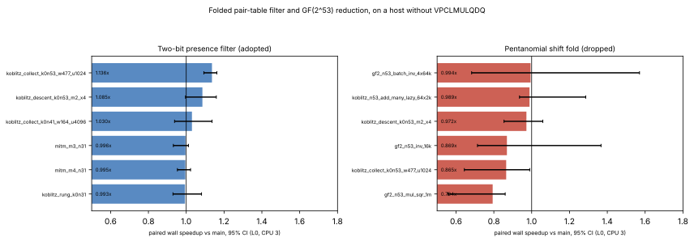

# Folded pair table: two-bit presence filter (and a dropped reduction)

**Date.** 2026-11-04. **Class.** Engineering. The decompositions are the
same; only the filter's stored bits change. [pcc:unverified]
**Host.** Session VM, Intel Xeon @ 2.80 GHz (AVX-512F/BW/DQ/VL; no
VPCLMULQDQ, no IFMA). Single thread on CPU 3, L0.

## Two-bit presence filter (adopted)

- **The cost it targets.** The descent phase profile
  (`experiments/descent-phases-k0n53-20261104/`) put a third of the k0n53
  descent in the presence-filter probe loop. On random keys the one-bit
  filter admits 12.3%, and each admitted key costs a bucket lookup in a
  4.2 MiB array.
- **The change.** Every key a CPU-built folded table stores now also sets
  bit `(h >> 32) & 63` of the same 64-bit word, and a lookup needs both
  bits.
  - The lookup is still one load.
  - False positives fall from `1 − e^{−ρ}` to about `(1 − e^{−2ρ})²` at
    filter load `ρ`.
  - Nothing is ever missed, so the decompositions are unchanged.
- **Device parity is unchanged.** `gpu/ecc2k`'s fold kernel, which is not
  in this repository, writes the one-bit layout.
  - `build_folded_within_one_bit_filter` builds that layout.
    `dump_fold_vectors` and `load_fold_table` now use it, so their
    word-for-word checks against the device are unaffected.
  - `FoldedParts` carries a `two_bit_filter` flag. A table taken over
    from a device sets it `false`.
- **Test.** `two_bit_filter_decomposes_as_the_one_bit_one_and_admits_fewer`
  runs at degree 53 with a 1500-point base and 20,000 probes:
  - the same decompositions from both tables;
  - every key the two-bit table answers, the one-bit table answers too;
  - admissions fall from 18.4% to 11.7% at that small table's higher
    filter load.

### Results against `main` a08cbbef7 (perfindex, 15 paired rounds)

| kernel | wall (95% CI) |
|---|---|
| `relation/koblitz_collect_k0n53_w477_u1024` | **1.136×** (1.093–1.162), verdict faster [pcc:unverified] |
| `relation/koblitz_descent_k0n53_m2_x4` | 1.085× (0.996–1.159), neutral |
| `relation/koblitz_collect_k0n41_w164_u4096` | 1.030×, neutral |
| `relation/koblitz_rung_k0n31`, `pdp/mitm_*` | 0.99–1.00×, neutral |

- **Instructions.** Callgrind Ir moves by 0.98–1.02×: the gain is fewer
  cache misses, not fewer instructions.
- **Fingerprints.** Every one matches `main`'s except
  `relation/koblitz_pair_table_k0n41_folded`, which hashes the stored
  filter words. Those words changed by design.

## Pentanomial shift fold (dropped, negative result)

- **The idea.** The scalar GF(2^53) multiply costs about 22 cycles of
  throughput on this host. Folding the pentanomial `z^53 + z^6 + z^2 + z + 1`
  by shifts instead of 7 table lookups measured quicker in isolation:
  4.6–5.7 ns against 6.0–9.5 ns throughput, and 7.8–8.0 ns against
  10.3–10.4 ns latency. [pcc:unverified]
- **In the kernels against `main`, it lost:**
  - `field_ec/gf2_n53_mul_sqr_1m` 0.794× (0.557–0.860, slower);
  - `relation/koblitz_collect_k0n53_w477_u1024` 0.865×;
  - index 0.991×.

  This agrees with the 0.84× measured on the VPCLMULQDQ host on
  2026-11-03.
- **Status.** It was reverted on this branch (commit 72581544e, reverted
  by 2ca5eca1c). The table stays.
- **Why the AVX-512 batched add showed no gain.** That profile ran on this
  host, which lacks VPCLMULQDQ. `Simd512::new` therefore returns `None`,
  and the scalar path runs either way. The kernel was simply not enabled
  here. [pcc:unverified]

## Limits

- **Noise.** Wall times on this shared VM are descriptive: A/A noise on
  these kernels is 4–13%.
- **Scope.** These are kernel and stage measurements. No complete-solve
  `S` and no matched-rho gap are stated.

## Data

- `data/filter-instr.{json,md}` and `data/filter-compare.{json,md}`.
- `data/penta-fold-compare.{json,md}`.
- `plot.py`.
