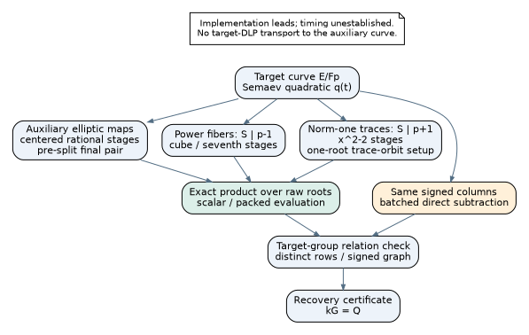

# Compiled field fibers and terminal factors

2026-11-15. Implementation leads and unsigned producer correctness evidence.
Claim `PCC-20261115-82ccdd` has unverified standing.
No runtime speedup or new large-field DLP recovery is established.
[pcc:unverified]

## Question and scope

The user requested faster Rust index calculus, further leads, and a complete
comparison with IC without auxiliary curves and with Pollard rho. This round
implements two additional structured encodings and simplifies the existing
auxiliary-map terminal. The baseline implementation is PR head
`ad3dfc9383ed4efbe4c408965e5c4639409e6868` (its core matches `9a944892`).
The final algorithm source is `facaac33bfe62bb59d9997141e53d9cffca72d2c`.
There is no currently qualified Rust timing baseline to ratchet. These are
recipe/API leads; no new finalized IC1 candidate, workload or measured run is
registered by this source-only round.
[pcc:unverified]

| Requirement | Status and evidence |
|---|---|
| Faster polynomial/GCD stage | Pre-split terminal and additional exact coefficient circuits implemented; source-operation audit below, runtime gain unmeasured |
| Additional leads | Power fibers and norm-one trace fibers implemented, including a trace-orbit preparation recurrence |
| IC without auxiliary curve | Both field families use no auxiliary elliptic curve; direct controls reuse exactly the generated signed columns |
| Both requested fields | Exact values, zero indices and relation checks at p=2^31-1 and p=2^61-1 |
| Complete end-to-end recovery | Matched producer correctness fixtures at p=127; fresh requested-field recoveries remain outstanding |
| Measure against rho | Existing bounded C rho remains exposed; a new matched timing panel is blocked by access and protocol gates |
| Formal proof | Six Lean identity declarations supplied; unbuilt because lake/Lean are absent; structural finite-field proof remains open |



The diagram describes implementation wiring, not an isogeny between target
curves. No target discrete logarithm is transported to an auxiliary group.
The editable source and vector rendering are [pipeline.dot](pipeline.dot) and
[pipeline.svg](pipeline.svg). [pcc:unverified]

## Terminal factorization and exact-value contract

Write the current homogeneous Semaev polynomial as
`q(t)=D*t^2-C*t+H`. For the last centered auxiliary map, set
`delta=A-terminal` and split `t^2+delta*t+B=(t-u)(t-v)` during preparation.
The final value is exactly `q(u)*q(v)`. This uses five general field
multiplications, compared with eight in the preceding general terminal
formula. If v=-u, the two factors share `H+u^2*D`; three multiplications
suffice, or one when u=1. The split requires a preparation square root.
These counts exclude initialization and preparation and are source-level
calls, not instructions or elapsed time. [pcc:unverified]

The public workspace still returns the complete exact product over all raw
membership roots, including roots that do not lift on the target curve.
Only the query coordinates are restricted to lifted representatives. No
multiplication by an undisclosed nonzero factor or division by D is used;
D=0 cases remain in the product-oracle tests. Scalar, AVX2 and AVX-512 share
one coefficient kernel, retaining the three-vector tile and fused zero masks.
[pcc:unverified]

## Power fibers from p-1

`FactorBase::multiplicative(curve,S,coset,backend)` accepts nonzero canonical
cosets and S dividing p-1, with prime factors 2,3,7 and at most one factor 2.
Both requested p have 126 dividing p-1. A bounded deterministic search finds
an element zeta of exact order S, and all coset*zeta^i are generated. Exact
order is checked against every prime divisor. Distinctness and each forward
membership equation are checked before lifting. S distinct roots exhaust the
monic degree-S polynomial `x^S-coset^S`; bounded search exhaustion is an
explicit resource error, not a nonexistence claim. [pcc:unverified]

For the power maps, write `s=C/D` and `w=H/D` only for the derivation when
D is nonzero. The sums of powers of the two quadratic roots are
`s*(s^2-3*w)` and `s*(s^6-7*w*(s^2-w)^2)` for exponents 3 and 7. Homogenizing
produces the implemented updates:

```
Cube:   (D,C,H) -> (D^3, C*(C^2-3*D*H), H^3)
Septic: (D,C,H) -> (D^7, C*(C^6-7*D*H*(C^2-D*H)^2), H^7)
```

The updates are polynomial identities; no inverse of D is evaluated.
For D=0 they reduce directly to the product for the linear polynomial
`H-C*t`. Odd total degrees finish with q(c); even degrees reserve the
square map for a split opposite pair. Coset 1 gives the particularly cheap
terminal pair +1,-1. This implements the paper's smooth-p-1 construction;
no novelty claim is made. [pcc:unverified]

## Norm-one traces from p+1

For p=2^B-1, the norm-one group in F_(p^2) has order p+1=2^B. Its trace
satisfies `tr(z^2)=tr(z)^2-2`. A trace a is accepted only when applying
x^2-2 exactly B-1 times yields -2. If xi is a root of
`X^2-a*X+1`, that condition implies xi^(2^(B-1))=-1, so xi has order 2^B.
It follows that xi^p=xi^-1 and its trace lies in F_p. The finite primitive
trace search is bounded and reports exhaustion explicitly. [pcc:unverified]

For depth d<=min(20,B-2), the terminal is tr(xi^(2^d)). It has order at least
four before taking its trace. Its two group preimages under inversion are
distinct; the 2^(d+1) group elements in the two powering fibers therefore
yield exactly 2^d distinct F_p traces. The depth bound avoids the ramified
terminal values. The constructor checks the resulting raw cardinality by
distinctness and every forward equation. [pcc:unverified]

Pushing q through x^2-2 requires four field multiplications per intermediate
stage. Set `u=C^2-2*D*H`, then update:

```
D' = D^2
C' = u-4*D^2
H' = H^2-2*u+4*D^2
```

The last stage uses its opposite preimages. This is a field-group encoding;
it neither requires an auxiliary elliptic curve nor counts its points.
[pcc:unverified]

Preparation uses a trace orbit rather than an inverse-square-root tree.
Let a=tr(xi), let zeta=xi^(2^(B-d)), and let b=tr(zeta). The first adjacent
trace c=tr(xi*zeta) satisfies
`c=(a*b+sqrt((a^2-4)*(b^2-4)))/2`. Either square-root choice chooses an
orientation of the same orbit. Starting with x0=a,x1=c, the recurrence
`x_(i+1)=b*x_i-x_(i-1)` enumerates tr(xi*zeta^i). The depth bound prevents
inversion from identifying two entries of this coset. This uses one square
root instead of 2^d-2 extractions in the inverse tree; depth one directly
uses a,-a and requires none. The inverse-tree algorithm remains in the tests
as a separate root-set oracle, with exhaustive small-field fiber checks.
[pcc:unverified]

## Source-operation audit

All entries count field multiplication calls per candidate coordinate, with
squaring counted as multiplication. They exclude initial Semaev coefficient
generation, point verification, relation recovery, preparation and constant
broadcasts. They are derived source counts, not benchmark observations.
[pcc:unverified]

| Operation | Multiplication calls |
|---|---|
| Old general rational terminal | 8 |
| New general split terminal | 5 |
| New opposite-root terminal | 3, or 1 for unit roots |
| Torus intermediate stage | 4 |
| Power cube stage | 7 |
| Power seventh stage | 15 |
| Power degree 18, coset 1, complete elimination after initialization | 15 |
| Power degree 126, coset 1, complete elimination after initialization | 30 |
| Torus depth 7, complete elimination after initialization | 27 |

A changed fiber changes its target-curve lift and relation distribution.
Comparing these counts across families does not establish equal useful work,
faster recovery, or a gain against rho. The [operation chart](operations.svg)
shows only source counts for the terminal rewrite. [pcc:unverified]

## Correctness evidence and failures

The [producer receipt](producer-checks.json) pins source, commands, raw logs
and recomputed test counts. The final source passes 20 core tests on stable
and Rust 1.78, and four targeted CLI tests. Format, clippy and documentation
checks pass. These are unsigned producer checks, not independent signed
verification or admitted performance measurements. [pcc:unverified]

Tests cover exact explicit Semaev products for multiplicative degrees
9,18,126 with cosets 1 and 3 in both requested fields, torus depths 3,5,7
there, and depths 1,2,5 over F_127. Available scalar/packed paths are checked
against the same product and direct signed relation. Small full recoveries
use E/F_127:y^2=x^3+2x+51, subgroup order 109, G=(3,46), and public fixtures
k=1,17,37,108; each circuit/direct pair uses identical walk parameters and
returns identical certificates and processed-query counts. This is a
correctness fixture, not a timing or natural-yield estimate.
[pcc:unverified]

An initial test assumed every power fiber would lift and failed: for
p=2^61-1, E:y^2=x^3+3, S=9 and coset=3, all nine roots are nonliftable.
The constructor correctly rejected the empty base. The test now independently
checks the empty lift and checks rejection in both direct/circuit modes.
Other tested fibers retain exact-product controls. A split membership
polynomial does not guarantee a usable target-curve base. The initial
failure transcript is retained separately. [pcc:unverified]

The initial documentation build failed on an unescaped PCC marker in the
included README; the marker was made literal and documentation was rebuilt.
A local benchrec gate initially lacked the tracked integrity-exclusion file
because of the sparse checkout; restoring that exact file from the merged
head made the gate pass without changing records or exclusions.
One formatter invocation used the formal-project directory with a relative
core manifest path and failed; the corrected root-directory check passed.
Neither failure was suppressed. An attempted Lean build found no lake binary.
[pcc:unverified]

## Formal proof map and limits

The [formal project](formal/FieldFibers.lean) supplies identity declarations
`AuxiliaryIC.FieldFibers.opposite_pair`, `cube_trace`, `seventh_trace`,
`torus_push`, `terminal_pair` and `orbit_discriminant`, each over arbitrary
commutative rings with ring proofs and axiom-audit commands. It pins Lean
4.35.0 and mathlib `cfc55fc58714a59dc06e6e79edc6d1d95140d3c2`, following
crypto-lean revision `56a7aec51b80be1f8f42eb3f5c2cd1979744367a`.
These sources have NOT been built or axiom-audited here: lake/Lean are absent.
No Lean theorem is reported checked. [pcc:unverified]

Even a successful build of those identity lemmas would leave the structural
finite-field proof open: cyclic norm-one group construction, primitive-trace
criterion, complete unramified fibers, trace-orbit enumeration, and the bridge
from circuit zeros to verified target-group relations. The readable argument
above and bounded tests do not substitute for those formal obligations.
[pcc:unverified]

## Sources checked and graph review

- Primary paper: Petit, Kosters, Messeng, *Algebraic approaches for the elliptic
  curve discrete logarithm problem over prime fields*, PKC 2016, sections
  3.3 and 3.4. Read from the [author PDF](https://people.maths.ox.ac.uk/petit/files/16PKC_primeECDLP.pdf),
  SHA-256 `a53030a6cde720c354aebfb65b1eb01e07766ce2d26e543d77f2516c0a49ef5b`.
  Its smooth-p-1 construction motivates the power fiber; its auxiliary-curve
  construction motivates the existing map path. Its timings are not reused.
- `cryptanalysis:crates/prime-field-auxiliary-ic/src/circuit.rs` and
  `src/circuit_x86.rs` at `ad3dfc9383ed4efbe4c408965e5c4639409e6868`.
- KB unavailable: no MCP research-kb tools or CLI executable/catalog in this
  environment; the repository wrapper reports exit 127. No KB source ID or
  negative prior-art conclusion can be supplied.
- Atlas fallback: the relevant paths are
  `crypto-autoresearcher:knowledge/leads/ecdlp/ic-prime/LEAD-ICP-algebraic-membership-factor-base.yaml`,
  `LEAD-ICP-pkm-tower-algebraic-oracle.yaml`, and
  `LEAD-ICP-prime-ic-constant-engineering.yaml`. GitHub returns VLT14 encrypted
  file contents, so the entries and `tools/lead_atlas.py --match` could not
  be read/executed. The first entry has blob
  `f11d274cc5a5c9e15cb618439dd9f5fb571c453e`. Updating that owning atlas
  requires a readable owner checkout; no disposition or novelty is inferred.
- Graphs checked: the immutable snapshot's diagrams and the candidate
  catalog/volcano-route graph paths. This change adds field-group encodings,
  no target-curve isogeny or new curve identity/route. Existing graph edges
  therefore remain current; only this implementation-flow diagram is added.

## Remaining experiment and access gates

[resource-presence.json](resource-presence.json) records absence of expected
checkpoint tokens, an AWS environment key pair, a Runpod key and a local GPU
utility. The preceding checkpoint/status attempts remain in the earlier
kernel-fusion receipt; no blocked alert-management API attempt was repeated.
No new benchmark was launched. [pcc:unverified]

The next discriminating experiment must freeze all encodings/bases before
fresh targets, then compare the preserved IC baseline, new auxiliary terminal,
each field fiber with its same-column direct control, and the strong rho
reference on identical single targets. Use at least five fresh targets, the
admitted placement/noise controls and resource envelope, exclusive online
phase accounting, separate cold setup including fiber construction, all
failure/censoring rows, A/A and positive controls, and independent signed
replay. The new CLI records the chosen fiber parameters, effective encoding,
raw and affine counts, and retains null qualified-speedup fields.
[pcc:unverified]

Those measurements require a successful S3 checkpoint gate and an admitted
GPU allocation. A new performance baseline, the full requested-size
end-to-end gain, and the distance to rho remain unresolved in
[the problem record](../../../../problems/prime-field-auxiliary-ic-validation.md).
