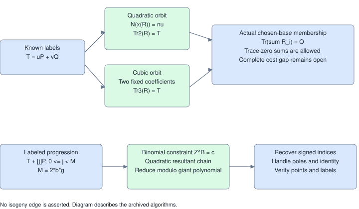
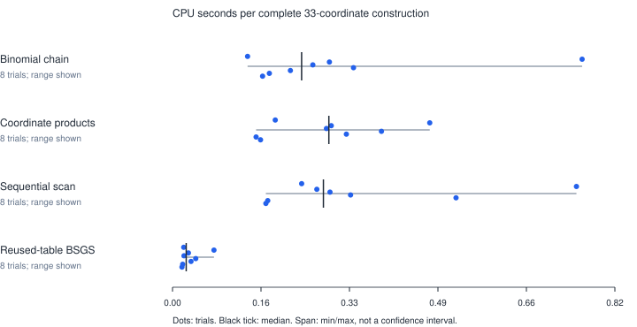

# Fixed-invariant Frobenius lifts and binomial progression certificates

**Retrospective exploratory import; pre-gate.** This publishes the three
prototypes, written arguments, final raw records and available logs prepared on
2026-10-27 outside this repository's experiment harness. It does not promote
them to a current lab benchmark, IC1 candidate, isolation tier or attack result.
No new scientific experiment was run for this publication.

The original 34-file package is preserved byte-for-byte in [archive/](archive/).
Its local source commit is `820693c998f88b4f7ee213c70c8b99be23734f1b`;
[PROVENANCE.json](PROVENANCE.json) pins its manifest digest. Original result
labels, including the other repository's `failed_or_overfit` vocabulary, are
historical and are not a new lab classification.

## Requested work and evidence

| Requirement | Recorded implementation and checks | Remaining gap |
| --- | --- | --- |
| Quadratic norm lifts and trace-aware solving | Explicit lifts; reciprocal sextic identities; orbit projection and univariate trace fibers; actual sampled-base membership retained | A faster solver directly on the reciprocal coefficient surface |
| Cubic orbits with two fixed coefficients | Quartic parameter solver; irreducibility checks; common-field and formal quotient representations; degree-nine divisor identities | Lower complete relation cost with the stronger symmetry |
| Arithmetic-progression coset hits | Homogeneous quadratic-resultant chain modulo the giant-point polynomial; complete signed index and pole recovery | Approximately linear field work remains; the proposed square-root total bound was not achieved |
| Public check-in | Preserved source/data, explanatory figures, this report and [PDF](REPORT.pdf), integrity checker and linked problem record | Publication and CI are tracked by the PR |

The original combined requirement remains open: cheaply construct known-labeled
points in a small usable coordinate domain and lower complete verified-relation
cost. See [the named obstruction](../../problems/known-label-thin-coordinate-construction.md).

## Mechanisms and scope



1. For known-labeled `T=uP+vQ`, the quadratic construction returns extension
   points with fixed abscissa norm and elliptic trace T. Three trace points
   yield a reciprocal sextic. The correct relation condition is
   `Tr_E(sum R_i)=O`, not `sum R_i=O`.
2. The cubic construction fixes the constant and linear coefficients of an
   irreducible orbit polynomial. A quartic supplies its interpolation
   parameters. Formal quotient representations suffice for trace-only divisor
   computations; they are not silently treated as one common extension field.
3. Symmetric baby/giant blocks preserve `Z^B-c` through a homogeneous quadratic
   resultant chain and recover actual progression indices and labels.

The [original write-up](archive/WRITEUP.md) gives the formulas and written
proofs. Its elementary finite-domain statement is: for either irreducible-orbit
construction, B prescribed orbit-parameter values cover at most 2B nonzero
traces. This restricts independent uniform rejection sampling; it is not an
impossibility result for nonuniform constructions or other direct solvers.
**Formalization status:** written proof only. No checked Lean theorem is
claimed; a Lean executable was unavailable on the publication host. The
geometric/Frobenius fiber argument, not just a conditional union bound, remains
to be formalized. The original full statement is preserved.

## Recorded observations

The following are historical CPU-only component observations on the original
host. Isolation, affinity, cgroup/hardware placement, A/A noise gates and a
qualified timing confidence interval were not retained. An isolation tier and
a qualified speedup are therefore **unknown**. These are eight complete
labeled-domain constructions per method, not single-target DLP times.

| Method | Sum of CPU seconds, 8 trials | Charged group operations | Blocks / failed blocks |
| --- | ---: | ---: | ---: |
| Binomial chain | 2.351736994 | 45,973 | 515 / 58 |
| Coordinate products | 2.276435383 | 45,973 | 515 / 58 |
| Sequential scan | 2.755015272 | 1,080,978 | 515 / 58 |
| Reused-table interval BSGS | 0.262263897 | 77,662 | 515 / 58 |



The plot displays every trial and the observed min/max span; these are not
confidence intervals. Exact input: `E/F_65537: y^2=x^3+2x+25`, full order
65,371, raw coset size 64, 33 usable abscissae, progression blocks of length
2,048. Each method uses the same starts and complete-domain stopping rule.
BSGS uses a 2,048-point table tuned for reuse. Setup, input generation,
failed blocks, index recovery and scalar verification count. Early identity
and antipodal opportunities were recorded while the construction continued.
This does not measure a complete attack. Same-target rho, final relation
linear algebra, descent, and the primary one-target online metric were not
measured here; their costs and speed ratios are unknown, not zero.

Raw records: [block benchmark](archive/experiments/ideas/block_benchmark.json),
[complete transcripts](archive/experiments/ideas/block_transcripts.json),
[lift benchmark](archive/experiments/ideas/lift_benchmark.json), and
[available original logs](import-logs/). The [summary](archive/results.json)
retains all component totals and original environment fields. No stronger
hardware or performance provenance is inferred during this import.

## Correctness and independence

The stored lift experiment has 64 bases, including 18 with no relation, and
78 checked degree-six/nine principal divisors. The block validation compares
four algorithms on 3,978 exhaustive blocks and checks 11,124 ordinary
resultants, including exceptional points. The stored replay audit checks
1,664 known labels, 2,496 extension representations, 588 divisor zeros and
1,163,264 progression indices. See [audit.json](archive/experiments/ideas/audit.json).

The extension audit uses separate pure-Python field arithmetic and does not
reuse the lift formulas or FLINT extension implementation. Prime-field curve
and scalar primitives are shared in `core.py`; this is not a fully independent
implementation of every arithmetic layer. The original audit was run before
publication. The publication check verifies preserved bytes and record
consistency; it does not relabel that audit as a fresh experiment.

## Identity, graphs and validation status

Exact historical parameters, generators, targets and seeds remain in the raw
records. Performance fixtures are p=257, 1153, 12289 and 65537, with prime
nonanomalous full group orders. p=17 and p=97 are anomalous fixtures used only
in arithmetic/construction checks. Canonical lab curve UIDs and candidate IDs
are unregistered for this imported package, so no new IC result row is admitted.
Registration and matched qualified controls remain prerequisites to promotion.

The existing `experiments/volcano-ic/figures/{census,ecdlp}.svg` graph set and
the curve-catalog role were checked for applicability. This import supplies
no new isogeny edge or curve-equivalence assertion, so those canonical graphs
and `experiments/ic-candidate-catalog/curves.yaml` are unchanged. The new
diagram records algorithm/data flow only.

## Review and reproduce

Publication checks, with the standard library only:

```sh
python3 experiments/prime-field-frobenius-blocks-20261027/check_archive.py
```

Regenerate the figures/report with ReportLab:

```sh
python3 experiments/prime-field-frobenius-blocks-20261027/render_report.py
```

The archive retains its original reproduction scripts and pinned
`python-flint==0.9.0` dependency. They are historical instructions. Before a
new scientific run, follow the current repository checkpoint, execution,
curve-identity and measurement rules in [AGENTS.md](../../AGENTS.md); this
publication does not launch or schedule such a run. Source and all JSON records
fit the repository's current artifact-policy thresholds; the checker records
their sizes without adding a policy exemption.

The next discriminating work is a direct reciprocal-surface solver with
chosen-base membership, or a block certificate that avoids M-scale field work.
Neither is claimed implemented beyond the archived prototypes.
