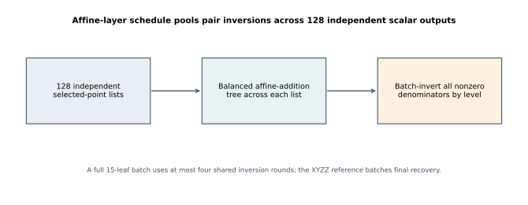
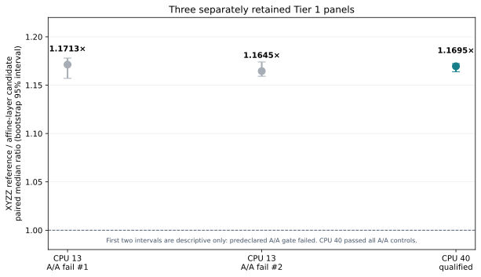

# Affine-layer batch tree: report

## Question and scope

Can point additions for 128 independent fixed-radix-14 secp256k1 outputs be arranged as per-scalar balanced affine trees, pooling denominators into one batch inversion at each tree level, instead of using XYZZ accumulators and a final batch recovery? The table, recoder, and 15-leaf schedule are unchanged. A full candidate batch uses at most four shared inversion rounds. `AffineLayer.lean` proves the tree-level sum identity under explicit pair-addition hypotheses; `BatchInverse.prefix_reverse_identity` in the parent experiment proves the batch inverse witness. The retained native holdout receipt supports the concrete Rust field/curve refinement, which has no Lean model. The pinned Rust source bytes and their generating repository/revision are not included, so this PR alone cannot reproduce that native replay or independently confirm the source-hash guard.

## Three retained panels

Each panel contains 96 verified arms and 48 paired comparisons on the same frozen 128-scalar fixture. The first two CPU 13 panels remain separate because their predeclared A/A gates failed. The third panel is a new CPU 40 run with only the execution pin changed in its new rules file; it passes all A/A gates and qualifies for the Tier 1 instance.

* `c24e37df66ad4b1a891f1805798a0887` (CPU 13; **unknown**, repeat 12 failed both A/A controls): XYZZ/affine means 62.193067/54.096080 ms; median ratio 1.171280×; paired bootstrap 95% interval [1.157072, 1.177994].
* `fe00f695389443f08d6cbf003f1a8b7e` (CPU 13; **unknown**, repeat 9 failed the post-comparison A/A control): XYZZ/affine means 61.819930/53.432215 ms; median ratio 1.164518×; paired bootstrap 95% interval [1.159208, 1.173961].
* `251bb8443cad471ab3e6162307fd0c46` (CPU 40; **qualified**, zero A/A failures): XYZZ/affine means 61.885156/53.156432 ms; median ratio **1.169535×**; paired bootstrap 95% interval **[1.163926, 1.172300]**.

The two CPU 13 comparison intervals are descriptive, not qualified: one repeat failed both controls at 1.286019 and 0.887931 in the first job; one post-control failed at 1.165546 in the second. The CPU 40 panel has no A/A failure, stable artifacts, and output checks on all arms. It measured 4.325881 µs per candidate output versus 5.036227 µs for XYZZ. Both paths retained 26,035,988 bytes; candidate table preparation averaged 3,957.984 ms and reference preparation 3,981.450 ms, outside the online interval. The ratio is a batch-throughput result for this 128-output workload, not one-call latency or proof of exclusive physical-host access.

## Audits and failed attempts

All three committed `analyze_affine_tier1.py --job ...` runs reproduced their corresponding audit JSON byte-for-byte. The CPU 13 panel logs retain their noisy A/A outcomes; the later CPU 40 panel is a new independent record and does not overwrite them. The audits validate receipt identities, arm outputs, and raw measurements; the pinned Rust source bytes themselves are absent, as noted above. The README lists archive digests and exact rerun commands. The retained `lean-check.log` records a successful build of both theorem modules with Lean 4.34.1; the concrete Rust field/curve refinement remains outside that Lean model.

## Graph and reproduction

The source-generated diagram shows how candidate inversion pooling crosses the 128 independent scalar trees. The panel graph keeps the two failed-gate intervals visible and marks them descriptive, while the CPU 40 result is the only qualified point. `visuals.py` reads the committed audit JSON files and emits the SVG/PDF figures. No end-to-end scalar-pipeline cost changed here: the broader experiment remains a stage-level fixed-base scalar diagnostic, and the inspected parent experiment has no canonical pipeline graph that this measurement updates. The report graph is the appropriate local view; it does not promote the stage result into an end-to-end claim.

Regenerate the plots with `visuals.py` when needed. Rebuild the PDF from the committed Markdown and SVG figures with:

```sh
python3 experiments/prime-j0-affine-layer-batch-20261015/visuals.py
pandoc experiments/prime-j0-affine-layer-batch-20261015/REPORT-2026-10-19.md \
  --from=gfm --pdf-engine=typst -V papersize=us-letter \
  --resource-path=experiments/prime-j0-affine-layer-batch-20261015 \
  -o experiments/prime-j0-affine-layer-batch-20261015/REPORT-2026-10-19.pdf
```

[Schedule diagram (SVG)](figures/affine-layer-dataflow.svg) · [PDF](figures/affine-layer-dataflow.pdf)





[Panel comparison graph (SVG)](figures/panel-ratios.svg) · [PDF](figures/panel-ratios.pdf)

## Decision and next step

The CPU 40 panel qualifies the affine-layer schedule for the frozen 128-output batch workload. Preserve the earlier noise-gate failures as part of the record. The next useful test is to measure this schedule under additional scalar input laws and separately evaluate cold end-to-end cost before treating it as a general scalar-multiplication improvement.
