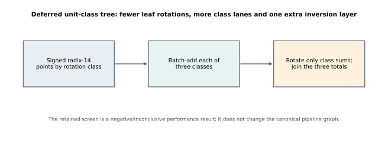
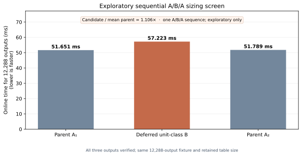

# Deferred unit-class affine tree: report

## Question and scope

Can the signed radix-14 lookup points be grouped by order-three x-rotation class, batch-added within each class, and rotated only after each class has been summed? This trades fewer per-leaf x-constant multiplications for three class lanes and a fifth inversion layer. `UnitClasses.three_class_delayed` proves the abstract group identity under explicit zero-preserving/additive endomorphism hypotheses; the retained native test log reports checking the concrete implementation. The formal result does not model the native Rust arithmetic bridge. The pinned input front/windows source bytes and their generating repository/revision are absent from this PR and local mirrors, so the native overlay/test cannot be independently reproduced from submitted files.

## Retained validation and exploratory result

The retained native release-test log reports checking 128 frozen scalar outputs against the parent affine-layer outputs, fixture points and an independent binary multiplier, including the identity case. All captured benchmark outputs shown here report `verified=1`, matching fixture hash `7f4672b7b676969fe40056d0f14c6ecf45ad36109870cdf3466ebafd9e7b22d8`, 12,288 outputs, and 26,035,988 retained bytes. The overlay pins front source `f3c3b072…` and windows source `cecb27d0…`; neither byte file is included, and no generating repository/revision is recorded, so these retained results do not establish a locally reproducible native build.

The sequential A/B/A sizing screen measured:

| Arm | Online time |
| --- | ---: |
| Parent affine tree, A₁ | 51.651204 ms |
| Deferred unit-class tree, B | 57.222970 ms |
| Parent affine tree, A₂ | 51.789285 ms |

The candidate/mean-parent ratio is **1.106×** in this single exploratory sequence. It has no pinned-runner A/A receipts or uncertainty estimate, so it is not a qualified performance result. The separate retained `unit-class-screen.stdout` diagnostic measured the candidate at 57.438771 ms; it is preserved, but is not pooled with the A/B/A sequence. The available screen does not support promoting this layout as a speed improvement. The README's build/test archive records the source, logs, failed or diagnostic attempts, and hashes.

## Proof, implementation and graph boundary

The group-level theorem requires `tau(0)=0` and additivity. The parent `AffineLayer.layers_preserve_sum` result proves the tree reduction under its explicit affine pair-addition hypothesis. `check_lean.sh` pins Lean 4.34.1 and the captured check log records the theorem's axioms. The retained native test log supplies a separate implementation check, but the pinned input source files are unavailable for replay; a Lean refinement of that concrete bridge remains open.

The figures are generated from retained raw stdout by `visuals.py`; no analyzed or frozen result file is rewritten. The source search was checked against the canonical scalar-pipeline graph: it introduces no qualified pipeline improvement and does not alter the selected pipeline or its costs, so those canonical graph sources remain current. The local A/B/A bars are a report of an exploratory diagnostic, not a promotion to the canonical graph.

Regenerate the figures from the retained stdout records and rebuild the PDF from the committed SVGs with:

```sh
python3 experiments/prime-j0-affine-unit-classes-20261015/visuals.py
pandoc experiments/prime-j0-affine-unit-classes-20261015/REPORT-2026-10-19.md \
  --from=gfm --pdf-engine=typst -V papersize=us-letter \
  --resource-path=experiments/prime-j0-affine-unit-classes-20261015 \
  -o experiments/prime-j0-affine-unit-classes-20261015/REPORT-2026-10-19.pdf
```

[Deferred tree diagram (SVG)](figures/unit-class-tree.svg) · [PDF](figures/unit-class-tree.pdf)





