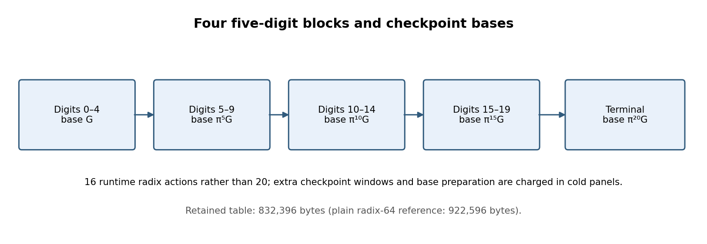
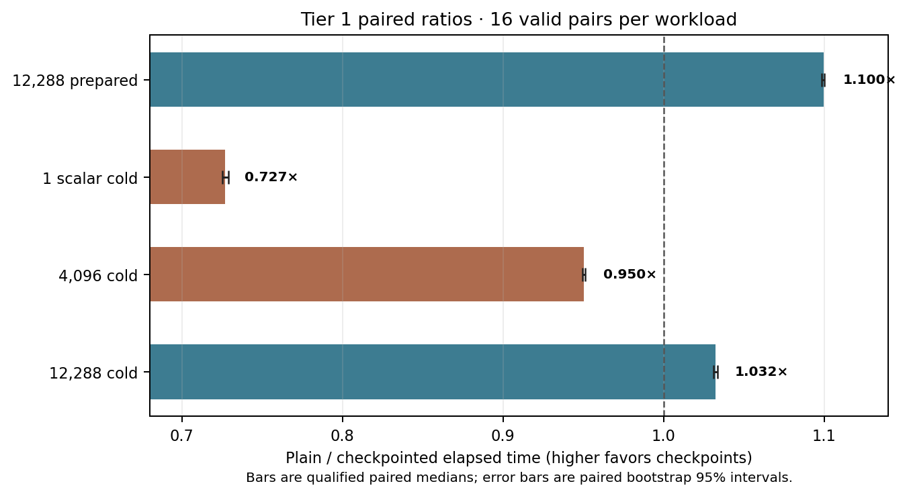

# Four radix-32 checkpoints: prepared gain and cold crossover

**Question.** Do four five-digit checkpoints improve the `31+32τ` scalar path, and how does their table-build cost change the result with workload size?

**Scope and instance.** This study uses SEC 2 secp256k1 (`E:y²=x³+7`, `p=2²⁵⁶−2³²−977`, prime subgroup order `n=FFFFFFFFFFFFFFFFFFFFFFFFFFFFFFFEBAAEDCE6AF48A03BBFD25E8CD0364141`). The fixture contains 12,288 scalar/point pairs; its SHA-256 is:

`a1c4964f174e36ea26f6a1897128f651a2ce7251e4bf4ffd532ff09221e721d3`

No new curve, isogeny, scalar rule, or canonical graph route is proposed.

{width=6.2in}

**Construction.** The [hash-guarded overlay](native_checkpointed_sparse32_width5_overlay.py) partitions the low-digit-first radix-`31+32τ` expansion into four five-digit blocks. It builds orbit-folded digit windows at `G`, `π⁵G`, `π¹⁰G`, and `π¹⁵G`, plus the terminal window at `π²⁰G`. The runtime evaluates four radix steps per block, 16 total instead of 20 plain Horner steps, and combines checkpoint results. The table retains 832,396 bytes versus 922,596 bytes for the plain radix-64 reference. These are retained table sizes, not peak process memory.

**Proof map.** The pinned [CheckpointedRadixFamily.lean](CheckpointedRadixFamily.lean) proves block distributivity and pair-Horner equivalence, transferring it to an abstract point evaluator under explicit addition and radix-map laws. Separate Lean modules check the secp256k1 subgroup eigenvalue and native `τ` numerators/affine chord coordinates under a modular inverse hypothesis. Fresh 4.34.1 receipts are indexed in [lean-checks-2026-10-19](lean-checks-2026-10-19/README.md). The denominator exception `x=0` has a written quadratic-reciprocity exclusion, but its full Lean proof and source-level Rust refinement remain open. Neither the abstract theorem nor finite point checks prove a concrete curve group law for all inputs.

**Matched Tier 1 panels.** Four plans were frozen on RunPod pod `thyvmdqmzsz5ik`, CPU 40, with 16 alternating repetitions, adjacent A/A controls, 96 arms, and 48 valid pairs in each panel. The prepared-table panel starts after table build; cold panels include process-local table preparation and evaluation of the stated prefix. Launch, fixture parsing, and independent point checks are outside Rust `Instant`. A plain/checkpoint ratio above 1 favors checkpointing.

\newpage

- **12,288 points, prepared:** 624.074 vs 567.898 ms, ratio 1.09981× [1.09867, 1.10015].
- **One scalar, cold:** 93.302 vs 128.346 ms, ratio 0.72691× [0.72501, 0.72878].
- **4,096 points, cold:** 304.017 vs 319.939 ms, ratio 0.95049× [0.94934, 0.95121].
- **12,288 points, cold:** 722.336 vs 699.322 ms, ratio 1.03225× [1.03102, 1.03372].

Retained table size was 922,596 bytes for plain radix-64 and 832,396 bytes for four checkpoints.

{width=5.7in}

The [prepared auditor](analyze_tier1_tau32cp5_online.py), [one-scalar cold auditor](analyze_tier1_tau32cp5_cold.py), [4,096-point cold auditor](analyze_tier1_tau32cp5_batch4096cold.py), and [12,288-point cold auditor](analyze_tier1_tau32cp5_batch1cold.py) verified source and artifact hashes, all commands and outputs, pair ledgers, independent point checks, stable artifacts, and A/A controls. Every panel completed 96 arms and 48 pairs with no invalid runs or failed A/A control. The original study record links the manifests, rules, launches, audits, raw archives, and shared native provenance.

- Prepared panel, job `ac432472940d44c7b8921c9e0ee8a366`: [manifest](tier1-tau32cp5-online-cpu40-manifest.json), [audit](tier1-tau32cp5-online-cpu40-audit.json), [raw archive](tau32cp5-online-tier1-raw.tar.gz).
- One-scalar cold panel, job `c2587ca888ca47efb8a6afdba6385750`: [manifest](tier1-tau32cp5-cold-cpu40-manifest.json), [audit](tier1-tau32cp5-cold-cpu40-audit.json), [raw archive](tau32cp5-cold-tier1-raw.tar.gz).
- 4,096-point cold panel, job `10d5b7daf9cf4712879d046e951a4a26`: [manifest](tier1-tau32cp5-batch4096cold-cpu40-manifest.json), [audit](tier1-tau32cp5-batch4096cold-cpu40-audit.json), [raw archive](tau32cp5-batch4096cold-tier1-raw.tar.gz).
- 12,288-point cold panel, job `689c6839e4504578801c1ec9339f5062`: [manifest](tier1-tau32cp5-batch1cold-cpu40-manifest.json), [audit](tier1-tau32cp5-batch1cold-cpu40-audit.json), [raw archive](tau32cp5-batch1cold-tier1-raw.tar.gz).

The cold direct-batch panels bracket the crossover between 4,096 and 12,288 outputs on this fixture: the four-checkpoint path is slower at 4,096 and faster at 12,288. The one-scalar panel also loses after charging table setup. This is workload-specific evidence on one allocation, not a universal admission threshold or throughput guarantee.

**Graph and remaining proof gap.** This is a schedule change for the existing secp256k1 instance; the canonical curve/isogeny catalog and route records have no graphable change. The shared [sparse-radix correctness problem](../../problems/secp256k1-sparse-radix-point-correctness.md) tracks the missing all-scalar digit/quotient and concrete group-law refinement. The native panels check the frozen workloads only. The [editable figure source](checkpoint5_report_2026-10-19.py), SVG and 180-dpi PNG copies, and this report's [PDF](CHECKPOINTED_RADIX32_REPORT_2026-10-19.pdf) accompany the result.
