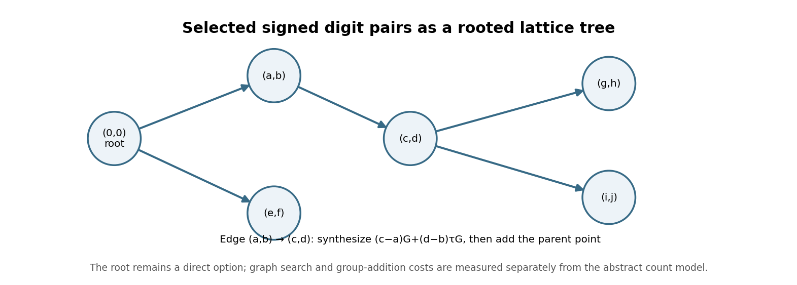
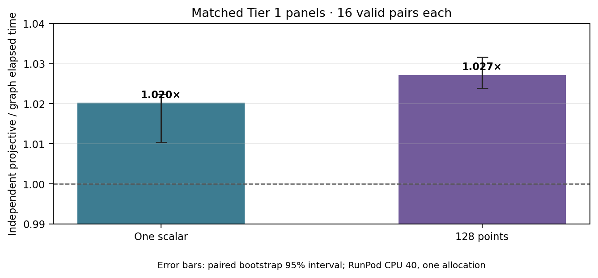

# Adaptive lattice graph for selected Eisenstein digit points

**Question.** Can selected `31+32τ` digit points share projective synthesis work through an addition graph, and does the measured gain survive fixture replay?

**Scope.** This engineering study is on SEC 2 secp256k1, `E:y²=x³+7` over `p=2²⁵⁶−2³²−977`, subgroup order `n=FFFFFFFFFFFFFFFFFFFFFFFFFFFFFFFEBAAEDCE6AF48A03BBFD25E8CD0364141`. The frozen 12,288 scalar/point fixture has SHA-256 `a1c4964f174e36ea26f6a1897128f651a2ce7251e4bf4ffd532ff09221e721d3`. No curve, isogeny, or new scalar rule is proposed.

{width=6.2in}

**Method and source review.** The [hash-guarded native overlay](native_sparse_digit_graph_overlay.py) starts from the scalar-local projective digit set and uses Prim's algorithm on its signed lattice pairs. An edge from parent `(a,b)` to target `(c,d)` synthesizes `(c−a)G+(d−b)τG` from an eight-bit shared dyadic basis, then adds the parent's already constructed point. The root `(0,0)` remains an available direct edge to every target. In the declared operation-count model, a root edge costs the number of set bits minus one, while a non-root edge charges the displacement synthesis and parent addition. Thus the minimum spanning tree is no worse than the direct-root star in that model. The model omits graph-search cost and treats group additions uniformly; the measured interval includes scalar-local preparation and evaluation, so wall-clock results include the graph search.

The graph selection and construction depend on each scalar's selected digits and pair distances. This implementation is **not constant-time** and must not be used for secret-scalar multiplication. No side-channel review or peak-memory measurement is claimed.

**Lean scope.** The pinned [Lean module](DigitGraph.lean) proves that adding the pair-lattice displacement reconstructs a target and that any evaluation map preserving pair addition transports that identity to a point addition. It also checks the direct root displacement. The module and dependencies were rebuilt with Lean 4.34.1; the new [dated proof receipt](lean-checks-2026-10-19/digit-graph-lean-check.json) matches current source hashes and records `#print axioms`. The graph lemmas depend only on standard `propext` and `Quot.sound`; `lean4checker --fresh` was unavailable. This does not prove that Rust's dyadic builder or `add_projective` implements the abstract maps for every secp256k1 point; the finite native replays are scoped checks of that bridge.

**Matched Tier 1 panels.** The [one-scalar](tier1-tau32-digit-graph-1-cpu40-manifest.json) and [128-point](tier1-tau32-digit-graph-128-cpu40-manifest.json) manifests compare the graph path with independent projective synthesis on identical inputs, CPU 40 on RunPod pod `thyvmdqmzsz5ik`, 16 alternating repetitions, and adjacent reference/reference A/A controls. Each completed 96 arms and 48 pairs. Rust `Instant` covers scalar-local preparation and Horner evaluation; process launch, fixture loading, and external output checking are outside the interval. The [rules](tier1-tau32-digit-graph-1-cpu40-rules.json), [launches](tier1-tau32-digit-graph-1-cpu40-launch.json), and [raw archive](tau32-digit-graph-1-raw.tar.gz) identify job `29a9d3b4552b4d809b9d4462738cb291`. The corresponding [128-point launch](tier1-tau32-digit-graph-128-cpu40-launch.json) and [raw archive](tau32-digit-graph-128-raw.tar.gz) identify job `b5dcc32046b34c7faf6ad6249d0c0888`; the [provenance archive](tau32-digit-graph-native-provenance.tar.gz) retains exact sources and binaries.

{width=5.8in}

| Frozen workload | Independent projective mean | Graph mean | Qualified paired median | Paired bootstrap 95% interval |
| --- | ---: | ---: | ---: | ---: |
| One scalar | 0.543 ms | 0.530 ms | 1.020× | [1.010, 1.022] |
| 128 points | 39.983 ms | 38.859 ms | 1.027× | [1.024, 1.032] |

The [independent auditor](analyze_tier1_tau32_digit_graph.py) confirmed source, binary, provenance, and raw hashes; exact commands and outputs; pair records; independent multiplication of measured fixture points; stable artifacts; and all A/A controls. Both panels were qualified with no invalid arms or A/A failures. These are small Tier 1 gains on one allocation, not general guarantees.

**Full-fixture replay.** Job `91167c97ca044280a925af245f13fa82` used two identical graph arms from the frozen [manifest](tier1-tau32-digit-graph-full-replay-cpu40-manifest.json), [launch](tier1-tau32-digit-graph-full-replay-cpu40-launch.json), and [raw archive](tau32-digit-graph-full-replay-raw.tar.gz). Each arm verified all 12,288 frozen outputs; the [independent auditor](analyze_tier1_tau32_digit_graph_full_replay.py) checked the fixture, binary, raw run records, output assertions, pair ledger, and independent last-scalar replay. The arms took 3.759 s and 3.740 s. This A/A replay has a null speedup and verifies only this finite fixture.

**Graph and remaining gap.** The [experiment index](README.md) and [digit-graph source record](DIGIT_GRAPH.md) now link this report. The graph represents a scalar-multiplication implementation optimization, not a curve/isogeny route; I checked the canonical curve catalog and route records and found no graphable finding to add. The shared [sparse-radix point-correctness problem](../../problems/secp256k1-sparse-radix-point-correctness.md) remains open: the map-add Lean theorem is conditional, and neither finite replay proves all-scalar digit selection or the native group-law refinement.

The [editable figure source](digit_graph_report_2026-10-19.py), SVG and 180-dpi PNG files, and this report's [PDF](DIGIT_GRAPH_REPORT_2026-10-19.pdf) are committed together.
