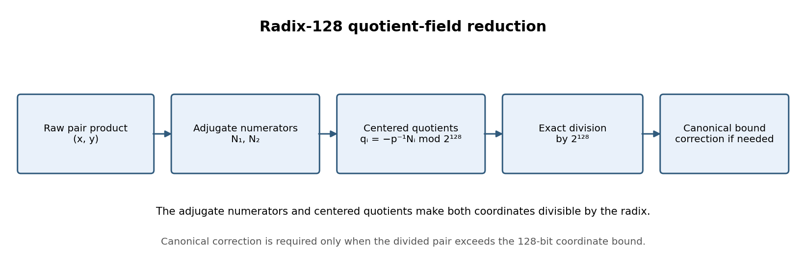
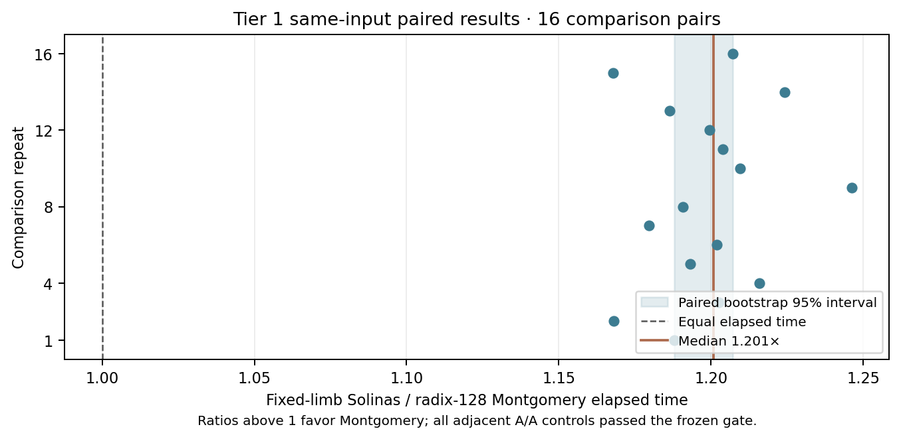

# Radix-128 Montgomery reduction in the Eisenstein quotient field

**Question.** Does radix-128 quotient-field reduction lower the timed cost of the existing secp256k1 Eisenstein scalar path relative to fixed-limb Solinas reduction, while preserving exact scalar outputs?

**Instance and inputs.** This is SEC 2 secp256k1, `E:y²=x³+7` over `p=2²⁵⁶−2³²−977`, in the prime subgroup of order `n=FFFFFFFFFFFFFFFFFFFFFFFFFFFFFFFEBAAEDCE6AF48A03BBFD25E8CD0364141` generated by `G`. The current catalog has no immutable secp256k1 curve/subgroup ID, so this report identifies the standard curve and subgroup by these exact parameters rather than assigning an ID. The fixture has 12,288 scalar/point pairs and SHA-256 `a1c4964f174e36ea26f6a1897128f651a2ce7251e4bf4ffd532ff09221e721d3`.

**Derived reduction.** Let `π=(a,b)`, `R=2^128`, and let `(x,y)` be the raw three-product result. Since `π·conj(π)=p`, the adjugate numerators are `N₁=(a−b)x+by` and `N₂=−bx+ay`. With `s=p⁻¹ mod R`, centered coefficients `qᵢ=−sNᵢ mod R` make `x+q₁a−q₂b` and `y+q₁b+q₂(a−b)` exactly divisible by `R`; divide to obtain the product modulo `π`. The [Montgomery Rust implementation](eisenstein_pair_montgomery.rs) applies the previous canonical lattice reducer only if the divided pair exceeds its 128-bit coordinate bound. Inputs use `xR mod p` encoding; the [fixed-limb Solinas reference](eisenstein_pair_fixed.rs) is preserved beside it. The exact 10,000-pair screen is generated by [eisenstein_montgomery.py](eisenstein_montgomery.py).

{width=6.3in}

**Exact checks and scope.** The frozen [10,000-pair screen](montgomery-self-check-10000.json) checks encoding, decoding, exact divisibility, product, rotation, and coordinate bounds. It reports maximum intermediate and Montgomery quotient widths of 128 and 127 bits, subsequent canonical quotients at most one bit, and 1,818 canonical corrections. The native implementation reproduced all 12,288 frozen scalar points. Its `14,211.423 ms` full-stream value is a separate diagnostic, not the Tier 1 comparison.

**Measured Tier 1 comparison.** Job `273359b6d2724700ad59ea1ddc978da8` used the frozen [manifest](tier1-eisenstein-montgomery-cpu40-manifest.json) and [rules](tier1-eisenstein-montgomery-cpu40-rules.json) to compare fixed-limb Solinas with radix-128 Montgomery on the first 512 common scalars over 16 alternating repetitions, using adjacent A/A controls on RunPod CPU 40. The independent [audit](tier1-eisenstein-montgomery-cpu40-audit.json) verifies 96 valid arms, 48 valid pairs, stable artifacts, every raw result, the 10,000-pair exact screen, and full native replay. All A/A controls passed the frozen `[0.90, 1.11]` range.

The mean timed stream was 726.038 ms for fixed-limb Solinas and 605.538 ms for Montgomery, or 1.418 and 1.183 ms per scalar. The qualified paired median fixed/Montgomery ratio was **1.200722×**, with a paired bootstrap 95% interval of **[1.187866, 1.207221]**. Ratios above one favor Montgomery. The timed interval starts after fixture loading and generator conversion, includes scalar parsing and projective arithmetic, and ends before exact point, rotation, and pack/unpack checks. This result is scoped to this conversion-free binary path on the observed Tier 1 instance.

\newpage

{width=5.8in}

**Proof boundary and graph impact.** Lean 4.34.1 checks the quotient congruence and Montgomery field semantics under explicit inverse and quotient hypotheses; the fresh module rebuild and builtin kernel replay are indexed in [dated Lean receipts](lean-checks-2026-10-19/README.md). Bit-level Rust signed-limb operations and the centered quotient implementation remain outside that proof. The existing 20,000-case differential limb replay, exact pair screen, and native full-stream replay are executable checks, not a universal refinement proof. This reduction changes arithmetic for the existing secp256k1 instance; it adds no curve or isogeny vertex or route. I checked [`experiments/ic-candidate-catalog/curves.yaml`](../../experiments/ic-candidate-catalog/curves.yaml) and [`isogeny_routes.json`](../../experiments/ic-candidate-catalog/isogeny_routes.json): neither has a secp256k1 curve record or route affected by this arithmetic implementation, so those canonical graph sources and their figures remain current.

The [raw Tier 1 archive](273359b6d2724700ad59ea1ddc978da8.tar.gz) and [native provenance archive](eisenstein-montgomery-native-provenance.tar.gz) retain the original data and binary provenance; their SHA-256 values are recorded in the study index above. The [editable figure source](eisenstein_montgomery_report_2026-10-19.py), SVG and 180-dpi PNG files, and this report's [PDF](EISENSTEIN_MONTGOMERY_REPORT_2026-10-19.pdf) preserve the visual source and result.
