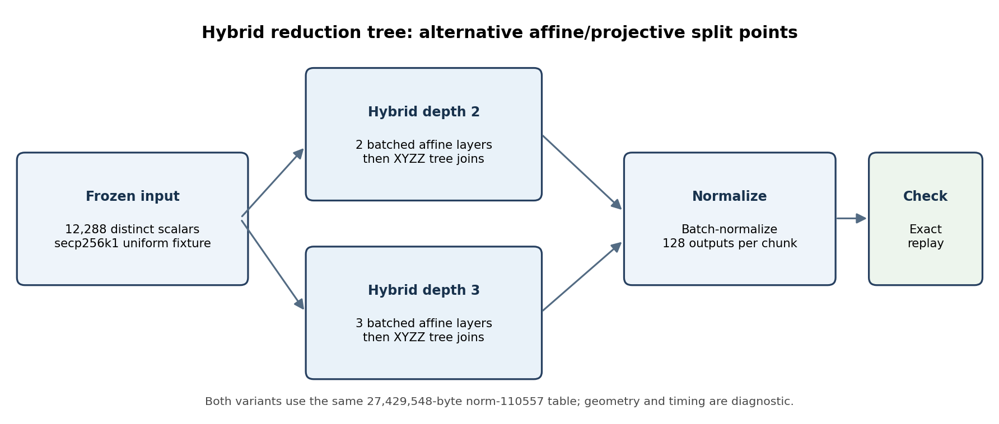
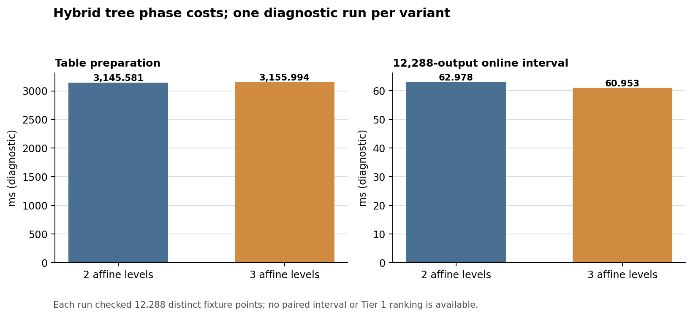

# Affine/projective reduction screen: diagnostic report

**Question.** Does moving the final one or two affine reduction levels into an XYZZ projective tree materially reduce the cost of the norm-110557 scalar path?

**Scope and method.** This report reviews the benchmark-only hybrid overlay for SEC 2 secp256k1, over `p = 2^256 − 2^32 − 977`, with subgroup order `n = FFFFFFFFFFFFFFFFFFFFFFFFFFFFFFFEBAAEDCE6AF48A03BBFD25E8CD0364141`. Both variants use the same norm-110557 table with 27,429,548 retained bytes and the frozen 12,288-distinct-scalar uniform fixture. The two-level variant performs two batched affine reductions before the remaining XYZZ joins; the three-level variant performs three. Each output batch contains 128 points, and the full stream is checked against the frozen expected points. This is a retrospective diagnostic review, not a predeclared Tier 1 comparison.

**Source and exact replay.** The [hash-guarded overlay](native_alt_hybrid_overlay.py) pins the native radix and unit-window source hashes, then inserts the alternative level counts and XYZZ batch normalization path. The [native provenance archive](alt-hybrid-native-provenance.tar.gz), SHA-256 `18cd292b61920873fa67cac896021ca5778d33d39a3ea803ee1fe31abfb25df5`, contains the exact source, binary, 12,288-case fixture, build logs, and per-variant output. Fixture SHA-256 is `a1c4964f174e36ea26f6a1897128f651a2ce7251e4bf4ffd532ff09221e721d3`; its base fixture SHA-256 is `7f4672b7b676969fe40056d0f14c6ecf45ad36109870cdf3466ebafd9e7b22d8`. The [independent receipt audit](audit_alt_hybrid.py) checks archive and source hashes, exact fixture identity, final scalar/point, full count, table size, and both replay outputs. It reproduces the [machine-readable receipt](alt-hybrid-audit.json) with `verified_exact_replay`.

**Result.** Both variants reproduced all 12,288 expected outputs. Depth 2 measured 3,145.580961 ms preparation and 62.978376 ms online; depth 3 measured 3,155.993970 ms preparation and 60.953218 ms online. Retained table size was unchanged. The online diagnostic difference is about 2.0 ms, while preparation differs by about 10.4 ms; the runs have no paired bootstrap interval, A/A noise gate, or Tier 1 isolation. Therefore these measurements establish correctness and phase costs, not a ranking or speedup. They show no large online reduction from moving one more affine level into the projective tail.

**Unresolved checks and graph status.** The two full-stream replays are correctness checks, not an independent formal proof of the native hybrid formulas or a fresh matched performance panel. The current report does not promote the nearby all-affine diagnostic into a comparison because its raw provenance is not part of this hybrid archive. No new curve, endomorphism, isogeny, candidate route, or measurement winner is proposed. The canonical curve/isogeny graph files are absent from this PR's experiment tree, so this report does not claim they were checked. The editable plot and diagram source is [`hybrid_tree_report_2026-10-19.py`](hybrid_tree_report_2026-10-19.py); SVG and PNG outputs and a PDF of this report are alongside it.
