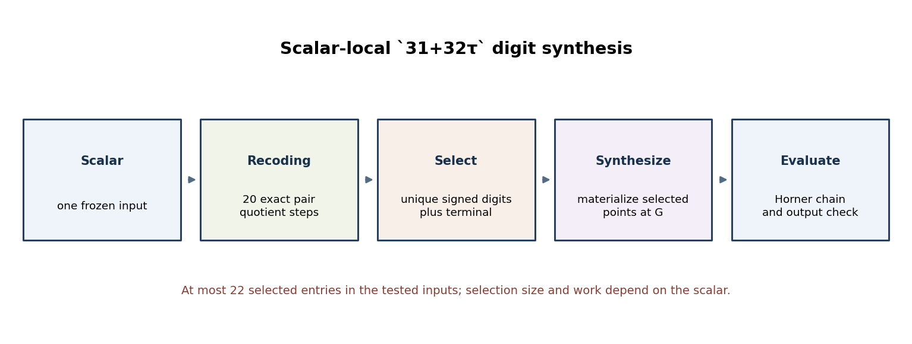
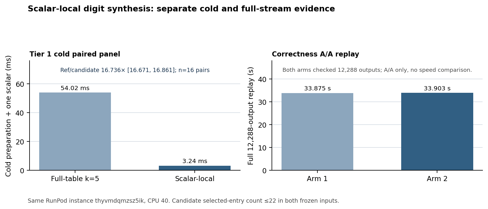

# Scalar-local `31+32τ` digit synthesis: cold path and full replay

**Question.** Can the `k=5` secp256k1 Horner path build only the digit points used by one scalar, and what does this change for one cold scalar versus a full frozen stream?

**Scope and inputs.** This experiment uses SEC 2 secp256k1, `E:y²=x³+7` over `p=2²⁵⁶−2³²−977`, with subgroup order `n=FFFFFFFFFFFFFFFFFFFFFFFFFFFFFFFEBAAEDCE6AF48A03BBFD25E8CD0364141`. The curve catalog has no EC1 secp256k1 record; these exact parameters identify the instance. The full fixture has 12,288 distinct scalar/point pairs and SHA-256 `a1c4964f174e36ea26f6a1897128f651a2ce7251e4bf4ffd532ff09221e721d3`.

{width=6.2in}

**Implementation review.** The hash-guarded [native overlay](native_sparse_on_demand_overlay.py) starts with the existing signed-pair recoder, gathers all twenty `31+32τ` digits, adds the terminal pair and a zero slot, then materializes the distinct selected points at `G`. It evaluates the same Horner chain and checks outputs against the fixture. The two frozen inputs used at most 22 selected entries, including the zero slot. This is an entry-count observation, not a peak-memory measurement; temporary arrays and maps also allocate.

The selected set and path length depend on the scalar: digit pairs, deduplication through `BTreeSet`/`BTreeMap`, point synthesis, terminal identity handling, and zero-digit additions vary with digit values. The implementation is therefore not constant-time and must not be treated as a secret-scalar multiplication path. The timing result is an engineering measurement of the frozen public fixture, not a side-channel assessment.

**One-scalar cold panel.** The committed [manifest](tier1-tau32-demand-cold-cpu40-manifest.json), [rules](tier1-tau32-demand-cold-cpu40-rules.json), [launch](tier1-tau32-demand-cold-cpu40-launch.json), [auditor](analyze_tier1_tau32_demand_cold.py), [audit receipt](tier1-tau32-demand-cold-cpu40-audit.json), [raw archive](tau32-demand-cold-tier1-raw.tar.gz), and [native provenance](tau32-demand-native-provenance.tar.gz) preserve serial job `a477a7b5198c4a9fa4db825ae0ce03ca` on RunPod `thyvmdqmzsz5ik`, CPU 40. Sixteen alternating pairs, 96 arms, and 48 pairs passed source/binary stability and all A/A controls. Fixture loading, process launch, and output checking are outside Rust `Instant`; the audited cold interval sums table/selector preparation and evaluation for each arm. The candidate has zero separately reported preparation, so comparing only `online_ms` would use the wrong boundary.

{width=6.2in}

| One frozen scalar, cold | Mean preparation + evaluation | Retained full reference table |
| --- | ---: | ---: |
| Full-table `31+32τ` reference | 54.023660 ms | 495,652 bytes |
| Scalar-local synthesis | 3.240267 ms | Not measured as peak memory |

The qualified reference/candidate paired median is `16.736384×`, with 95% paired bootstrap interval `[16.671217,16.860954]` across 16 valid comparisons. The A/A controls passed the predeclared `[0.90,1.11]` range. This is a Tier 1 one-scalar cold result on one observed allocation; it does not establish batch throughput or a memory advantage.

**Full-stream correctness replay.** The separate [manifest](tier1-tau32-demand-full-replay-cpu40-manifest.json), [rules](tier1-tau32-demand-full-replay-cpu40-rules.json), [launch](tier1-tau32-demand-full-replay-cpu40-launch.json), [auditor](analyze_tier1_tau32_demand_full_replay.py), [receipt](tier1-tau32-demand-full-replay-cpu40-audit.json), and [raw archive](tau32-demand-full-replay-raw.tar.gz) preserve job `22a05f971a814d459e3ec804fe967539`. Both candidate arms verified all 12,288 outputs; the audit independently replayed the final scalar multiplication and verified the binary/source and input hashes. The arm intervals were `33.874515 s` and `33.902518 s`. This is a correctness A/A replay, not a matched throughput comparison against the full-table implementation.

**Limits and graph status.** The [shared sparse-radix proof record](../../problems/secp256k1-sparse-radix-point-correctness.md) tracks the unresolved all-scalar digit-selector and curve group-law bridge. The full replay checks only the committed fixture; it does not prove universal correctness, constant-time behavior, or a peak-memory bound. The follow-on [projective builder](PROJECTIVE_DIGITS.md) is a separate implementation path with its own panels. No new curve or map was found. The study has no canonical curve/isogeny graph source to update, and `origin/main` contains no secp256k1 catalog entry. The [editable figure source](on_demand_digit_report_2026-10-19.py), SVG/180-dpi PNG copies, and this report's [PDF](ON_DEMAND_DIGITS_REPORT_2026-10-19.pdf) accompany the report.
