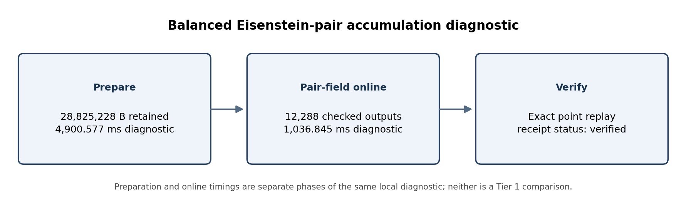
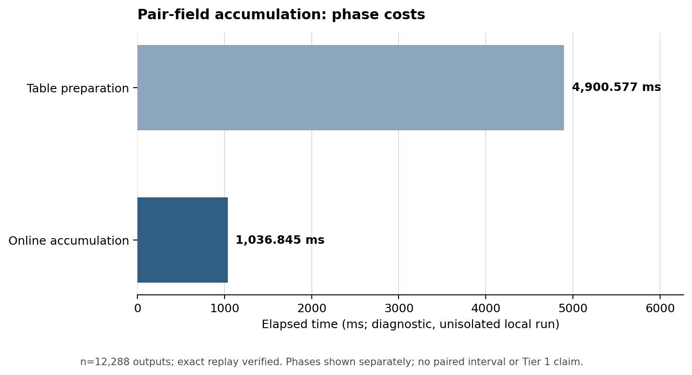

# Balanced-pair accumulation screen: diagnostic report

**Question.** Does keeping selected points in balanced Eisenstein-pair coordinates through the radix-14 group sum merit a qualified performance comparison against the ordinary-field cached paths?

**Scope and method.** This is a source and evidence review of the benchmark-only pair-accumulation overlay, not a production change. The fixture contains 12,288 frozen secp256k1 scalar/point pairs; its base fixture SHA-256 is `7f4672b7b676969fe40056d0f14c6ecf45ad36109870cdf3466ebafd9e7b22d8`. The curve is SEC 2 secp256k1 over `p = 2^256 − 2^32 − 977`, with subgroup order `n = FFFFFFFFFFFFFFFFFFFFFFFFFFFFFFFEBAAEDCE6AF48A03BBFD25E8CD0364141` and generator `G`; the native provenance archive carries the exact fixture and executable. The [hash-guarded overlay](native_pair_accumulation_overlay.py) prepares the frozen norm-136531 affine table as balanced `(x,y)` pairs, applies unit rotations and signs in the pair field, performs mixed Jacobian additions, batch-normalizes 128 outputs, and converts final affine values back to conventional field elements. The measured path preserves preparation and online time as separate phases.

**Evidence.** The run is identified by native provenance archive SHA-256 `2f36e7c6d52a85790f17428daedec09c95d3c3e936f44a655c18725ecb2c9c1f`. The independent [receipt auditor](audit_pair_accumulation.py) reproduces [`pair-accumulation-audit.json`](pair-accumulation-audit.json): status `verified_exact_replay`, 12,288 outputs, 28,825,228 retained bytes, 4,900.576860 ms preparation, and 1,036.845373 ms online. The archive includes the exact source, executable, fixture, build logs, stdout, and stderr. The [existing result record](PAIR_ACCUMULATION.md) links the implementation and provenance.

**Finding and limits.** The replay is positive correctness evidence and the performance screen is negative: pair-field online accumulation took about 1.04 seconds after about 4.90 seconds of table preparation, while nearby ordinary-field cached diagnostics were roughly 64–68 ms. Those neighboring timings are not a matched panel, so this evidence has no paired interval and does not establish a qualified speed ratio. It is sufficient to reject direct pair-field accumulation as the next timing candidate, while retaining the measured phase and memory costs for future work. The path remains diagnostic and does not change default scalar multiplication.

**Checks and graph status.** The receipt auditor was rerun against the committed archive and reproduced its receipt. The pair-field algebraic representation is limited to secp256k1 and the stated subgroup; no new curve, endomorphism, isogeny, candidate route, or measured winner is proposed. The canonical curve/isogeny graph files are not present in this PR's experiment tree, so this report makes no claim that those main-branch graphs were checked. The editable figure source is [`pair_accumulation_report_2026-10-19.py`](pair_accumulation_report_2026-10-19.py); the generated SVGs and PDF accompany this report.
