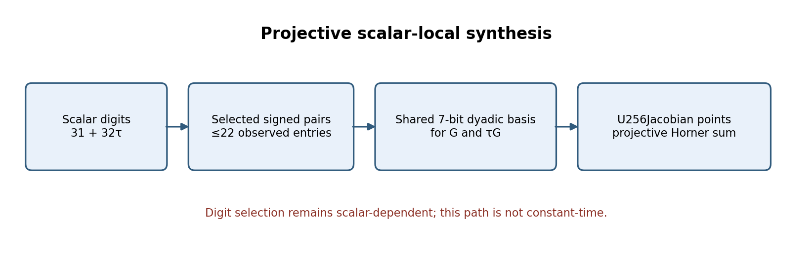
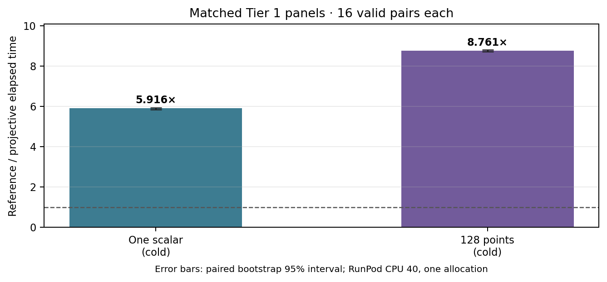

# Native projective synthesis for scalar-local Eisenstein digits

**Question.** Does constructing selected `31+32τ` digit points directly in native projective coordinates improve the scalar-local path, and what correctness evidence covers the measured and full-fixture workloads?

**Scope and instance.** This is an engineering study of SEC 2 secp256k1 (`E: y²=x³+7`, `p=2²⁵⁶−2³²−977`, subgroup order `n=FFFFFFFFFFFFFFFFFFFFFFFFFFFFFFFEBAAEDCE6AF48A03BBFD25E8CD0364141`). The fixture contains 12,288 scalar/point pairs. Its SHA-256 is:

`a1c4964f174e36ea26f6a1897128f651a2ce7251e4bf4ffd532ff09221e721d3`

It does not add a curve, isogeny, scalar rule, or universal correctness theorem.

{width=6.2in}

**Implementation review.** The hash-guarded [native overlay](native_sparse_projective_digit_overlay.py) replaces affine point synthesis from the selected signed digit pairs with a shared seven-bit dyadic basis for `G` and `τG`. Each selected pair is assembled using native `U256Jacobian` operations, and the Horner accumulator consumes those projective points directly via `add_projective`. This avoids the earlier pair-field window construction and affine conversion. The frozen manifests observed at most 22 selected entries; this is not a peak-memory measurement.

The selected pairs, map lookups, synthesis loop, and additions still depend on scalar digits. The implementation is therefore **not constant-time** and is not suitable for secret-scalar use. No side-channel assessment or peak-memory measurement was performed.

**Matched Tier 1 panels.** The one-scalar and 128-point v2 manifests compare projective synthesis against the preceding scalar-local builder on identical frozen inputs. Both ran on RunPod pod `thyvmdqmzsz5ik`, CPU 40, with 16 alternating repetitions, 96 completed arms, 48 completed pairs, and adjacent reference/reference A/A controls. The Rust `Instant` interval covers scalar-local preparation plus evaluation; process launch, fixture loading, and external replay are outside the interval. The two [manifests](tier1-tau32-projective-1-v2-cpu40-manifest.json) and [128-point manifest](tier1-tau32-projective-128-v2-cpu40-manifest.json), their [rules](tier1-tau32-projective-1-v2-cpu40-rules.json), [launches](tier1-tau32-projective-1-v2-cpu40-launch.json), and archived [raw outputs](tau32-projective-1-v2-raw.tar.gz) identify job `508270ee2b714b2db002f9c37b906f38`; corresponding [128-point launch](tier1-tau32-projective-128-v2-cpu40-launch.json) and [raw outputs](tau32-projective-128-v2-raw.tar.gz) identify job `47fb3c09560f494eb27769d25135e7e4`. The common [native provenance](tau32-projective-native-provenance.tar.gz) pins the sources and executable.

{width=5.8in}

| Frozen workload | Earlier builder mean | Projective mean | Qualified paired median | Paired bootstrap 95% interval |
| --- | ---: | ---: | ---: | ---: |
| One scalar, cold | 3.199 ms | 0.543 ms | 5.916× | [5.853, 5.937] |
| 128 points, cold | 349.468 ms | 39.829 ms | 8.761× | [8.719, 8.802] |

The [independent panel auditor](analyze_tier1_tau32_projective.py) verified frozen source/binary and raw archive hashes, commands and outputs, the pair ledgers, A/A gates, and independent replay of all measured outputs. Both comparisons were qualified, artifact-stable, and had no invalid arms or A/A failures. These are Tier 1 observations for one allocation and the specified cold workloads, not a general performance guarantee.

**Dispatch correction retained.** The first manifests accidentally dispatched the earlier scalar-local executable in both comparison slots. The preserved jobs `6815d8a260564a7ba4bbd31d166a969e` and `844d71a000a94f0dafc1dc9a6b9f54a1` are valid A/A controls only; the [v1 audit receipts](tier1-tau32-projective-1-cpu40-audit.json) classify them as `invalid_plan_candidate_equals_reference` and leave the speedup null. The corrected v2 plans were frozen before dispatch and name the projective candidate. No data from the v1 controls is promoted as a performance result.

**Full-fixture correctness replay.** The separate serial [manifest](tier1-tau32-projective-full-replay-cpu40-manifest.json), [launch](tier1-tau32-projective-full-replay-cpu40-launch.json), and [raw archive](tau32-projective-full-replay-raw.tar.gz) preserve job `3cddff74cf9349bdaec7b6910c4884a0`. Both identical candidate arms verified all 12,288 outputs with stable artifacts; the [auditor](analyze_tier1_tau32_projective_full_replay.py) also checked the frozen fixture digest, binary, raw commands and output, pair ledger, and independent final-scalar replay. The arms took 3.850 s and 3.854 s. This is an A/A correctness and cost-shape replay with no speedup claim; it does not establish correctness for all scalars.

**Graph and proof status.** The study concerns an implementation change for the existing secp256k1 instance, so it creates no new canonical curve/isogeny graph edge or node. I checked the experiment's [adaptive digit graph record](DIGIT_GRAPH.md), the earlier [scalar-local report](ON_DEMAND_DIGITS_REPORT_2026-10-19.md), and the repository's canonical candidate catalog and route records; none is changed by this result. The finite replay does not prove the all-scalar group-law refinement. The shared [sparse-radix correctness problem](../../problems/secp256k1-sparse-radix-point-correctness.md) tracks the unresolved selector and native-to-mathematical bridge, with its acceptance criteria and next discriminating checks.

The [editable figure source](projective_digit_report_2026-10-19.py), SVG and 180-dpi PNG copies, and this report's [PDF](PROJECTIVE_DIGITS_REPORT_2026-10-19.pdf) are committed together. The PDF includes the report and both visuals.
