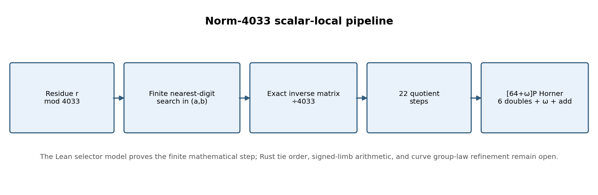
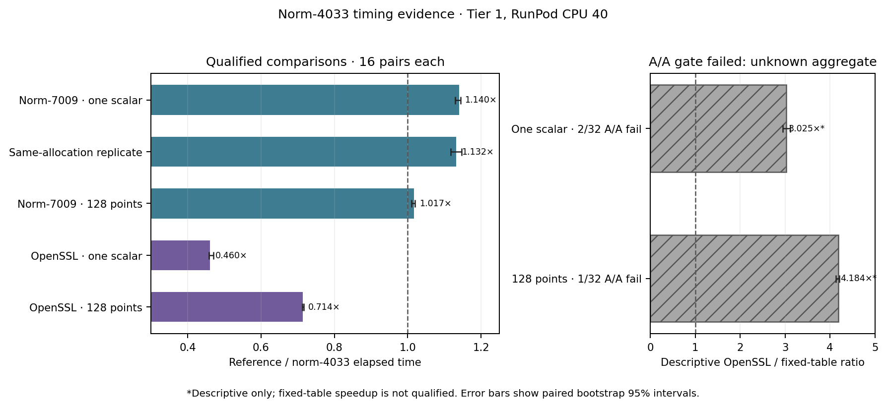

# Norm-4033 Eisenstein radix: selector proof, native costs, and limits

**Question.** Does the `π=64+ω=65−τ` Eisenstein radix improve scalar-local multiplication over the preceding norm-7009 path, and how does the result compare with OpenSSL's fixed-base secp256k1 multiplication?

**Scope and instance.** This study uses SEC 2 secp256k1 (`E:y²=x³+7`, `p=2²⁵⁶−2³²−977`, subgroup order `n=FFFFFFFFFFFFFFFFFFFFFFFFFFFFFFFEBAAEDCE6AF48A03BBFD25E8CD0364141`). The full fixture has 12,288 scalar/point pairs. Its SHA-256 is:

`a1c4964f174e36ea26f6a1897128f651a2ce7251e4bf4ffd532ff09221e721d3`

It is an implementation and measurement study for this existing curve; it adds no curve, isogeny, or canonical graph edge.

{width=6.2in}

**Selector and arithmetic.** The [hash-guarded overlay](native_sparse_radix4033_overlay.py) uses `π=64+ω=65−τ` of norm 4033. Its digit selector solves `a+65b ≡ r (mod 4033)`, lifts the residue, and searches a five-by-five window around a rounded norm-minimizing center with deterministic tie breaks. The inverse matrix for multiplication by `65−τ` produces quotient numerators `(62A−3B, A+65B)`, each divided exactly by 4033. The recoder uses 22 steps; the Horner action is `[64+ω]P`, implemented with six doublings, one order-three x rotation, and one projective addition.

The [source-bound selector auditor](audit_radix4033_selector.py) independently checks all 2,017 nonnegative signed residues against an exhaustive lattice minimum; negation covers the remaining residues for 4,033 total. It verifies the quotient congruence for every class, maximum selected-digit norm 1,323, and maximum coordinate magnitudes 63 and 42. This is a finite residue-domain result, not a source-level proof of the Rust fixed-width operations or group law.

**Lean scope.** The pinned [radix module](Radix4033.lean) checks the norm, quotient adjugate, exact quotient under the selector congruence, and radix action. [Radix4033Bounds.lean](Radix4033Bounds.lean) proves a uniform rounded-digit norm bound and a 22-step terminal table bound under explicit lattice-envelope and quotient hypotheses. [Radix4033Selector.lean](Radix4033Selector.lean) proves the rounded witness lies in the finite search and that the mathematical least-norm choice yields an exact quotient for every integer-pair state. I reran all three checkers with Lean 4.34.1; the dated receipts ([radix](lean-checks-2026-10-19/radix4033-lean-check.json), [bounds](lean-checks-2026-10-19/radix4033-bounds-lean-check.json), [selector](lean-checks-2026-10-19/radix4033-selector-lean-check.json)) record source hashes and `#print axioms`. The Rust tie order, signed-limb arithmetic, x rotation, and curve group-law refinement remain open.

**Tier 1 comparison with norm-7009.** On RunPod pod `thyvmdqmzsz5ik`, CPU 40, the one-scalar plan completed 96 arms and 48 pairs with all A/A and artifact checks passing. The primary [manifest](tier1-radix4033-1-cpu40-manifest.json), [rules](tier1-radix4033-1-cpu40-rules.json), [launch](tier1-radix4033-1-cpu40-launch.json), and [raw archive](radix4033-1-raw.tar.gz) identify job `5198a67ca1fb418884feeb1585ad7d67`. A separately frozen same-allocation replication with the same plan used job `85e158fb07c14ef78a803932b89da785`; its [launch](tier1-radix4033-1-cpu40-replication-launch.json), [audit](tier1-radix4033-1-cpu40-replication-audit.json), and [raw archive](radix4033-1-replication-85e158fb-raw.tar.gz) preserve the 96 arms and 48 pairs. The prepared 128-point panel is job `8fd7116208d94dee871413c6e33b4859`, with its [plan](tier1-radix4033-128-cpu40-manifest.json), [rules](tier1-radix4033-128-cpu40-rules.json), [launch](tier1-radix4033-128-cpu40-launch.json), and [raw archive](radix4033-128-raw.tar.gz).

| Workload | Norm-7009 mean | Norm-4033 mean | Qualified reference/candidate median | Paired bootstrap 95% interval |
| --- | ---: | ---: | ---: | ---: |
| One scalar, initial panel | 0.542 ms | 0.471 ms | 1.140× | [1.130, 1.144] |
| One scalar, same-allocation replication | 0.542 ms | 0.490 ms | 1.132× | [1.117, 1.146] |
| 128-point prepared stream | 39.500 ms | 38.959 ms | 1.017× | [1.010, 1.019] |

The [independent auditor](analyze_tier1_radix4033.py) verified the source, binary, raw commands and outputs, pair records, independent scalar replay of measured points, artifact stability, and A/A controls. Each panel is Tier 1 evidence from one allocation; the one-scalar replication is not a second-allocation replication.

**Comparison with OpenSSL.** The [OpenSSL baseline](openssl_secp256k1_baseline.c) calls OpenSSL 3.0.13 `EC_POINT_mul` on the same scalars and points. Its timed interval includes multiplication and affine `x:y` serialization; fixture parsing, curve setup, one warm multiplication, and process launch are excluded. The custom path times scalar recoding, graph digit synthesis, Horner evaluation, and affine output. Thus the reference/candidate ratios below compare the declared application intervals, with the excluded OpenSSL warmups retained in the audit.

| Workload | OpenSSL mean | Norm-4033 mean | Qualified OpenSSL/custom median | Paired bootstrap 95% interval |
| --- | ---: | ---: | ---: | ---: |
| One scalar | 0.220 ms | 0.474 ms | 0.460× | [0.458, 0.470] |
| 128 points | 27.653 ms | 38.792 ms | 0.714× | [0.712, 0.717] |

These qualified ratios below 1 show the norm-4033 scalar-local path was slower than OpenSSL on these cold and batched workloads. Each panel completed 96 arms and 48 pairs with passing A/A controls. Jobs `efdcff6ed47646598f58aed0e059bcf5` and `71ebf8c5348a487a9a505933bb892b93` are preserved by their [one-scalar](tier1-radix4033-vs-openssl-1-cpu40-launch.json) and [128-point launch records](tier1-radix4033-vs-openssl-128-cpu40-launch.json), with matching [audits](tier1-radix4033-vs-openssl-1-cpu40-audit.json) and [raw archives](radix4033-vs-openssl-1-raw.tar.gz). The [auditor](analyze_tier1_radix4033_vs_openssl.py) verifies both OpenSSL and candidate source/binary hashes and independently replays the measured outputs.

{width=6.25in}

**Fixed-table engineering result.** Reusing the norm-4033 digit and terminal tables reduces repeated point synthesis. The table retains 436,132 bytes; setup averaged 48.128 ms for the one-scalar panel and 49.497 ms for 128 points. The measured online means were 0.073 ms and 6.741 ms, with descriptive OpenSSL/reference ratios 3.025× and 4.184×. However, the frozen `[0.90,1.11]` calibration rule failed in 2 of 32 one-scalar A/A calibration pairs and 1 of 32 128-point A/A pairs. Therefore the aggregate speedup is **unknown**; the gray bars in the graph are descriptive only and not qualified comparisons. Their jobs were `1eab28e2edf04d8194bb174915625f37` and `2f8cb0ec64a147199e9e1b1d8d89da60`; the [one-scalar](tier1-radix4033-vs-openssl-fixed-table-1-cpu40-audit.json) and [128-point audits](tier1-radix4033-vs-openssl-fixed-table-128-cpu40-audit.json) retain the failed controls and full intervals.

**Fixture replays.** The scalar-local candidate's A/A full-fixture replay (job `1d3cf18c0fc94bf3b4c9646d783156f2`) checked all 12,288 outputs in each arm at 3.652 s and 3.670 s. The fixed-table A/A replay (job `9beb2491d85c42da9652e15bb0cfe24e`) also checked all 12,288 outputs in each arm; its online intervals were 626.201 ms and 625.523 ms, with 47.165 ms and 47.191 ms preparation. Both have null speedup claims. Their [auditors](analyze_tier1_radix4033_full_replay.py) verify source, binary, fixture, outputs, raw records, and independent final-scalar replay.

**Graph and proof status.** No curve or route changed; I checked the canonical curve catalog and route records and found no graphable change. The [norm-4033 problem record](../../problems/secp256k1-radix4033-native-refinement.md) tracks the remaining selector-to-Rust and concrete point-map/group-law refinement. The measurements are workload- and allocation-specific, and the variable-digit path has not received a side-channel assessment. The [editable figure source](radix4033_report_2026-10-19.py), SVG and 180-dpi PNG copies, and this report's [PDF](RADIX4033_REPORT_2026-10-19.pdf) accompany the result.
