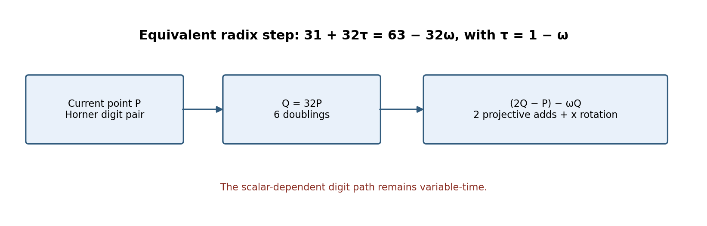
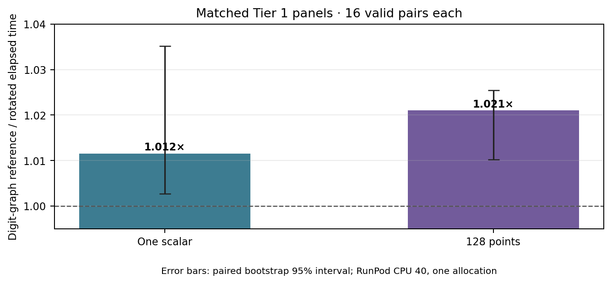

# Rotated evaluation of the `31+32τ` radix step

**Question.** Can the sparse `31+32τ` Horner step use the secp256k1 order-three x rotation to replace explicit `τ` evaluation, and does that schedule change measured cold costs?

**Scope and instance.** This is an implementation comparison on SEC 2 secp256k1 (`E:y²=x³+7` over `p=2²⁵⁶−2³²−977`, prime subgroup order `n=FFFFFFFFFFFFFFFFFFFFFFFFFFFFFFFEBAAEDCE6AF48A03BBFD25E8CD0364141`). The frozen input fixture has 12,288 scalar/point pairs. Its SHA-256 is:

`a1c4964f174e36ea26f6a1897128f651a2ce7251e4bf4ffd532ff09221e721d3`

No new curve or scalar rule is proposed.

{width=6.2in}

**Identity and native review.** In the pair basis, `τ=1−ω`, so `31+32τ=63−32ω`. With `Q=32P`, the native candidate evaluates `(2Q−P)−ωQ` per nonidentity Horner step: six doublings, two projective additions, and one x rotation. The hash-guarded [overlay](native_sparse_rotated_step_overlay.py) changes only this radix step and the pilot entry point relative to the adaptive digit graph.

The pinned [Lean module](RotatedRadixStep.lean) proves `τ=1−ω`, the pair-lattice identity `63−32ω=31+32τ`, and its transfer under explicit addition, subtraction, scaling, and endomorphism-map hypotheses. I reran the [Lean checker](check_rotated_radix_step_lean.py) with the pinned 4.34.1 release; the dated [fresh receipt](lean-checks-2026-10-19/rotated-radix-step-lean-check.json) preserves source hashes and `#print axioms` for all three declarations. The module does not prove the native x-rotation implementation or curve-coordinate/group-law refinement; the fixture replay checks that implementation on a finite workload.

The radix digit selection remains scalar-dependent, as in the preceding graph implementation. The path is **not constant-time** and must not be used for secret-scalar multiplication.

**Matched Tier 1 panels.** The [one-scalar](tier1-tau32-rotated-step-1-cpu40-manifest.json) and [128-point](tier1-tau32-rotated-step-128-cpu40-manifest.json) plans compare the rotated step with the digit-graph path on identical frozen inputs, RunPod pod `thyvmdqmzsz5ik`, CPU 40, 16 alternating repetitions, and adjacent reference/reference A/A controls. Each panel completed 96 arms and 48 pairs. Rust `Instant` includes scalar-local preparation and Horner evaluation; fixture loading, process launch, and external replay are outside the timed interval. The [one-scalar rules](tier1-tau32-rotated-step-1-cpu40-rules.json), [launch](tier1-tau32-rotated-step-1-cpu40-launch.json), and [raw archive](tau32-rotated-step-1-raw.tar.gz) identify job `c61069334c8a4d83bebbb05dc242e1b2`. The [128-point rules](tier1-tau32-rotated-step-128-cpu40-rules.json), [launch](tier1-tau32-rotated-step-128-cpu40-launch.json), and [raw archive](tau32-rotated-step-128-raw.tar.gz) identify job `93837f49c72c4f0d9311366066628dc7`. The [native provenance](tau32-rotated-step-native-provenance.tar.gz) retains both exact source trees and binaries.

{width=5.8in}

| Frozen workload | Graph reference mean | Rotated candidate mean | Qualified paired median | Paired bootstrap 95% interval |
| --- | ---: | ---: | ---: | ---: |
| One scalar | 0.561 ms | 0.544 ms | 1.012× | [1.003, 1.035] |
| 128 points | 39.898 ms | 39.170 ms | 1.021× | [1.010, 1.025] |

The [independent auditor](analyze_tier1_tau32_rotated_step.py) checked hashes, raw commands and output, pair records, independent scalar replay of every measured fixture point, artifact stability, and all A/A controls. Both panels were qualified with no invalid arms or A/A failures. These are small Tier 1 observations on one allocation, not a general performance guarantee.

**Full-fixture replay.** The frozen [manifest](tier1-tau32-rotated-step-full-replay-cpu40-manifest.json), [launch](tier1-tau32-rotated-step-full-replay-cpu40-launch.json), and [raw archive](tau32-rotated-step-full-replay-raw.tar.gz) preserve this run:

`09eeb419886a43e393492b4511a8c233`

Both identical candidate arms verified all 12,288 outputs; the [auditor](analyze_tier1_tau32_rotated_step_full_replay.py) checked the fixture, binary, raw commands, pair ledger, and independent final-scalar replay. Arm times were 3.699 s and 3.712 s. This A/A replay has a null speedup claim and proves neither all-scalar correctness nor a matched full-stream speedup.

**Graph status and remaining bridge.** The step is an implementation transform for an existing curve and changes no canonical curve/isogeny node or route. I checked the experiment's [adaptive digit graph study](DIGIT_GRAPH_REPORT_2026-10-19.md) and the repository curve catalog/route records; no graphable fact changed. The shared [sparse-radix point-correctness problem](../../problems/secp256k1-sparse-radix-point-correctness.md) remains open for the selector, native `ω`/`τ` maps, and curve group-law refinement.

The [editable figure source](rotated_step_report_2026-10-19.py), SVG and 180-dpi PNG copies, and this report's [PDF](ROTATED_RADIX_STEP_REPORT_2026-10-19.pdf) are committed together.
