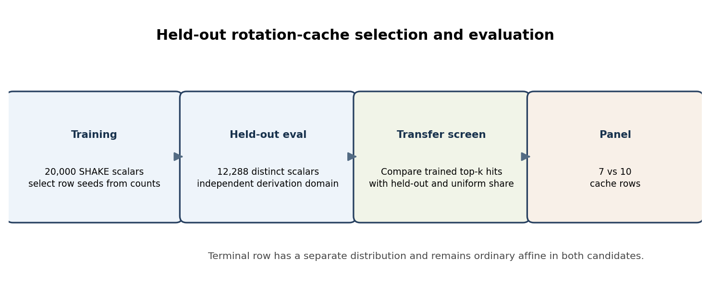
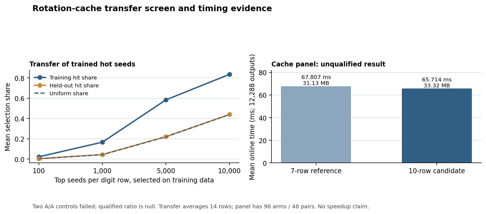

# Radix-14 rotation-cache transfer and panel: diagnostic report

**Question.** Do training-hot digit seeds transfer to an unseen scalar stream, and does caching two-x rotation data in ten digit rows improve the seven-row reference under the frozen 32 MiB cap?

**Scope and inputs.** This report covers two linked but distinct results for SEC 2 secp256k1 over `p = 2^256 − 2^32 − 977`, subgroup order `n = FFFFFFFFFFFFFFFFFFFFFFFFFFFFFFFEBAAEDCE6AF48A03BBFD25E8CD0364141`. The transfer screen uses 20,000 SHAKE256-derived training scalars and a separate 12,288-scalar evaluation fixture; their derivation domains differ. The training and evaluation histogram archives are SHA-256 `5bfc62f10c60bcf0bc47ef68db8c1cc99561037fad8218d5cdddd4fb1b1a6fc5` and `34aacf4063e4f5716f5938dd513d572a57ea31e59cd87ed3de6218718fc6f93d`. The held-out fixture is SHA-256 `a1c4964f174e36ea26f6a1897128f651a2ce7251e4bf4ffd532ff09221e721d3`.

{width=6.35in}

**Transfer method and finding.** For each of the fourteen digit rows, the analysis sorts seeds by training count and measures their share of training and held-out selections at `k=100, 1,000, 5,000, 10,000`, against the uniform share `k/22,756`. The [reanalyzer](analyze_rotation_seed_transfer.py) was rerun from decompressed committed histograms and reproduced `rotation-seed-transfer-audit.json` byte-for-byte. Mean training/evaluation Pearson correlation across those fourteen rows is `0.003705`. For top 1,000 seeds per row, mean training coverage is `16.6972%`, held-out coverage is `4.4789%`, and uniform coverage is `4.3944%`. Training-hot seeds therefore show no useful transfer on the held-out rows. The terminal row is analyzed separately because its distribution differs; it remains ordinary affine in both candidates.

**Cache panel and measurement boundary.** The [ten-row overlay](native_cache10_overlay.py) selects rows `0,1,3,4,6,7,9,10,12,13` from the training-based rule without consulting held-out scalars. The reference stores two-x values in seven even rows. The frozen serial Tier 1 panel used 16 alternating pairs, 96 arms, 48 pairs, 12,288 checked outputs per arm, a fixed 33,554,432-byte cap, and one RunPod instance (`thyvmdqmzsz5ik`, CPU 40). It measures 96 consecutive 128-scalar batches after fixture loading and table construction, with output checking outside the timed interval; preparation and retained bytes are separate.

{width=6.35in}

The independent [panel auditor](analyze_tier1_cache10.py) was rerun and reproduced `tier1-cache10-cpu40-audit.json` byte-for-byte. Native provenance archive SHA-256 is `0320bddb984f3f3afc958d0d2e2467779596ebc3516f612f07ded96cf25ff6da`; raw panel archive SHA-256 is `0f68e3e2c1c54ba00013b803b6a135b484b9c3e1742286650952603f0e087f47`; job ID is `e0d10d9a14e4406684212690eb680518`. The reference averaged 67.807406 ms and retained 31,133,444 bytes; the candidate averaged 65.714195 ms and retained 33,318,020 bytes. The descriptive paired median reference/candidate ratio is `1.028614`, with bootstrap interval `[1.014163,1.046736]`, but two A/A controls were outside the predeclared `[0.90,1.11]` band (`1.203446`, `1.201942`). Under the frozen gate the qualified ratio is null and status is `unknown_after_tier_gate`.

**Decision and limits.** The held-out screen rejects selecting hot seeds from the 20,000-scalar profile. The ten-row panel does not establish a performance winner: the candidate uses about 2.19 MB more table memory, and failed A/A controls invalidate the timing aggregate. The exact replay and retained-memory counts pass, but this is a batch result on one observed cloud instance; physical-host isolation is unobserved. A new timing decision needs a newly frozen environment and manifest. The editable figure source is [`rotation_cache_report_2026-10-19.py`](rotation_cache_report_2026-10-19.py); SVG/PNG outputs and a PDF accompany this report.

**Open checks and graph status.** The fixed row schedule is not shown to be globally memory-optimal. The replay does not prove constant-time behavior or formal correctness of the implementation. No new curve, endomorphism, isogeny, candidate route, or winner is proposed. Canonical curve/isogeny graph files are absent from this PR's experiment tree, so this report makes no claim that main-branch graph files were checked.
