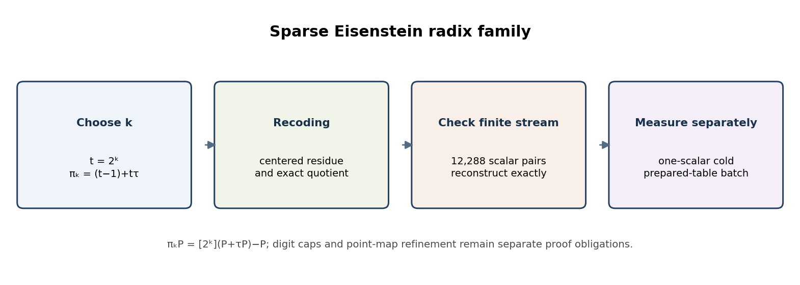
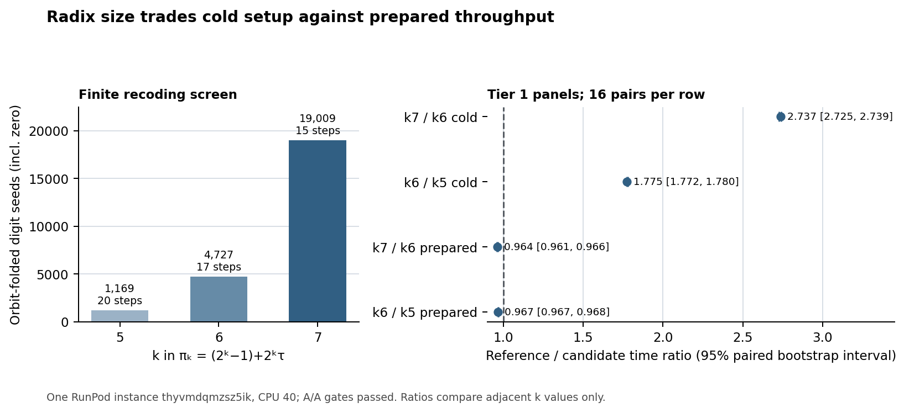

# Sparse Eisenstein radix family: screen, proof boundary, and paired costs

**Question.** Across `πₖ=(2ᵏ−1)+2ᵏτ`, how do finite-fixture recoding geometry, one-scalar cold cost, and prepared-table throughput vary for `k=5,6,7`?

**Scope and input.** The experiment uses SEC 2 secp256k1, `E: y²=x³+7` over `p=2²⁵⁶−2³²−977`, and prime subgroup order `n=FFFFFFFFFFFFFFFFFFFFFFFFFFFFFFFEBAAEDCE6AF48A03BBFD25E8CD0364141`. The 12,288-scalar fixture SHA-256 is `a1c4964f174e36ea26f6a1897128f651a2ce7251e4bf4ffd532ff09221e721d3`. The curve catalog on `origin/main` has no secp256k1 EC1 record; this report identifies the exact standard curve and subgroup parameters and does not mint a new ID.

{width=6.25in}

**Algebra and proof status.** Set `t=2ᵏ`, so `πₖ=(t−1)+tτ`, with `τ²=3τ−3`. Pair multiplication is `((t−1)u−3tv, tu+(4t−1)v)`, its norm is `7t²−5t+1`, and the point action is `[t](P+τP)−P`. The pinned [SparseRadixFamily.lean](SparseRadixFamily.lean) proves those identities for every integer `t`, the quotient residue `τ=4−7t`, its root polynomial, and norm scaling. It also proves terminal norm bounds for `k=5` and `k=6` under explicit per-step recurrence and digit-cap hypotheses. The [Lean checker](check_sparse_radix_family_lean.py) and committed [receipt](sparse-radix-family-lean-check.json) record successful Lean 4.34.1 builds and `#print axioms`; the source hash in the receipt matches the current file. I could not rerun Lean in this worktree because no `lean` executable is installed.

The recurrence hypotheses are not proved for the selected native digits. The [integer screen](screen_sparse_radix_family.py) and its committed [receipt](sparse-radix-family-screen.json) check exact reconstruction on the fixture, not a global termination theorem. This review used the committed screen receipt and source; it did not regenerate that Python-produced receipt. The recoding report says `native_point_replay: pending` for each row because this screen operates on integer pairs. Separate native panels below check the implemented point outputs for their frozen workloads; neither establishes a curve-wide formal refinement.

| `k` | Radix | Norm | Digit seeds incl. zero | Fixture steps | Largest observed terminal norm |
| ---: | --- | ---: | ---: | ---: | ---: |
| 5 | `31+32τ` | 7,009 | 1,169 | 20 | 1 |
| 6 | `63+64τ` | 28,353 | 4,727 | 17 | 9 |
| 7 | `127+128τ` | 114,049 | 19,009 | 15 | 7 |

The counts and terminal values are finite-fixture observations. They do not prove selector optimality or a uniform digit cap. The chosen counts decrease as `k` rises in this fixture while the number of steps falls; the table geometry and measured costs below are the actual comparison evidence.

**Native panels.** Four retrospective Tier 1 comparisons ran serially on RunPod `thyvmdqmzsz5ik`, CPU 40; each had 16 pairs (96 arms, 48 pairs) and passing artifact/A/A gates. Cold panels charge table setup plus one scalar; prepared panels time 12,288 scalars after setup. Re-running each existing auditor reproduced its committed JSON receipt byte-for-byte.

{width=6.25in}

| Workload and comparison | Reference mean | Candidate mean | Reference/candidate paired median (95% interval) | Retained bytes, ref → cand |
| --- | ---: | ---: | ---: | ---: |
| One-scalar cold, `k=7 → k=6` | 255.343752 ms | 93.577572 ms | 2.737020 [2.725245, 2.738990] | 2,636,452 → 922,596 |
| One-scalar cold, `k=6 → k=5` | 93.497948 ms | 52.673690 ms | 1.774959 [1.771918, 1.779729] | 922,596 → 495,652 |
| Prepared 12,288-point stream, `k=7 → k=6` | 602.053380 ms | 624.655146 ms | 0.963705 [0.961166, 0.965874] | 2,636,452 → 922,596 |
| Prepared 12,288-point stream, `k=6 → k=5` | 625.229301 ms | 645.932010 ms | 0.967429 [0.966595, 0.968334] | 922,596 → 495,652 |

The panel jobs, in table order, are [cold k7/k6 `1ebc1b95247c45bb90c957bed33ba2b1`](tier1-tau64-cold-cpu40-audit.json), [cold k6/k5 `8e13db8a4f57421f8bfe92c47c1131fe`](tier1-tau32-cold-cpu40-audit.json), [prepared k7/k6 `664fc7a36b064850ae1c103b186f057a`](tier1-tau64-online-cpu40-audit.json), and [prepared k6/k5 `6348a3b2fdc74dbf81fd861372894c54`](tier1-tau32-online-cpu40-audit.json). The linked study note indexes manifests, rules, raw archives, and source provenance. Cold panels favor the smaller candidate radix for setup plus one scalar; prepared panels favor the larger reference radix for this stream. These are separate workloads and adjacent comparisons, not one universal winner.

**Native and graph limits.** The [k=6 overlay](native_sparse_radix64_overlay.py), [k=5 overlay](native_sparse_radix32_overlay.py), and Tier 1 audits provide native point-replay evidence for the frozen workloads; the audit receipts check outputs, hashes, timing boundaries, and paired gates. The family screen remains pair-only (`native_point_replay: pending`). Uniform selected-digit caps for `k=5,6`, per-step code-to-Lean refinement, and the curve-wide point-map/group-law bridge remain open, so general correctness for every subgroup scalar is not established.

No new curve or isogeny route was found. The study tree has no canonical curve/isogeny graph to update; `origin/main` has no secp256k1 catalog record. The method and measurement graphs document this existing radix study and change no curve/map edge. The [editable figure source](sparse_radix_family_report_2026-10-19.py) reads committed receipts; SVG/PNG and this report's [PDF](SPARSE_RADIX_FAMILY_REPORT_2026-10-19.pdf) are included.
