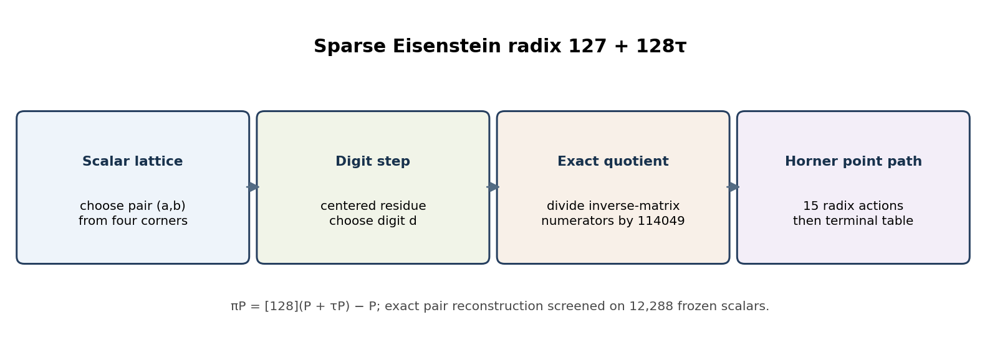
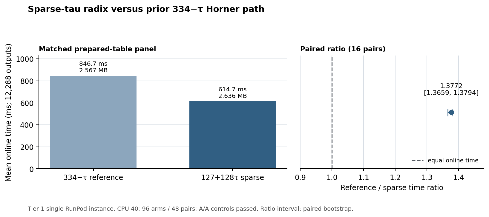

# Sparse Eisenstein radix on secp256k1: exact recoding and paired panel

**Question.** Does the table-light radix `π = 127 + 128τ` reproduce the frozen secp256k1 scalar stream, and how does its prepared-table online time compare with the earlier `334−τ` Horner path?

**Scope and identity.** The curve is SEC 2 secp256k1, `E: y² = x³ + 7` over `p = 2²⁵⁶ − 2³² − 977`, using the prime-order subgroup `n = FFFFFFFFFFFFFFFFFFFFFFFFFFFFFFFEBAAEDCE6AF48A03BBFD25E8CD0364141` generated by `G`. No immutable EC1 curve/subgroup ID for secp256k1 exists in the current curve catalog, so this result uses the standard exact curve and subgroup parameters rather than inventing a registry ID. The scalar fixture contains 12,288 distinct SHAKE256-derived scalars; its SHA-256 is `a1c4964f174e36ea26f6a1897128f651a2ce7251e4bf4ffd532ff09221e721d3`.

{width=6.25in}

**Derived pair arithmetic.** In the basis `1,τ` with `τ² = 3τ−3`, the radix norm is `N(127+128τ)=114049`; its quotient residue is `τ ≡ −892 (mod 114049)`. The pair multiplication matrix is `(a,b) ↦ (127a−384b,128a+511b)`. Since `127+128τ = 128(1+τ)−1`, its point action is `πP=[128](P+τP)−P`, implemented as one `τ` action, seven doublings, then subtraction of `P`. These identities are checked by `sparse_pair_shortcut`, `sparse_norm`, `tau_residue`, and `sparse_pair_norm` in [SparseTauRadix.lean](SparseTauRadix.lean).

For a pair `(A,B)` after subtracting the selected digit, the inverse matrix gives quotient numerators `511A+384B` and `−128A+127B`, each divided by `114049`. The native selector enumerates nearby residue lifts and nearby integer candidates around the norm-minimizing center, then chooses the lexicographic minimum `(norm, |b|, |a|, a, b)`. The [independent screen](screen_sparse_tau_radix.py) exhausts all 57,025 signed residue indices and recodes the frozen 12,288-scalar fixture for 15 steps, checking exact integer divisibility and reconstruction at each step. Rerunning it reproduced [sparse-tau-radix-screen.json](sparse-tau-radix-screen.json) byte-for-byte: maximum selected digit norm 37,804, maximum observed terminal norm 7, and 25 distinct terminal pairs. This is finite fixture evidence; the theorem linking the pair action to an actual curve-wide group law is conditional in Lean and remains open.

**Native implementation and measurement.** I inspected the exact [provenance archive](sparse-tau-native-provenance.tar.gz) implementation. Its residue folding, digit sign handling, inverse-matrix quotient, and divisibility assertions match the independent integer formulas; its point multiplier matches the Lean pair identity. The pinned [Lean check](check_sparse_tau_lean.py) proves the pair identities and exact trace reconstruction, then states the point-Horner result under explicit `map_add` and `map_radix` hypotheses. Those hypotheses are not a formal refinement proof of the Rust field and curve operations.

The retrospective serial Tier 1 panel used one RunPod instance (`thyvmdqmzsz5ik`, CPU 40), 16 alternating repetitions, 96 arms, and 48 paired records. Each timed arm evaluated the same 12,288 distinct scalars after per-process table preparation; fixture loading and independent output checks were outside `Rust Instant`. The [manifest](tier1-sparse-tau-cpu40-manifest.json), [frozen rules](tier1-sparse-tau-cpu40-rules.json), [launch receipt](tier1-sparse-tau-launch.json), [auditor](analyze_tier1_sparse_tau.py), [raw panel archive](sparse-tau-tier1-raw.tar.gz), and [native provenance](sparse-tau-native-provenance.tar.gz) retain the exact run. Rerunning the auditor reproduced [tier1-sparse-tau-cpu40-audit.json](sparse-tau-cpu40-audit.json) byte-for-byte: all 96 arms and 48 pairs were valid, artifacts were stable, all A/A controls passed, and the paired interval excluded 1.

{width=6.25in}

| Prepared-table path | Mean online time | Retained table |
| --- | ---: | ---: |
| `334−τ` reference | 846.675290 ms | 2,566,612 bytes |
| `127+128τ` sparse | 614.672321 ms | 2,636,452 bytes |

The qualified reference/sparse paired median is `1.3771539`, with the predeclared 95% by-repeat bootstrap interval `[1.3659075, 1.3794007]` across 16 valid comparison pairs. This supports an online-time advantage for this exact prepared-table workload on this observed cloud instance. The sparse table retains 69,840 more bytes. It does not establish cold single-scalar latency or performance on other hardware; those require separately timed panels.

**Negative findings and limits.** The exact digit screen proves neither optimality of the bounded selector over every lattice point nor a formal implementation refinement. The finite replay covers the committed fixture, not every subgroup scalar. The `point_replay_status` field in the recoding screen remains `open_native_group_check`; do not promote the screen to a curve-wide theorem. The native panel's output verification is independent finite evidence, not a substitute for the missing curve-wide group-law and arithmetic bridge. No new curve, endomorphism, isogeny, or candidate route was found. The study tree has no canonical curve/isogeny graph source or rendering to update; the main catalog was checked and contains no secp256k1 record, so no graph edge or curve entry is changed.

The [editable figure source](sparse_tau_radix_report_2026-10-19.py) reads the committed audit JSONs; its SVG/PNG outputs and this report's [PDF](SPARSE_TAU_RADIX_REPORT_2026-10-19.pdf) accompany the report. The report presents a measured single-instance result while keeping the exact unresolved proof obligations visible.
