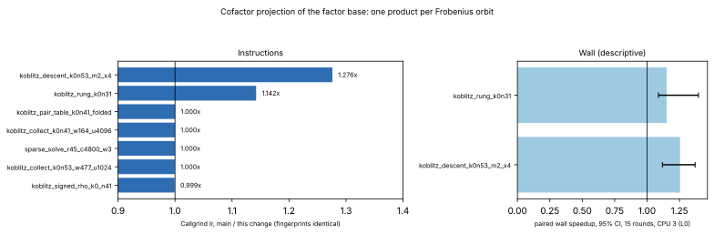

# Cofactor projection of the factor base: one product per Frobenius orbit

**Date.** 2026-11-04. **Class.** Engineering: the same projected points
come out, and every perfindex fingerprint matches `main`'s
(d3a0f1320). [pcc:unverified]

## What changed

- **Where the cost was.** `projected_signed_orbit_map_fast`
  (`suite/src/cryptanalysis/koblitz_index_calculus.rs`) computed `[h]P`
  for every factor-base point. It runs once whenever an
  `IndividualLogSolver`, a column coverage or a log solver is built. At
  degree 53 on the 15,264-point base, that was 15,264 scalar
  multiplications: 32% of the four-target `koblitz_descent_k0n53_m2_x4`
  kernel.
- **The change.** `[h]` commutes with the Frobenius π. Along an orbit
  `points[i_k] = π^k(points[i_0])`, the projections are therefore
  `π^k([h]points[i_0])`. The new `project_by_cofactor` multiplies once
  per orbit and takes one Frobenius step (two `2^k`-th powers) per
  further point, which is about 290 products at degree 53.
- **Fallback.** Points that no orbit lists are still multiplied one by
  one.
- **Tests.**
  - New: `orbit_walked_cofactor_projection_matches_per_point_products`,
    every point against its own product at degrees 15, 31, 37 and 53.
  - Existing, passing unchanged: the general/single-word map agreement
    tests.
  - 291 Koblitz tests pass.

## Result (perfindex against `main` d3a0f1320)

| kernel | Callgrind Ir ratio | wall, 15 rounds (95% CI) |
|---|---|---|
| `relation/koblitz_descent_k0n53_m2_x4` | **1.276×** [pcc:unverified] | 1.254× (1.118–1.371) |
| `relation/koblitz_rung_k0n31` | **1.142×** [pcc:unverified] | 1.151× (1.088–1.396) |
| collection, pair table, sparse solve, signed rho | 1.000× (±0.05%) | neutral |

- **Wall verdicts:** the perfindex verdict for both rows is "neutral".
  The host's A/A noise was ±13–15% during the run (L0, shared 4-vCPU VM,
  CPU 3 pinned).
- **Primary measurement:** the instruction counts, which are
  deterministic.

## Limits

- This is a setup cost of the descent and of every log-solver build. It
  shrinks with the number of targets one solver serves, so the four-target
  kernel overstates it for a large batch.
- This is not a complete-solve `S` row, so no matched-rho gap is stated.

## Data

- `data/perfindex-instr.{json,md}`.
- `data/perfindex-compare-7r.json` and `data/perfindex-compare-15r.{json,md}`.
- `plot.py`.
