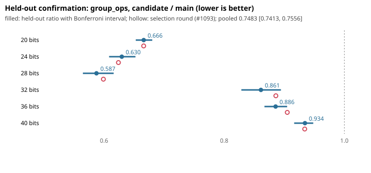

# Held-out confirmation: plain negation-map rho change (F + B + D128 + R1.5)

Protocol frozen in this PR's first commit (`PROTOCOL.md`, `PROTOCOL.sha256`; commit `47c2f11f4562`), before the code commit `0df3e3e0c537` and before any data. Base: `main` `3321bbfb129b`. Seed 20261026 (not used by #1092 or #1093).

## Question

Does making the arm selected in #1093 the default of `ca_rho_solve` lower mean `group_ops` on fresh random generic curves at 20 to 40 bits?

## Design and commands

6 sizes x 40 curves x 50 targets = 2,000 paired solves per size and library; one thread, solver seed = target + 1. Libraries: `main` unchanged, and the same source with the change (both Release, `CA_CUPQC=OFF`, `CA_WERROR=ON`).

```sh
CRYPTANALYSIS_LIB=<main build>/libcryptanalysis.so python3 experiments/rho-confirm-20261026/run.py --label main --out main.jsonl
CRYPTANALYSIS_LIB=<candidate build>/libcryptanalysis.so python3 experiments/rho-confirm-20261026/run.py --label candidate --out cand.jsonl
python3 experiments/rho-confirm-20261026/analyze.py main.jsonl cand.jsonl --out experiments/rho-confirm-20261026
```

Raw rows: `rows_main.jsonl.gz` (sha256 `10ec81cc0a6058f5b9ce9b4a35544e342ab05d29a9cc937c8f1dda44c1db9c53`), `rows_candidate.jsonl.gz` (sha256 `117373d8a2fb6b95781f05daec077cac4e01ecbc9f3212ee1dbcf8d980e4dee1`), 12,000 rows each. Host: shared 4-vCPU VM; the counts are deterministic.

## Checks

- All 24,000 solves recovered the planted logarithm.
- The candidate source reproduces the selection arm `F+B+D128+R1.5` exactly: 0 mismatches against the selection round's group_ops on 8,000 solves at 20 to 32 bits (run before this experiment). The code was then reformatted with clang-format on the changed lines only; a re-run of 6,000 held-out solves (20 to 28 bits) gives identical group_ops.
- Build warning-free with `-DCA_WERROR=ON`. All 19 tests of the sparse checkout (`ctest -j2`) pass. clang-format: 121 violations in `src/rho.c` against 136 on `main`, none new on the changed lines.

## Result



| size | main S | candidate S | ratio candidate / main | interval (Bonferroni over 6) |
|---|---|---|---|---|
| 20 bits | 2.166 | 1.441 | 0.6661 | [0.6528, 0.6803] |
| 24 bits | 1.827 | 1.149 | 0.6296 | [0.6085, 0.6523] |
| 28 bits | 1.758 | 1.033 | 0.5875 | [0.5648, 0.6160] |
| 32 bits | 1.139 | 0.980 | 0.8612 | [0.8286, 0.8944] |
| 36 bits | 1.073 | 0.950 | 0.8856 | [0.8670, 0.9048] |
| 40 bits | 0.973 | 0.909 | 0.9345 | [0.9165, 0.9482] |

Pooled ratio 0.7483, 95% interval [0.7413, 0.7556]; all logarithms correct: True; confirmed: True

The selection round's pooled ratio was 0.7558 [0.7462, 0.7653]; the held-out ratio 0.7483 [0.7413, 0.7556] is inside it. The confirmation criterion of the protocol is met: pooled upper bound below 1, no size with a lower bound above 1, all solutions correct. Mean S at 20 / 24 / 28 / 32 / 36 / 40 bits goes from 2.166 / 1.827 / 1.758 / 1.139 / 1.073 / 0.973 to 1.441 / 1.149 / 1.033 / 0.980 / 0.950 / 0.909.

## Limits

- Operation counts only; no wall time. The candidate uses larger tables below about 36 bits, a smaller distinguished-point spacing and fixed-base tables; the wall effect of each needs a Tier 1 run before any time claim.
- Generic curves, negation map, one thread; the paths for other groups, thread counts, user-supplied r and checkpoint resume are unchanged or untested here. Old rho checkpoints no longer match (r and dp_bits differ) and are rejected by the existing identity check.
- Native work outside `group_ops` (field inversions, cache effects) is not priced.
- Distance to the textbook negation-map figure (about 0.89): mean S is 0.909 at 40 bits and 1.441 at 20 bits.
