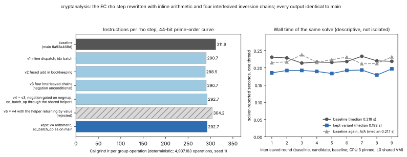

# The EC rho step without the vtable, with four interleaved inversion chains

**Date.** 2026-11-01. **Status.** Measured. Instruction counts are
Callgrind's (deterministic). Wall time is descriptive: a shared 4-vCPU
cloud VM (Intel Xeon @ 2.10 GHz, AVX-512 present, no hardware counters),
one CPU pinned with `taskset`, nothing else quiet; **L0 / "shared host" in
this repository's tiers (AGENTS.md "CPU performance evidence tiers"), not
Tier 0 or Tier 1.** **Class.** Engineering: every solve returns the same
logarithm with the same group-operation count, iteration count and
distinguished-point table on the same seed, so `S` and every reported
constant are unchanged; there is no ECDLP cost change and no rho
comparison.



## What changed

`ca_rho_solve`'s walk (`src/rho.c`, `rho_thread_main`) takes one batched
step per round: pick each walk's multiplier, add it to the walk's point with
Montgomery's simultaneous inversion, canonicalise under the negation map,
hash, decide. On `main` every one of those went through the group vtable
(`ca_group_batch_op`, `ca_group_canonicalize`, `ca_group_hash`) after
copying the multiplier and the point into staging arrays. For the native
`E(F_p)` group (`ca_ec_group_is_native`) the walk now:

- reads each walk's point and its multiplier where they lie and computes the
  denominators with `ca_ec_add_den` and the sums with `ca_ec_add_with_di`,
  inline functions in `src/ca_internal.h` that restate the element
  arithmetic of `ec_batch_op` (with `ca_ec_bmul`, the Montgomery product
  `ec_batch_op` had as a local); `ec_batch_op` itself keeps its body, for
  the reason under "Variants rejected";
- runs Montgomery's trick over **four interleaved chains** (walk `w` is in
  chain `w mod 4`), with suffix products so the inverses come out in walk
  order, and joins the four chain totals with the prefix/suffix trick so the
  batch still pays **one** field inversion; the join costs `3·4 − 2 = 10`
  extra multiplications per batch of 256 (of about 770);
- canonicalises and hashes with the inline functions behind the vtable's
  `ec_canonicalize` and `ec_hash` (`ca_ec_canon_words`, `ca_ec_hash_words`:
  the vtable entries now call these same functions), the canonicalisation
  selecting rather than branching on a data-dependent comparison;
- in `walk_apply`, with the negation map on, forms the negated coefficients
  unconditionally and selects them (the flag is a coin flip on walk data).

Generic groups (`Z_p^*`, user groups) keep the vtable path. Why the
chains: a Montgomery product is about twelve cycles of latency and the
single-chain trick runs 2·W of them in series per batch; the first variant
of this change (inline dispatch, no copies, one chain) cut instructions by
the same 7% and changed the wall time by nothing (medians 0.233 / 0.241 /
0.234 s, rounds in `data/wall_ab_fused_rounds.txt`), which is what pointed
at the serial chain.

## Identical outputs

Baseline binary: `main` 8a93e468d, built before the edits (Release, `-O3 -g`).
Candidate: this branch. One thread, the solver's JSON output compared field
by field (`x`, `ops`, `iterations`, `table_entries`):

| curve | seeds | result |
|:--|:--|:--|
| 44-bit, `p = 17592186044399, a = p − 3, b = 95, n = 17592192476281` (prime order) | 1, 2, 3, 4 | identical (seed 1: `x = 1797554627005`, 4,907,163 ops, 18,496 iterations, 18,495 table entries) |
| 36-bit, `p = 68719476731, a = p − 3, b = 33, n = 68719022539` (prime order) | 1, 2, 3, 4; and `--walks 1, 2, 3, 5, 7` at seed 1 (chains of 1, 2, 3 and 4 with a ragged tail) | identical |
| `Z_p^*`, `p = 4503599627372423, q = 2251799813686211` (the generic path) | 1, 2, 3 | identical |

`ctest --test-dir build`: 19 of 19, including the new checks in
`tests/test_group.c` that the inline arithmetic agrees with `ca_group_op` on
the batch cases (doubling, inverse pair, identity, in place) and that the
inline canonicalisation and hash agree with the vtable's.

The performance index's own validity gate (`scripts/perf/perfindex.py
instr`): every `dlp` and `field_ec` kernel's fingerprint is identical between
the two `ca_perfbench` builds (`data/perfindex-instr-dlp.md`,
`data/perfindex-instr-field_ec.md`).

## Instructions (Callgrind Ir)

| measurement | baseline | this change | ratio |
|:--|--:|--:|--:|
| `ca solve --alg rho`, 44-bit curve, seed 1, whole process | 1,530,505,869 | 1,436,152,339 | **0.938** |
| per group operation (÷ 4,907,163) | 311.9 | 292.7 | 0.938 |
| perfindex `dlp/c_rho_ec36` (4 targets, 36-bit curve) | 199,957,434 | 189,530,435 | **0.948** (index 1.055×) |
| perfindex `dlp/c_rho_zp40` (`Z_p^*`, generic path) | 270,988,160 | 273,556,841 | 1.009 (neutral) |
| perfindex `field_ec/c_ec_batch_add` (`ca_group_batch_op`, 60-bit) | 233,479,793 | 233,479,793 | 1.000 |
| perfindex `field_ec/c_ec_count_points` | 57,787,732 | 57,999,568 | 1.004 (neutral) |
| every other `dlp` and `field_ec` kernel | — | — | 1.000 |

The `Z_p^*` walk pays about 1% more instructions for the `if (ec)` and
`if (sh->negmap)` tests it now takes each step; its wall time is measured
below. `ec_batch_op` is untouched, so `c_ec_batch_add` is
instruction-identical.

## Variants rejected

Every variant is in `data/measurements.json` (`callgrind_ir`, whole
process, 44-bit seed 1) and in the figure; the kept code is the last row.

- *Negation unconditional on every path* (v3, 290.7 Ir/op): formed the
  negated coefficients on the generic path too, which cost `dlp/c_rho_zp40`
  7% of its instructions (0.926×); gating it on `sh->negmap` (v4, 292.7
  Ir/op) returns that kernel to within 1% and costs the EC walk 2 Ir/op.
- *`ec_batch_op` through the shared helpers* (v4): instruction-identical
  to `main` on `c_ec_batch_add`, but clang's static analyzer (`clang-tidy`,
  CI's `.clang-tidy`) declines to inline `ca_ec_add_with_di` at the call
  depth `ec_count_once → ec_interval_all → ec_multiples → ec_batch_op`
  reaches and then reports the batch's results as uninitialised
  (`core.uninitialized.Branch` at `ec_dbl`); the finding disappears at
  inline depth 6, so it is an analyzer limit, not a bug.
- *The helper returning the sum by value* (v5, 304.2 Ir/op): satisfies the
  analyzer and costs 13 Ir/op in the walk, `c_ec_batch_add` 0.921× and
  `c_ec_count_points` 0.950× (the 32-byte struct goes through a temporary).
- *`ec_batch_op` storing through a local temporary*: satisfies the analyzer,
  same kernel cost as v5 (0.921× / 0.950×); rejected.
- *Kept*: v4's walk and helpers, `ec_batch_op`'s body as on `main`
  (292.7 Ir/op; every `field_ec` kernel 1.000, `c_ec_count_points` 1.004
  as before).

## Wall time (descriptive, L0)

`ca solve --alg rho` on the 44-bit curve, seed 1, one thread, the solver's
own `seconds` (which excludes process start), pinned to CPU 3, nine
interleaved rounds of baseline / candidate / baseline, the kept binary,
host load 0.7 with nothing else of ours running
([`data/wall_ab_final_rounds.txt`](data/wall_ab_final_rounds.txt)):

| arm | median | min |
|:--|--:|--:|
| baseline | 0.219 s | 0.214 s |
| this change | **0.192 s** | 0.179 s |
| baseline again (A/A) | 0.217 s | 0.212 s |

The two baseline arms differ by 1%; the candidate is 12% below both: about
45 ns per step before and 39 ns after, on this host. An earlier pass over
the v3 code, with a Rust build and a Callgrind run active on other cores,
read 0.228 / 0.190 / 0.224 s ([`data/wall_ab_v3_rounds.txt`](data/wall_ab_v3_rounds.txt)):
the baseline ran slower on the busy host and the candidate did not, so the
17% of that pass overstates the quiet-host gap. This is not a Tier 0 or
Tier 1 measurement and no end-to-end or cross-host claim is made from it.
The performance index's paired wall comparison (`perfindex.py compare`,
five rounds, CPU 3, A/A arm; [`data/perfindex-compare.md`](data/perfindex-compare.md)):
`dlp/c_rho_ec36` 1.180× (95% CI 1.052–1.282, A/A noise ±7.5%, "faster"),
`dlp/c_rho_zp40` 1.031× (CI 0.899–1.080, neutral), `field_ec/c_ec_batch_add`
0.997× (CI 0.944–1.034, ±1.1%), `field_ec/c_ec_count_points` 1.002×;
the index over every kernel, most of them untouched, is 0.999× (CI
0.945–1.025).

## What is left in a step

Callgrind, per step, after the change: about 115 instructions in the field
arithmetic (six Montgomery products, six subtractions, two additions), about
30 in the hash and canonicalisation, about 20 in the coefficient updates, and
the rest in the walk's bookkeeping (index, window, distinguished-point test,
loop control, loads and stores of the 108-byte walk record). The wall time
is latency-bound, not instruction-bound: the step costs ~82 cycles at 2.1
GHz for ~293 instructions. The next levers are the Euclidean inversion's
64-bit divisions (about 36 per batch, ~4–5 cycles per step amortised) and,
for `p < 2^52`, a 52-bit-radix AVX-512 IFMA step; both are larger changes
and neither is started here.

## Reproduce

```sh
cmake -S . -B build -DCMAKE_BUILD_TYPE=Release -DCMAKE_C_FLAGS_RELEASE="-O3 -DNDEBUG -g"
cmake --build build -j4 && ctest --test-dir build
ARGS="solve --alg rho --group ec --p 17592186044399 --a 17592186044396 --b 95 --order 17592192476281 \
      --g 3059076832945,1187200924441 --h 7378758875510,11599828042334 --threads 1 --seed 1"
build/ca $ARGS                                   # x, ops, iterations, table_entries, seconds
valgrind --tool=callgrind --cache-sim=no --branch-sim=no build/ca $ARGS   # Ir
python3 scripts/perf/perfindex.py build --c --ref origin/main --out /tmp/ci-base
python3 scripts/perf/perfindex.py build --c --current --out /tmp/ci-cand
python3 scripts/perf/perfindex.py instr --base /tmp/ci-base/ca_perfbench --cand /tmp/ci-cand/ca_perfbench --out /tmp/ci-ir --filter dlp
/tmp/report-venv/bin/python plot.py              # figures/ from data/measurements.json
```
