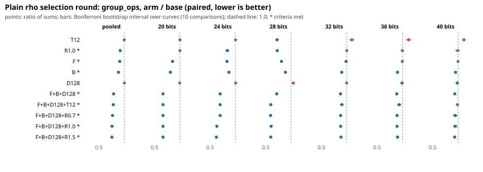

# Plain negation-map rho selection round: results

Protocol frozen before any data (`PROTOCOL.md`, `PROTOCOL.sha256`; PR #1093, commit `8e880fdec1f0`). Base revision: `main` `fb701711f5ee`. Seed 20261025. This is a **selection** result on operation counts; the confirmation on fresh curves is a separate PR.

## Question

Which changes to `ca_rho_solve` lower mean `group_ops` on random generic curves at 20 to 40 bits, paired on identical targets and solver seeds?

## Design (as frozen)

6 sizes x 40 curves x 50 targets = 2,000 solves per size and arm, 12 arms plus an unflagged-`main` pass; ratio of sums per size, pooled by geometric mean over sizes; bootstrap over curves (10,000 resamples), Bonferroni over 10 comparisons. Winner rule: pooled upper bound < 1, no size with lower bound > 1, all solves correct; select the lowest pooled ratio.

Commands: `cmake ... -DCMAKE_C_FLAGS=-DCA_RHO_MEASURE_ARMS` on `main` with `measure-arms.patch` applied; `run.py --seed 20261025 --curves 40 --targets 50`; `run.py ... --arms main` on the unflagged build; `analyze.py rows_arms.jsonl.gz rows_main.jsonl.gz`. Raw rows: `rows_arms.jsonl.gz` (sha256 `d6df79af7022aec382ab6be375947e85e569a87afd47e528f1a3b640e6757fcd`, 144,000 rows), `rows_main.jsonl.gz` (sha256 `da8d4374e738c420588c458bd8bc6067b63c2ceb355203cc8a6daa87880554e7`, 12,000 rows). Host: shared 4-vCPU VM; counts are deterministic, so isolation does not matter.

## Checks

- Identity control: `control` equals `base` on all 12,000 solves. Unflagged `main` equals `base` on all 12,000 solves.
- All 144,000 + 12,000 solves recovered the planted logarithm.

## Result

Ratios are arm / base group_ops (ratio of sums); intervals are Bonferroni bootstrap intervals over the 40 curves of each size.

| arm | pooled ratio | Bonferroni interval | 20 bits | 24 bits | 28 bits | 32 bits | 36 bits | 40 bits | criteria met |
|---|---|---|---|---|---|---|---|---|---|
| T12 | 0.9992 | [0.9873, 1.0118] | 1.000 [1.000, 1.000] | 1.000 [1.000, 1.000] | 0.723 [0.697, 0.750] | 1.098 [1.057, 1.142] | 1.124 [1.077, 1.170] | 1.115 [1.084, 1.151] | no |
| R1.0 | 0.9191 | [0.9073, 0.9310] | 1.000 [1.000, 1.000] | 0.839 [0.803, 0.876] | 0.726 [0.697, 0.755] | 1.000 [0.989, 1.010] | 0.999 [0.975, 1.023] | 0.992 [0.949, 1.038] | yes |
| F | 0.9095 | [0.9029, 0.9158] | 0.855 [0.839, 0.872] | 0.832 [0.812, 0.851] | 0.809 [0.787, 0.830] | 0.986 [0.975, 0.996] | 0.998 [0.994, 1.002] | 1.000 [0.999, 1.001] | yes |
| B | 0.8858 | [0.8842, 0.8873] | 0.812 [0.806, 0.818] | 0.868 [0.864, 0.872] | 0.887 [0.885, 0.888] | 0.900 [0.897, 0.903] | 0.903 [0.899, 0.906] | 0.951 [0.948, 0.954] | yes |
| D128 | 1.0021 | [0.9943, 1.0101] | 0.996 [0.973, 1.017] | 1.003 [0.975, 1.032] | 1.042 [1.013, 1.069] | 0.998 [0.983, 1.015] | 0.991 [0.985, 0.997] | 0.985 [0.982, 0.987] | no |
| F+B+D128 | 0.7895 | [0.7836, 0.7952] | 0.666 [0.654, 0.678] | 0.697 [0.679, 0.715] | 0.716 [0.696, 0.734] | 0.876 [0.866, 0.885] | 0.889 [0.883, 0.895] | 0.936 [0.932, 0.940] | yes |
| F+B+D128+T12 | 0.7839 | [0.7731, 0.7949] | 0.666 [0.654, 0.678] | 0.697 [0.679, 0.715] | 0.599 [0.574, 0.624] | 0.903 [0.868, 0.941] | 0.936 [0.896, 0.975] | 0.987 [0.958, 1.021] | yes |
| F+B+D128+R0.7 | 0.7679 | [0.7584, 0.7775] | 0.666 [0.654, 0.678] | 0.697 [0.679, 0.715] | 0.595 [0.572, 0.619] | 0.878 [0.865, 0.893] | 0.896 [0.871, 0.919] | 0.943 [0.902, 0.988] | yes |
| F+B+D128+R1.0 | 0.7577 | [0.7478, 0.7675] | 0.666 [0.654, 0.678] | 0.632 [0.611, 0.654] | 0.606 [0.580, 0.630] | 0.878 [0.865, 0.893] | 0.896 [0.871, 0.919] | 0.943 [0.902, 0.988] | yes |
| F+B+D128+R1.5 | 0.7558 | [0.7462, 0.7653] | 0.666 [0.654, 0.678] | 0.624 [0.604, 0.643] | 0.599 [0.574, 0.624] | 0.886 [0.857, 0.915] | 0.905 [0.877, 0.936] | 0.934 [0.920, 0.945] | yes |

Mean S = group_ops / sqrt(order) per arm and size:

| arm | 20 bits | 24 bits | 28 bits | 32 bits | 36 bits | 40 bits |
|---|---|---|---|---|---|---|
| base | 2.158 | 1.844 | 1.743 | 1.126 | 1.065 | 0.974 |
| control | 2.158 | 1.844 | 1.743 | 1.126 | 1.065 | 0.974 |
| T12 | 2.158 | 1.844 | 1.260 | 1.236 | 1.194 | 1.087 |
| R1.0 | 2.158 | 1.559 | 1.265 | 1.125 | 1.064 | 0.965 |
| F | 1.849 | 1.534 | 1.411 | 1.109 | 1.063 | 0.974 |
| B | 1.752 | 1.601 | 1.545 | 1.014 | 0.962 | 0.927 |
| D128 | 2.146 | 1.851 | 1.815 | 1.125 | 1.055 | 0.959 |
| F+B+D128 | 1.439 | 1.284 | 1.246 | 0.985 | 0.947 | 0.912 |
| F+B+D128+T12 | 1.439 | 1.284 | 1.042 | 1.017 | 0.996 | 0.961 |
| F+B+D128+R0.7 | 1.439 | 1.284 | 1.039 | 0.988 | 0.953 | 0.917 |
| F+B+D128+R1.0 | 1.439 | 1.170 | 1.055 | 0.988 | 0.953 | 0.917 |
| F+B+D128+R1.5 | 1.439 | 1.152 | 1.042 | 0.997 | 0.965 | 0.910 |

Checks: {"all_solves_correct": true, "n_solves_per_arm": 12000, "control_identical_to_base": true, "unflagged_main_identical_to_base": true}

Selected: F+B+D128+R1.5 (ranking ['F+B+D128+R1.5', 'F+B+D128+R1.0', 'F+B+D128+R0.7', 'F+B+D128+T12', 'F+B+D128', 'B', 'F', 'R1.0'])

## Observations

- **Selected by the frozen rule: `F+B+D128+R1.5`**, pooled ratio 0.756 [0.746, 0.765]: group_ops fall by 6.6% at 40 bits, 9.5% to 11% at 32 and 36 bits, and 33% to 40% at 20 to 28 bits. Mean S at 20 / 24 / 28 / 32 / 36 / 40 bits goes from 2.158 / 1.844 / 1.743 / 1.126 / 1.065 / 0.974 to 1.439 / 1.152 / 1.042 / 0.997 / 0.965 / 0.910.
- The pooled intervals of `F+B+D128+R0.7`, `+R1.0` and `+R1.5` overlap (0.768, 0.758, 0.756); the rule picks the lowest point estimate, which the data do not separate from its neighbours. `R1.5` is worse than `R1.0` at 32 and 36 bits (0.886 against 0.878 and 0.905 against 0.896, intervals overlapping) and better at 24 and 40 bits.
- **`B` (fixed-base setup) gives 0.812 to 0.951** at every size, by construction without changing any walk; its per-size intervals are tight (about 0.5% wide at 24 to 40 bits). The setup is cut by about two thirds.
- **`F` (immediate 2/4-cycle escape)** gives 0.855, 0.832, 0.809 at 20, 24, 28 bits, 0.986 at 32 bits, and no change at 36 and 40 bits.
- **`T12` (budget divisor 12)** helps only at 28 bits (0.723) and raises operations by 9.8% to 12.4% at 32 to 40 bits, with a significant regression; pooled 0.999. It fails the winner criteria. `R1.0` alone (r about sqrt(sqrt(n)/lg)) does not regress at any size (1.000, 0.839, 0.726, 1.000, 0.999, 0.992) and meets the criteria.
- **`D128` (smaller DP spacing) alone is not a gain**: pooled 1.002, +4.2% at 28 bits [1.013, 1.069] and -1.5% at 40 bits. Its contribution to the combined arm is not isolated here (there is no arm without it).

## Prediction scoring

- `B` "about 13% at 20 to 28 bits, 10% at 32 to 36, 5% at 40": measured 19%, 13%, 11%, 10%, 10%, 5%. The saving at 20 bits was larger than predicted.
- `F` "about 0 at 36 and 40 bits": confirmed (0.998, 1.000).
- `R1.0` and `T12` lower operations at 24 and 28 bits: `R1.0` yes (0.839, 0.726); `T12` at 28 bits only (no change at 24 bits, because the budget still gives r = 8).
- `T12` may raise operations at 36 and 40: confirmed (+12.4%, +11.5%).
- `D128` "at most 2%": wrong at 28 bits (+4.2%).

## Interpretation (separate from the observations)

- The gains come from three independent parts: setup cost (`B`), cycle cost at r = 8 (`F`), and a table of 16 to 32 entries instead of 8 below 30 bits (`R`). The old budget rule `sqrt(n)/(48 lg)` is too small below about 30 bits and the divisor-12 rule is too large above it; a rule growing like `sqrt(sqrt(n)/lg)` avoids both.
- Whether `D128` belongs in the default is not established by this round; it can only be tested with a `F+B+R1.5` arm. The confirmation PR keeps the frozen selected arm as is.

## Limits

- Operation counts only. Fixed-base tables, a larger table and a smaller DP spacing change memory traffic; wall time needs a Tier 1 run.
- Generic curves, negation map only, one thread; 40 curves per size, so per-size intervals for walk-changing arms are wide.
- Fixed-base accounting charges each set bit one operation (as `ca_group_mul` does) and the 2 (bitlength - 1) table doublings to setup.
- A selection on these curves is optimistic; the held-out confirmation is the claim.
