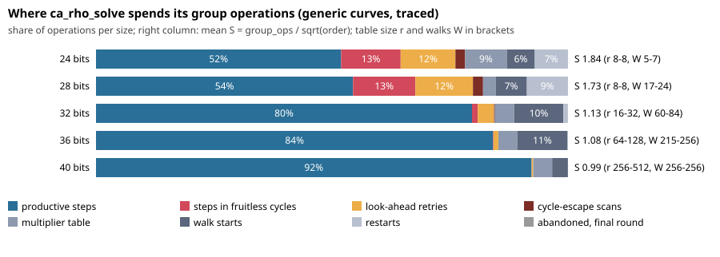

# Where `ca_rho_solve` spends its group operations (exploratory trace)

**Label: exploratory.** No protocol was frozen before this data. It selects nothing and
claims no speedup. It decides which candidates a later, frozen selection round should test.

## Question

`ca_rho_solve` (src/rho.c) is the plain negation-map Pollard rho: the solver for curves without
GLV structure, and the reference every GLV ratio is measured against. Where do its group
operations go on random generic curves (automorphism order 2), 24 to 40 bits, and which parts
could be reduced?

## Revisions and environment

- **Library:** `main` at `fb701711f5ee` plus a diagnostic-only change to `src/rho.c`, compiled in with `-DCA_RHO_TRACE`.
  The default build has no trace code. The only non-`#ifdef` edit is that the internal `walk_escape_cycle` now returns the cycle length it measures; the walk is unchanged.
- **Builds:** Release, `CA_CUPQC=OFF`, `CA_WERROR=ON`, GCC; traced build `-DCA_RHO_TRACE`, untraced build default. Single-threaded solves (the trace is not thread-safe).
- **Host:** shared 4-vCPU cloud VM. Every figure is a deterministic operation count, not a time.
- **Raw data:** `trace.jsonl.gz` (sha256 `a1901c8ff4428c3f1a5da03db0b56273ae559e53227032390603c51055494bb0`), 4,500 rows, one per (curve, target), with the trace fields.
  `untraced-fingerprint.jsonl.gz` (sha256 `c1da4465e093c7e0f6c32b66332edc36fb334eb9859fcd7f1da3d975c5f640b5`) holds the same solves from the untraced build.

## Design

- 5 sizes (24, 28, 32, 36, 40 bits of the prime subgroup order r) x 30 random curves x 30 targets = 4,500 solves.
- Curves are y^2 = x^3 + a x + b with random a, b over a prime p of about size+3 bits, with a prime subgroup of exactly the requested size and cofactor <= 16. Seeds are `"<seed>:<bits>"` and `"<seed>:<p>:<a>:<b>:<target>"` with seed 20261024. Solver seed is target index + 1.
- Every operation of `rho_solve_impl` is booked to exactly one of: multiplier table, initial walk starts, restarts (by reason), batch slots whose step the look-ahead rejected ("retries"), the cycle-escape scan and doubling, and committed steps. Committed steps are split into steps inside a fruitless cycle that was later escaped (the trailing run of points that repeat with the detected period), steps of abandoned segments, and the rest ("productive").
- An exact-collision oracle (a hash set of every committed point, tagged with the trail that first visited it) measures how many steps a walk takes after meeting a point of another trail.

## Commands

```sh
cmake -S . -B b-trace -DCMAKE_BUILD_TYPE=Release -DCA_CUPQC=OFF -DCA_WERROR=ON -DCMAKE_C_FLAGS=-DCA_RHO_TRACE
cmake --build b-trace --target cryptanalysis
CA_RHO_TRACE_FILE=/tmp/raw.jsonl CRYPTANALYSIS_LIB=b-trace/libcryptanalysis.so python3 experiments/rho-walk-trace-20261024/trace_run.py --out trace.jsonl
CRYPTANALYSIS_LIB=b-plain/libcryptanalysis.so python3 experiments/rho-walk-trace-20261024/trace_run.py --labels-only --out untraced.jsonl
python3 experiments/rho-walk-trace-20261024/summarise.py   # summary.json, tables below
python3 experiments/rho-walk-trace-20261024/chart.py && python3 experiments/rho-walk-trace-20261024/render.py
```

## Checks

- **Tracing does not change the walk.** All 4,500 solves give identical group_ops and recovered logarithm in the traced and untraced builds (0 mismatches).
- **The booking is complete.** For all 4,500 solves, table + starts + restarts + step slots + escape operations equals `group_ops`, and committed steps + retries + unused slots of the last round equals the step slots. The solver aborts on a violation and `trace_run.py` asserts it again.
- **Every answer is correct.** Every recovered logarithm equals the planted one.

## Result



Share of all group operations (ratio of sums over the 900 solves of each size):

| bits | solves | mean S | table r | walks W | table | starts | restarts | retries | escapes | cycle steps | abandon | productive | escapes /1e4 steps |
|---|---|---|---|---|---|---|---|---|---|---|---|---|---|
| 24 | 900 | 1.845 | 8-8 | 5-7 | 8.9% | 5.9% | 7.0% | 11.6% | 2.0% | 12.6% | 0.0% | 51.9% | 50.1 |
| 28 | 900 | 1.732 | 8-8 | 17-24 | 2.7% | 6.6% | 8.7% | 12.2% | 2.1% | 13.2% | 0.0% | 54.4% | 50.0 |
| 32 | 900 | 1.134 | 16-32 | 60-84 | 4.1% | 10.4% | 0.9% | 3.4% | 0.2% | 1.2% | 0.1% | 79.7% | 4.1 |
| 36 | 900 | 1.078 | 64-128 | 215-256 | 4.0% | 10.6% | 0.1% | 1.0% | 0.0% | 0.1% | 0.1% | 84.1% | 0.3 |
| 40 | 900 | 0.993 | 256-512 | 256-256 | 4.0% | 3.3% | 0.0% | 0.3% | 0.0% | 0.0% | 0.0% | 92.3% | 0.0 |


Cycles, restarts and detection delay per size:

| bits | restarts / solve | of which same (a,b) | cycles escaped / solve | 2-cycles | 4-cycles | 6-cycles | >= 8 | steps per escaped cycle | retries / 1e4 slots | first cross-trail repeat to solve (share of steps) |
|---|---|---|---|---|---|---|---|---|---|---|
| 24 | 6.4 | 100% | 19.6 | 17% | 63% | 13% | 7% | 39.0 | 1524 | 10.5% |
| 28 | 26.0 | 100% | 80.5 | 17% | 63% | 13% | 7% | 39.1 | 1527 | 5.7% |
| 32 | 6.2 | 100% | 20.6 | 9% | 83% | 7% | 1% | 36.6 | 408 | 2.9% |
| 36 | 2.0 | 100% | 6.5 | 3% | 95% | 3% | 0% | 36.2 | 120 | 2.1% |
| 40 | 0.2 | 100% | 2.4 | 1% | 98% | 1% | 0% | 37.1 | 35 | 2.1% |


Mean S is group_ops / sqrt(order), averaged over solves. The textbook figure for a negation-map walk with no overhead is about 0.89.

### Observations (exact counts on these runs)

- **S falls from 1.85 at 24 bits to 0.99 at 40 bits.** The shares behind it change sharply at 32 bits, where the default table rule steps from r = 8 to r = 16 to 32.
- **At 24 and 28 bits the table is r = 8 and about a quarter of all operations go to its consequences:**
  look-ahead retries (11.6% and 12.2%, one slot in about 6.6), steps inside fruitless cycles (12.6% and 13.2%), and escape scans (2.0% and 2.1%). A further 7.0% and 8.7% go to restarts, and every restart in the data (100%) is a walk reaching a distinguished point with exactly the (a, b) it had stored: a walk that sat in a cycle containing a distinguished point.
  So fruitless cycles and their by-products (retries, cycle steps, escape scans, restarts) account for 33.2% and 36.2% of operations at these two sizes.
- **At 32 bits the same costs are 3.4% retries, 1.2% cycle steps, 0.2% escape scans, 0.9% restarts.** At 36 and 40 bits they are at most 1.0% in total.
- **Cycle detection is slow relative to the cycle.** An escaped cycle costs 36 to 39 committed steps on average, and 63% (24, 28 bits) to 98% (40 bits) of the cycles have length 4 and 1% to 17% have length 2. Detection is by the 64-step window self-comparison, which sees the cycle only when the walk returns to the stored window start.
- **Setup is a large and size-independent cost.** Table + starts + restarts take 21.8% (24 bits), 18.0% (28), 15.4% (32), 14.7% (36) and 7.3% (40) of operations. Each start or table entry is two scalar multiplications booked as popcount + bitlength - 1 each (about 3 log2 n operations).
  Starts are 10.4% and 10.6% at 32 and 36 bits because W is 60 to 84 and 215 to 256 there.
- **Abandonment is essentially unused.** 2 abandoned walks in 4,500 solves (all in the 24-bit row).
- **Detection delay is a small, bounded cost.** From the first repeat of another trail's point to the solve takes 10.5% (24 bits) to 2.1% (36, 40 bits) of committed steps. Steps taken by a walk that had already met another trail are at most 0.5% of steps (`dup_steps`).


### Interpretation (separate from the observations)

- The reducible shares by size are: fruitless-cycle consequences 33% and 36% at 24 and 28 bits and 5.7% at 32 bits; setup (table, starts, restarts) 22% to 15% at 24 to 36 bits (restarts appear in both sums).
  These are upper bounds on what a change to those parts can remove; a larger table or a cheaper start moves cost between parts.
- Larger tables trade less cycle and retry cost against table cost. The default budget `sqrt(n) / (48 lg n)` allows r = 8 up to about 30 bits; the GLV walk uses `sqrt(n/m) / (12 lg n)` (#1065).
- Cycles are found about 36 steps late on average. A direct check of the last 2 and 4 committed points (a deterministic 2/4-cycle escape as in #953) would cut the steps per cycle, and would meet the distinguished-point repeat before it triggers a restart.
- Setup scalar multiplications use a fresh double-and-add on fixed bases (the generator and the target). A table of 2^b times each base (as `precomp.c` uses) turns each into popcount additions; this preserves every walk exactly.
- A lower bound on distinguished-point spacing (`dp_bits`) trades table memory for detection delay. The measured delay share (2% at 36 and 40 bits) bounds what it can recover.

### Hypotheses for a frozen selection round (untested)

1. Table budget divisor 48 -> 24, 12 or 6 (raises r at 24 to 32 bits).
2. Immediate 2/4-cycle escape trigger in `rho_thread_main`.
3. Fixed-base table for the multiplier table, walk starts and restarts.
4. A smaller DP spacing (divisor 32 -> 128 in the `dp_bits` rule).
5. Combinations of the above.

## Limits

- Exploratory: no protocol was frozen first; nothing here is a speed claim.
- Operation counts only. The walk's cost per operation (batched inversions, cache effects of a larger table) is untouched by this report; wall time needs a Tier 1 run.
- Generic curves only (no automorphism beyond negation); 30 curves per size.
- Single-threaded; cycle steps are booked as the trailing run of points that repeat with the detected period (bounded by a 192-point history), so a cycle entered long before detection is truncated.
- `unprocessed` slots (the end of the last round) are at most 0.06% of operations.
