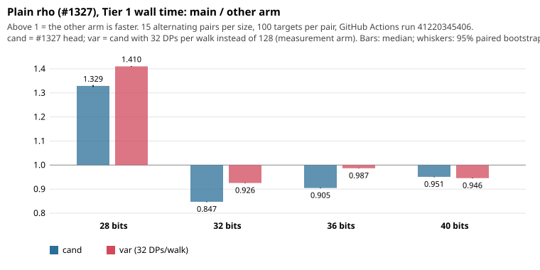

# Plain rho (#1327) on the Tier 1 path: fewer operations, more wall time at 32-40 bits

**Result.** On a GitHub Actions `ubuntu-24.04` runner under the Tier 1 gate
([run 41220345406](https://github.com/aburan28/cryptanalysis/actions/runs/41220345406)),
#1327's head (`cand`) is **faster than main at 28 bits and resolved slower at 32, 36 and 40 bits**,
although it uses 7-14% fewer group operations at those sizes. The runner filled `paired_speedup`
only at 28 bits. Nothing here is a speedup claim for 32-40 bits.

| bits | wall ratio ref / cand | 95% paired bootstrap | operations ref / cand | CPU ratio | ns per operation, ref -> cand |
|---|---|---|---|---|---|
| 28 | **1.329** | [1.325, 1.333] | 1.577 | 1.329 | 47.5 -> 56.3 |
| 32 | **0.847** | [0.846, 0.849] | 1.067 | 0.847 | 43.4 -> 54.7 |
| 36 | **0.905** | [0.904, 0.906] | 1.144 | 0.905 | 42.8 -> 54.1 |
| 40 | **0.951** | [0.949, 0.952] | 1.090 | 0.951 | 41.6 -> 47.8 |

Measurement arm `var` (cand with 32 DPs per walk in place of 128; not proposed):

| bits | wall ratio ref / var | 95% paired bootstrap | operations ref / var | ns per operation, ref -> var |
|---|---|---|---|---|
| 28 | **1.410** | [1.409, 1.412] | 1.552 | 47.5 -> 52.3 |
| 32 | **0.926** | [0.925, 0.927] | 1.059 | 43.4 -> 49.6 |
| 36 | **0.987** | [0.986, 0.987] | 1.129 | 42.8 -> 49.0 |
| 40 | **0.946** | [0.945, 0.947] | 1.048 | 41.7 -> 46.2 |

- **Provider and host:** GitHub Actions, standard `ubuntu-24.04`, AMD EPYC 7763, cgroup v2, no CPU quota,
  both arms pinned to CPU 0, 15 alternating pairs per size and comparison, 15/15 valid in all eight.
- **Gate:** `binaries_stable`, `artifacts_stable`, `runner_stable` all true; `host_exclusivity_proved` is
  false, as it always is for Tier 1. Every run printed `verified=1` and the frozen scalar hash.
- **Binaries:** the runner's builds are byte-identical to the authoring-VM builds hashed in the protocol
  (`e0ac43df…`, `45ac6774…`, `9d4add68…`).
- **Receipts:** `tier1-github-41220345406/` holds the run summaries, preflights, allocation and host
  probe, `binaries.sha256` and per-arm medians. The raw `runs.jsonl` and stdout/stderr stay in the
  workflow artifact `rho-walltime-tier1-41220345406-1` (30 days) and are not in Git (docs/artifacts.md; this
  session has no store credentials).

## Predictions, scored (written before the run)

| | prediction | outcome |
|---|---|---|
| P1 | cand faster than ref at 28 bits | **held** (1.329) |
| P2 | cand slower at 32, 36, 40; resolved at 36 and 40 | **held** (resolved slower at all three) |
| P3 | var not slower than ref at 36 and 40 | **partly failed.** At 36 var is slightly slower (0.987, upper bound below 1). At 40 var is as slow as cand (0.946 vs 0.951) |

So the DP spacing explains part of the cost at 32 and 36 bits but not at 40:

- **32 bits:** 0.847 -> 0.926 when D128 is dropped.
- **36 bits:** 0.905 -> 0.987.
- **40 bits:** 0.951 vs 0.946, no change.

At 40 bits dropping D128 also costs operations (ref/var 1.048 against ref/cand 1.090), so there D128 saves
operations and costs nothing measurable in time.

## Observations and interpretation

- **Observation:** the cost per group operation rises in every cand row, by 19% (28), 26% (32), 26% (36)
  and 15% (40) over main. Operation count, the repository's usual proxy, overstates cand's gain; the
  28-bit gain is smaller in time (1.33) than in operations (1.58).
- **Interpretation, not measured:** the larger table (R1.5), the 128 DPs per walk and the setup tables
  change memory traffic and per-step bookkeeping. Which of the four changes costs most at 40 bits is not
  separated by this design; `var` isolates D128 only.
- **Hypothesis for a follow-up:** a variant keeping F and B but with main's table size and 32 DPs.
  It needs its own operation-count protocol first: in the selection round (#1093) D128 alone saved no
  operations.

## Limits

- **Intervals** come from 15 pairs of the same frozen 100-target panel, so they describe timing noise on
  that panel, not variation across curves. They are narrow for that reason.
- **Scope:** generic curves, single thread, 28-40 bits, one runner instance and CPU model.
- **Not measured:** memory use and cache behavior directly; larger sizes; threads above one.
- **Disclosed exploratory run** (authoring VM, contended) pointed the same way at 32-40 bits and is
  superseded by this run.
