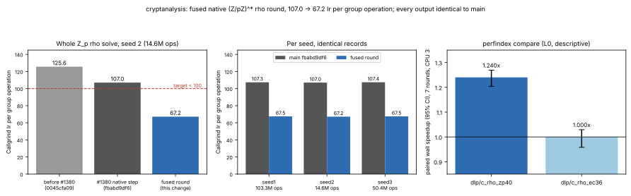

# The native (Z/pZ)^* rho round, fused: under 100 instructions per step

**Date.** 2026-11-03. **Status.** Measured. Instruction counts are
Callgrind's (deterministic). Wall time is descriptive: a shared 4-vCPU
cloud VM (Intel Xeon @ 2.10 GHz, no hardware counters), CPU 3 pinned;
**L0 / "shared host" in this repository's tiers, not Tier 0 or Tier 1.**
**Class.** Engineering: every solve returns the same logarithm with the same
group-operation count, iteration count and distinguished-point table on the
same seed, so `S` and every reported constant are unchanged.
**Target.** Fewer than 100 Callgrind instructions per group operation on the
`Z_p^*` rho walk; it was 107.0 after
[`rho-zp-step-20261103`](../rho-zp-step-20261103/REPORT.md). **Result: 67.2.**



## What changed

After #1380 the native `(Z/pZ)^*` round still had the shape of the generic
one: a first pass formed every walk's product into a staging array
`Yn[w]` (a 32-byte copy of the point in, the product into word 0), and a
second pass copied `Yn[w]` back into the walk and did the bookkeeping, with
the EC/Z_p/generic dispatch, the negation-map tests and the window test
evaluated per walk. Line-level Callgrind on seed 2 put about 117M of the
1,563M instructions on the two copies, 160M on the per-walk dispatch and
negation-map tests, and showed `sh->n`, `sh->alpha`, `sh->beta`,
`sh->dp_mask` and the Montgomery constants reloaded for every walk: the
pass stores `uint64_t` lvalues, which may alias `*sh` as far as the
compiler knows.

For the native `Z_p` group without the negation map (it has none,
`canonicalize` is NULL, so `sh->negmap` is always 0 for it), each round is
now one pass, `rho_zp_round` in `src/rho.c`, per walk and in walk order:
index from the stored hash, Montgomery product of the residue word in place
(`ca_ec_bmul`, the same reduction as `ca_mont_mul`), `ca_zp_hash_word`,
the exponent update, `since_dp`, then the distinguished-point test
(`rho_zp_dp`, out of line, statement for statement the bookkeeping pass's
code) or the abandon test. Every constant is read once per round into a
local. The round adds its `W` operations (and, in field-count builds, its
`W` multiplications) up front as the staged pass did, so a round cut short
by a solve, a table limit or an allocation failure counts the same.

Why the order is the same walk: the staged pass computed all `W` products
and then committed them in walk order, stopping at the walk that ended the
round. A walk's product reads only that walk's state. Computing it just
before its commit therefore gives the same value, and the restarts draw from
the rng in the same order. Without the negation map no multiplier is ever
rejected (`retry` stays 0) and there is no window test. Builds with
`CA_RHO_TRACE` keep the staged path (the fused round is compiled out), and
every other group keeps its own path.

## Identical outputs

- `ca solve --alg rho --group zp --p 4503599627372423 --order
  2251799813686211 --g 1377747092617056 --h 3666041038937390 --threads 1`,
  seeds 1–6, against `main`'s binary. Identical `status`, `x`, `ops`,
  `iterations`, `table_entries`, `collisions` and `bytes_peak`. Operation
  counts: seed 1 103,317,083; seed 2 14,606,732; seed 3 50,399,197.
- `ctest`: 19 of 19. A new check in `tests/test_rho.c` runs six solves on
  the native group and on the same group behind a copy of its vtable,
  which is not native and so takes the staged `batch_op` path.
  - It covers `r = 32` (mask index), `r = 20` (fastmod index) and a
    `max_ops`-capped run.
  - It requires the same status, answer, operations, iterations and table.
  - It fails when the fused round's `beta` index is perturbed.
- The performance index's validity gate: every fingerprint identical.
- Multi-threaded solves are scheduling-dependent on `main` as well (two
  `main` runs at 2 threads: 47,507,151 and 47,093,807 operations), so they
  are not an identity test.

## Instructions (Callgrind Ir)

| measurement | `main` fbabd9df6 | fused round | ratio |
|:--|--:|--:|--:|
| whole `Z_p` rho solve, seed 1 (103,317,083 ops) | 11,090,838,937 | 6,971,404,689 | 0.629 |
| whole `Z_p` rho solve, seed 2 (14,606,732 ops) | 1,563,271,818 | 981,122,494 | **0.628** |
| whole `Z_p` rho solve, seed 3 (50,399,197 ops) | 5,412,493,838 | 3,403,134,007 | 0.629 |
| **per group operation**, seeds 1 / 2 / 3 | 107.3 / 107.0 / 107.4 | **67.5 / 67.2 / 67.5** | 0.628 |
| perfindex `dlp/c_rho_zp40` | 233,308,726 | 146,925,023 | **0.630** (index 1.588×) |
| perfindex `dlp/c_rho_ec36` | 190,785,114 | 190,186,983 | 0.997 (code layout, neutral) |
| every other `dlp`, `field_ec` and `relation` kernel | — | — | 1.000 |

Per-op figures include the setup, the distinguished-point handling and the
process start; the loop body is 63 instructions on x86-64 (gcc -O2), roughly split as follows:

| part of the step | instructions |
|:--|--:|
| index | 5 |
| Montgomery product and reduction | 12 |
| hash | 15 |
| two exponent updates | 14 |
| stores, `since_dp`, DP and abandon tests, loop control | the rest |

Two constants are spilled to the stack. The EC kernel's 0.3% is layout:
its code is unchanged.

Across the two rounds, `Z_p` rho went from 125.6 to 107.0 to 67.2
instructions per group operation on seed 2.

## Wall time (descriptive, L0)

`perfindex.py compare --rounds 7 --threads 1 --taskset 3`, all kernels
([`data/perfindex-compare.md`](data/perfindex-compare.md)):

- `dlp/c_rho_zp40`: 29.22 → 23.92 ms, **1.240×** (95% CI 1.204–1.269, A/A
  noise ln 0.006, "faster").
- `dlp/c_rho_ec36`: 1.000× (CI 0.958–1.029, "neutral").
- Every other kernel: "neutral".
- Performance index: 1.015 (95% CI 1.008–1.029), gate valid. That is this
  one kernel, averaged into its area.

## Reproduce

```sh
cmake --build build -j4 && ctest --test-dir build
python3 scripts/perf/perfindex.py build --c --ref origin/main --out /tmp/ci-base
python3 scripts/perf/perfindex.py build --c --current --out /tmp/ci-cand
python3 scripts/perf/perfindex.py instr --base /tmp/ci-base/ca_perfbench --cand /tmp/ci-cand/ca_perfbench --out /tmp/ci-ir
python3 scripts/perf/perfindex.py compare --base /tmp/ci-base/ca_perfbench --cand /tmp/ci-cand/ca_perfbench --out /tmp/ci-cmp --rounds 7 --threads 1 --taskset 3
valgrind --tool=callgrind --callgrind-out-file=/dev/null build/ca solve --alg rho --group zp \
  --p 4503599627372423 --order 2251799813686211 --g 1377747092617056 --h 3666041038937390 --threads 1 --seed 2
/tmp/report-venv/bin/python experiments/rho-zp-fused-20261103/plot.py
```

## Next

The step that is left is the arithmetic itself: the product, the hash and
the two updates of `a` and `b`. The next lever is algorithmic rather than
engineering. A walk that records its multiplier indices since the last
distinguished point, and rebuilds `(a, b)` only when it reaches one,
removes the 14 instructions of the updates. That costs a replay at each
distinguished point. It is accounting-neutral only if `ops` keeps counting
group operations alone, so it needs its own protocol before it is measured.
