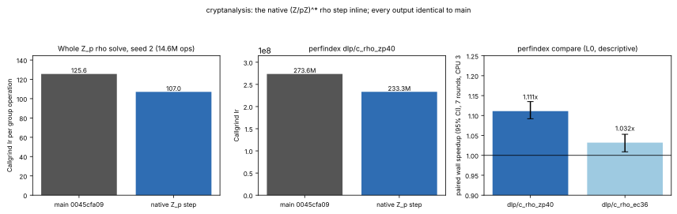

# The native (Z/pZ)^* rho step inline

**Date.** 2026-11-03. **Status.** Measured. Instruction counts are
Callgrind's (deterministic). Wall time is descriptive: a shared 4-vCPU
cloud VM (Intel Xeon @ 2.10 GHz, no hardware counters), CPU 3 pinned;
**L0 / "shared host" in this repository's tiers, not Tier 0 or Tier 1.**
**Class.** Engineering: every solve returns the same logarithm with the same
group-operation count, iteration count and distinguished-point table on the
same seed, so `S` and every reported constant are unchanged.



## What changed

The EC rho walk has had its own inline step since
[`rho-ec-step-20261101`](../rho-ec-step-20261101/REPORT.md). The native
`(Z/pZ)^*` group still went through the generic path: copy every walk's
multiplier into one staging array and every point into another, call
`zp_batch_op` through the vtable (one Montgomery product per walk), then
call `zp_hash` through the vtable per walk. Callgrind put that walk at
125.6 instructions per group operation, of which the Montgomery product is
about 12.

For the native group (`ca_zp_group_is_native`), `rho_thread_main` now
multiplies each walk's residue word by its multiplier's in place
(`Yn[w] = wk->Y; Yn[w].w[0] = ca_mont_mul(...)`, which is what
`zp_batch_op` wrote, the point's other words carried over as the copy did)
and hashes with `ca_zp_hash_word`, the inline function `zp_hash` now calls.
The group has no negation map, so canonicalisation is unchanged (never
called). Every other group keeps the vtable path.

## Identical outputs

`ca solve --alg rho --group zp --p 4503599627372423 --order
2251799813686211 --g 1377747092617056 --h 3666041038937390 --threads 1`,
seeds 1–3, against `main`'s binary: identical `x`, `ops`, `iterations`,
`table_entries` (seed 1: 103,317,083 operations; seed 2: 14,606,732; seed
3: 50,399,197). `ctest`: 19 of 19, with a new check in `tests/test_group.c`
that the inline product and hash equal `ca_group_op` and `ca_group_hash` on
a 64-step chain. The performance index's validity gate: every `dlp` and
`field_ec` fingerprint identical.

## Instructions (Callgrind Ir)

| measurement | `main` 0045cfa09 | this change | ratio |
|:--|--:|--:|--:|
| whole `Z_p` rho solve, seed 2 (14,606,732 ops) | 1,834,275,912 | 1,563,271,817 | **0.852** |
| per group operation | 125.6 | 107.0 | 0.852 |
| perfindex `dlp/c_rho_zp40` | 273,556,841 | 233,308,726 | **0.853** (index 1.173×) |
| perfindex `dlp/c_rho_ec36` | 189,530,435 | 190,785,114 | 1.007 (neutral) |
| every other `dlp` and `field_ec` kernel | — | — | 1.000 |

The EC kernel's 0.7% is code layout, not work: the EC step's calls and
inlining are unchanged (`objdump` of `rho_thread_main`), and moving the
`Z_p` step out of line (`noinline`) left the EC count where it was while
costing the `Z_p` kernel 0.8% (235,070,337 Ir), so the inline form is kept.

## Wall time (descriptive, L0)

`perfindex.py compare --filter c_rho --rounds 7 --threads 1 --taskset 3`
([`data/perfindex-compare-rho.md`](data/perfindex-compare-rho.md)):
`dlp/c_rho_zp40` 32.75 → 29.19 ms, **1.111×** (95% CI 1.092–1.135, A/A
noise ±2.7%, "faster"); `dlp/c_rho_ec36` 1.032× (CI 1.009–1.053, A/A ±3.6%,
"neutral"). The solver's own seconds on seed 1: 1.564 → 1.366 s (one run
each, not a measurement).

## Reproduce

```sh
cmake --build build -j4 && ctest --test-dir build
python3 scripts/perf/perfindex.py build --c --ref origin/main --out /tmp/ci-base
python3 scripts/perf/perfindex.py build --c --current --out /tmp/ci-cand
python3 scripts/perf/perfindex.py instr --base /tmp/ci-base/ca_perfbench --cand /tmp/ci-cand/ca_perfbench --out /tmp/ci-ir --filter dlp
python3 scripts/perf/perfindex.py compare --base /tmp/ci-base/ca_perfbench --cand /tmp/ci-cand/ca_perfbench --out /tmp/ci-cmp --filter c_rho --rounds 7 --threads 1 --taskset 3
/tmp/report-venv/bin/python experiments/rho-zp-step-20261103/plot.py
```
